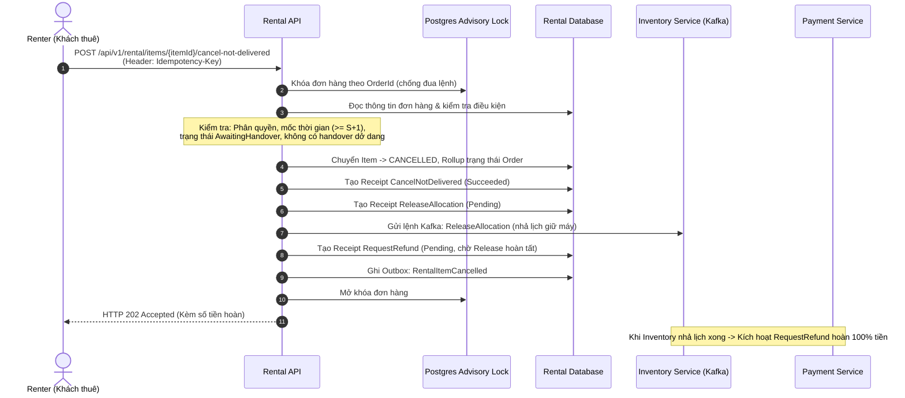
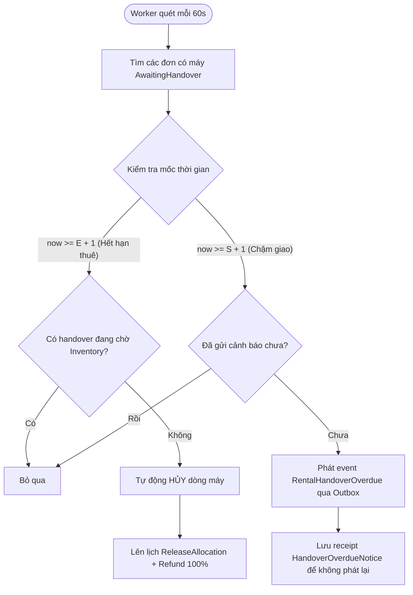

# Thiết Kế Chi Tiết: DPR-204 — Thiết Bị Không Được Giao (Cancellation & Refund)

> **Mục tiêu**: Xử lý bài toán khi máy móc thi công công trường (máy đầm cóc Mikasa, máy lu rung Sakai, máy trộn bê tông...) không được bàn giao đến công trình đúng hẹn.

---

## 1. Các Mốc Thời Gian Quan Trọng (Giờ Việt Nam - UTC+7)

> [!IMPORTANT]
> **Quy tắc thời gian đặt trước (`RentalBookingPolicy.MinimumLeadDays = 3`)**:  
> Thời gian bắt đầu thuê ($S$ - `ExpectedStartDate`) **bắt buộc phải cách ngày đặt đơn/ngày hiện tại tối thiểu 3 ngày** (để Supplier có thời gian chuẩn bị và điều phối thiết bị công trường).

**Ví dụ minh họa cụ thể**:
- **Ngày đặt đơn (Hôm nay)**: `19/10/2026`
- **Ngày bắt đầu thuê sớm nhất ($S$)**: `22/10/2026` ($19/10 + 3$ ngày)
- **Ngày kết thúc thuê ($E$)**: `27/10/2026`

```text
Ngày đặt (19/10)       S (22/10)                 S + 1 (23/10 00:00)           E + 1 (28/10 00:00)
───────┼───────────────────┼──────────────────────────────┼─────────────────────────────┼───────────►
   Đặt trước >= 3 ngày   Ngày bắt đầu               Mốc QUÁ HẠN GIAO MÁY             Mốc HẾT HẠN THUÊ
                         (Supplier giao máy)        - Renter bắt đầu được hủy        - Tự động hủy đơn
                                                    - Phát cảnh báo quá hạn          - Hoàn tiền 100%
```

| Mốc thời gian | Thời điểm cụ thể | Hành động hệ thống & Renter |
| :--- | :--- | :--- |
| **Ngày đặt $\rightarrow$ Trước ngày $S$** | Trước `22/10` | Đơn hàng ở trạng thái chờ đến ngày giao (`AWAITING_HANDOVER`). |
| **Trong ngày $S$** | Trước `23/10 00:00` | Renter **chưa được hủy**. Nếu gọi API sẽ nhận lỗi `409 CANCEL_TOO_EARLY` (để Supplier có trọn vẹn ngày thi công đầu tiên để vận chuyển thiết bị đến công trình). |
| **Quá hạn giao** | Từ `23/10 00:00` | - **Renter được chủ động hủy** dòng máy đó.<br>- Background Worker phát **cảnh báo quá hạn** (`RentalHandoverOverdue`) 1 lần duy nhất. |
| **Tự hủy (Hết hạn)** | Từ `28/10 00:00` | Kỳ thuê kết thúc mà máy vẫn chưa bao giờ được giao $\rightarrow$ **Hệ thống tự động hủy** và hoàn tiền 100%. |

---

## 2. Quy Trình Renter Chủ Động Hủy Dòng Thuê



### 2.1. Điều kiện và mã lỗi của API hủy

Thứ tự kiểm tra (dừng ở lỗi đầu tiên):

| # | Điều kiện | Kết quả |
| :-- | :--- | :--- |
| 1 | `Idempotency-Key` thiếu hoặc dài hơn 64 ký tự; `reason` dài hơn 500 ký tự | 400 |
| 2 | Không tìm thấy dòng | 404 `RentalItem.NotFound` |
| 3 | Người gọi không phải renter của đơn (kể cả supplier của dòng) | 404, giống hệt id không tồn tại (IDOR); service token: 403 |
| 4 | Cùng key, cùng nội dung | Trả lại kết quả đã lưu |
| 5 | Cùng key, khác nội dung | 409 `IDEMPOTENCY_CONFLICT` |
| 6 | Dòng đã `CANCELLED` (key khác) | Trả kết quả cũ, không tạo thêm receipt |
| 7 | Dòng không ở `AWAITING_HANDOVER` | 409 `Order.CancellationForbidden` |
| 8 | Chưa tới `S + 1` (00:00 giờ VN) | 409 `CANCEL_TOO_EARLY` |
| 9 | Có receipt `MarkAssetsHandedOver` đang `Pending`/`Processing` của dòng | 409 `HANDOVER_IN_PROGRESS` |

### 2.2. Số tiền hoàn

"Hoàn 100%" là **tiền thuê + tiền cọc của riêng dòng bị hủy**: `RefundItemRequest(item.Id, item.RentalAmount, item.DepositAmount)`, giống luồng supplier từ chối. Các dòng khác trong đơn không bị ảnh hưởng. Response trả `refundAmount = RentalAmount + DepositAmount`.

### 2.3. Giả định cần xác nhận với Inventory

Cả hai luồng hủy (renter hủy, worker tự hủy) dùng lệnh `ReleaseAllocation` hiện có. Dòng đã được supplier chấp nhận nên allocation đã ở trạng thái xác nhận, **chưa kiểm chứng được** Inventory có nhả được lịch đã xác nhận bằng lệnh này. Nếu Inventory từ chối thì receipt Release thất bại, và vì Refund chờ Release nên **tiền chưa được hoàn**. Phải xác nhận với team Inventory trước khi đưa lên môi trường thật. Nếu cần lệnh khác thì đó là thay đổi contract, phải thống nhất riêng.

---

## 3. Rollup Trạng Thái Đơn Hàng (Order Status Rollup)

Khi một đơn hàng có nhiều thiết bị (Multi-item), trạng thái của cả đơn hàng được tính toán như sau:

| Dòng 1 (VD: Máy lu Sakai) | Dòng 2 (VD: Máy đầm Mikasa) | Trạng thái toàn bộ Đơn hàng | Giải thích |
| :--- | :--- | :--- | :--- |
| `IN_RENTAL` (Đã nhận) | `CANCELLED` (Hủy do không giao) | **`IN_RENTAL`** | Còn thiết bị đang hoạt động trên công trường. |
| `AWAITING_HANDOVER` | `CANCELLED` | **`AWAITING_HANDOVER`** | Vẫn còn thiết bị chờ Supplier bàn giao. |
| `CANCELLED` | `CANCELLED` | **`CANCELLED`** | Toàn bộ thiết bị trong đơn đều bị hủy. |
| `REJECTED` (Supplier từ chối) | `CANCELLED` | **`CANCELLED`** | Tất cả thiết bị đều kết thúc, có ít nhất 1 dòng hủy. |

Quy tắc nhánh mới trong `EvaluateOrderStatusRollup` (đặt sau các nhánh `Rejected`/`Expired` hiện có, không đổi thứ tự cũ): khi mọi dòng thuộc `Rejected`/`Expired`/`Cancelled` và có ít nhất một dòng `Cancelled` thì đơn thành `CANCELLED`, ghi một `RentalStateTransition`. Thiếu nhánh này, đơn gồm 1 dòng `REJECTED` + 1 dòng `CANCELLED` sẽ kẹt ở `AWAITING_HANDOVER`.

`RentalOrder.MarkCancelled` hiện gọi `ApplyHoldExpired` (dòng thành `Expired`) và chưa có nơi nào gọi. Task này **không dùng và không sửa** nó.

---

## 4. Cơ Chế An Toàn: Chống Hoàn Tiền 2 Lần & Chống Đua Lệnh

```text
┌─────────────────────────────────────────────────────────────────────────────┐
│ 1. CHỐNG ĐUA LỆNH (CONCURRENCY)                                            │
│    Cả Renter và Worker đều phải xin Advisory Lock: lock(orderId)            │
│    Bên nào đến sau sẽ thấy dòng đã ở trạng thái CANCELLED -> Trả kết quả cũ │
├─────────────────────────────────────────────────────────────────────────────┤
│ 2. CHỐNG HOÀN TIỀN LẶP (IDEMPOTENCY)                                        │
│    Khóa của receipt được sinh cố định:                                      │
│    - Release: hash("ReleaseAllocation", "{orderId}:{itemId}")               │
│    - Refund:  hash("RequestRefund", "{orderId}:{itemId}")                   │
│    -> Mỗi dòng thiết bị chỉ tồn tại DUY NHẤT 1 cặp receipt Release/Refund   │
├─────────────────────────────────────────────────────────────────────────────┤
│ 3. THỨ TỰ AN TOÀN TUYỆT ĐỐI                                                 │
│    Receipt RequestRefund có: prerequisiteOperationId = releaseOpKey         │
│    -> Chỉ khi Inventory nhả máy thành công, Payment mới được hoàn tiền.     │
└─────────────────────────────────────────────────────────────────────────────┘
```

---

## 5. Background Worker: Cảnh Báo Quá Hạn & Tự Hủy

Hệ thống có worker chạy ngầm định kỳ (mỗi 60s):



Ghi chú worker:
- Cấu hình `Rental:HandoverOverdue`: `Enabled` (true), `ScanIntervalSeconds` (60), `BatchSize` (50). Mỗi đơn xử lý trong một scope DI riêng, lỗi một đơn không dừng cả lượt quét.
- Tự hủy đi đúng đường của renter hủy (cùng khóa đơn, cùng `ScheduleReleaseAndRefundAsync`), actor là `System`, lý do "Hết kỳ thuê mà chưa bàn giao".
- Thêm các action `CancelNotDelivered` và `HandoverOverdueNotice` vào danh sách loại trừ của `OperationRecoveryWorker` nếu worker đó quét theo `Action`.
- Thông báo chỉ là event qua outbox vì chưa có Notification service.

---

## 6. Kế Hoạch Triển Khai Code

### Bước A: Nền Tảng Domain
- Tạo `RentalItem.Cancellation.cs`: thêm phương thức `ApplyNotDeliveredCancellation`.
- Bổ sung nhánh Rollup `Cancelled` vào `RentalOrder.EvaluateOrderStatusRollup`.
- Viết Unit Tests domain trong `ItemCancellationDomainTests.cs`.

### Bước B: API & Service Renter Hủy
- Trích xuất hàm dùng chung `ScheduleReleaseAndRefundAsync` từ `RentalOperationExecutor.Supplier.cs`.
- Tạo `IItemCancellationService` và `ItemCancellationService`.
- Thêm endpoint `POST /api/v1/rental/items/{itemId}/cancel-not-delivered` vào `RentalItemsController.cs`.
- Viết Integration Tests trong `ItemCancellationTests.cs`.

### Bước C: Background Worker
- Thêm event `RentalItemCancelled` và `RentalHandoverOverdue` vào `KafkaContractSpec.cs`.
- Tạo `HandoverOverdueOptions`, `IHandoverOverdueService`, `HandoverOverdueService`.
- Tạo worker `HandoverOverdueWorker`.
- Viết Worker Tests trong `HandoverOverdueTests.cs`.

### Bước D: Kiểm Tra Tổng & Tài Liệu
- Test hủy: trước `S+1` bị 409; sau `S+1` có đủ receipt Release + Refund (Refund chờ Release) và event outbox; hủy lần hai cùng key và khác key đều không tạo thêm receipt; dòng `IN_RENTAL` bị 409; đang chờ bàn giao bị 409; người lạ/supplier/service token nhận 404/404/403.
- Test tiền: số hoàn bằng `RentalAmount + DepositAmount`; đơn 2 dòng chỉ hủy 1 dòng thì dòng kia và đơn không đổi; hủy cả 2 dòng thì đơn `CANCELLED`.
- Test đua: renter hủy đồng thời với worker chỉ tạo một cặp Release/Refund.
- Test worker: cảnh báo quá hạn chỉ phát một lần; qua `E+1` thì tự hủy; bỏ qua dòng đang chờ bàn giao.
- Chạy lại các test supplier từ chối để bảo vệ phần tách `ScheduleReleaseAndRefundAsync`.
- Cập nhật README, mô tả Swagger, số operation trong `SwaggerDocumentationTests`.

### Phạm vi không làm
- Supplier tự báo "không giao được" để hủy sớm.
- Gửi mail/push (chưa có Notification service).
- Sửa `RentalOrder.MarkCancelled`.
- Đổi contract với Inventory (xem 2.3).

### Gợi ý commit
| Bước | Message |
| :-- | :--- |
| A | `feat(rental): DPR-204 add not-delivered cancellation for rental items and roll cancelled items up to the order` |
| B + C | `feat(rental): DPR-204 let the renter cancel an undelivered item and auto-cancel it after the rental period, releasing the allocation and refunding 100%` |
| D | `test(rental): DPR-204 cover cancellation races, refunds and overdue notices, and document the flow` |
