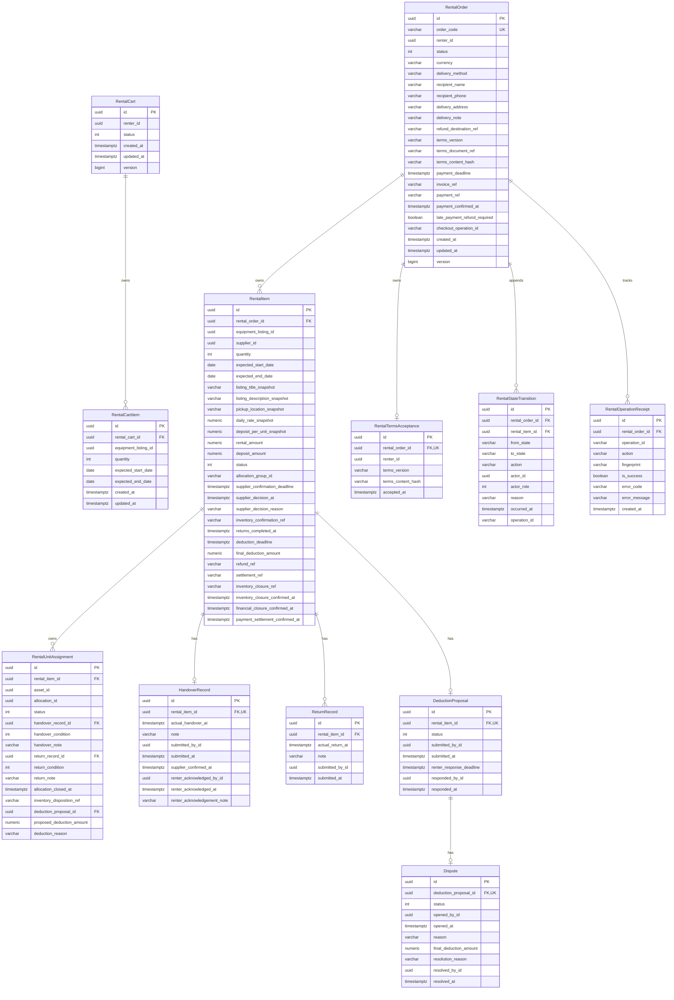

# DPRental — Rental Service Domain Model & Database Schema Specification

- **Document Version:** 2.0.0 (Data & Schema Frozen Specification)
- **Effective Date:** 2026-10-08
- **Service:** `RentalService`
- **Architecture Pattern:** Pure Domain Entities & Schema with Decoupled Workflow Specifications

---

## 1. Architectural Scope & Implementation Boundaries

In accordance with project architecture guidelines (AGENTS.md) and the current refactoring mandate:
- **Domain Entities:** Strictly restricted to data structures, EF Core relational mappings, attributes, and simple localized invariants (validation, non-negative whole VND calculations, date interval validation, collection integrity).
- **Workflow Decoupling:** Complex business workflows (payment confirmation, late payment refund orchestration, supplier decision deadlines, handover/return verification, deduction proposal acceptance/disputes, financial settlements, and inventory closure coordination) have been **deliberately removed from domain entities**.
- **Handover Status:** These workflows currently have no runtime execution path in the domain entities. Section 6 of this document serves as the formal **Acceptance & State Transition Specification** to be implemented in the subsequent Application Service task.
- **Service Boundaries:**
  - `RentalService` owns commercial snapshots, order lifecycle state, and physical assignment tracking.
  - `InventoryService` owns listings, physical assets, availability, and allocation groups (referenced via `AllocationGroupId`, `AllocationId`, `AssetId`).
  - `PaymentService` owns invoices, bank collections, refunds, and payouts (referenced via `InvoiceRef`, `PaymentRef`, `RefundRef`, `SettlementRef`).
  - `MediaService` owns binary storage and signing (referenced strictly via `MediaId` GUID arrays; no binary or temporary URLs stored in Rental).

---

## 2. Entity Relationship Diagram (ERD)

---

## 3. Aggregate Boundaries & Ownership

### 3.1. Aggregate Root 1: `RentalCart`
- **Ownership:** Owns `RentalCartItem` collection.
- **Responsibility:** Pre-checkout staging area. Holds equipment listing references, quantities, and dates. Does not store commercial rates, calendars, or asset assignments.

### 3.2. Aggregate Root 2: `RentalOrder`
- **Ownership:** Owns all order fulfillment, audit, terms, and financial lifecycle records:
  - `RentalItem` collection (commercial lines).
  - `RentalTermsAcceptance` (immutable snapshot of accepted legal terms).
  - `RentalStateTransition` collection (append-only audit history of order & item state changes).
  - `RentalOperationReceipt` collection (technical idempotent receipt tracking).
  - Child entities under `RentalItem`: `RentalUnitAssignment`, `HandoverRecord`, `ReturnRecord`, `DeductionProposal`, `Dispute`.
- **Integrity Rule:** No child entity has an independent repository. All persistence write operations execute through `RentalOrder`. Internal foreign keys use `DeleteBehavior.Restrict`.

---

## 4. Entity Field Dictionary & Persistence Schema

### 4.1. `rental_orders` (Schema: `rental`)
| Column | Type | Nullable | Constraints | Description |
|---|---|---|---|---|
| `id` | `uuid` | No | PK | Primary key of the rental order aggregate. |
| `order_code` | `varchar(64)` | No | Unique Index | Human-readable order identifier (e.g. `ORD-20261008-001`). |
| `renter_id` | `uuid` | No | Index | User ID of the customer who placed the order. |
| `status` | `integer` | No | Index | `RentalOrderStatus` enum value. |
| `currency` | `varchar(3)` | No | Check ('VND') | Commercial currency. In MVP v1, strictly 'VND'. |
| `delivery_method` | `varchar(64)` | No | — | Selected delivery mode (Pickup, Delivery). |
| `recipient_name` | `varchar(200)` | No | — | Contact person recipient name. |
| `recipient_phone` | `varchar(32)` | No | — | Contact recipient phone number. |
| `delivery_address` | `varchar(500)` | No | — | Destination address for handover. |
| `delivery_note` | `varchar(2000)` | Yes | — | Optional delivery instructions. |
| `refund_destination_ref` | `varchar(256)` | No | — | Defaults to `'ORIGINAL_PAYMENT_SOURCE'`. |
| `terms_version` | `varchar(64)` | No | — | Version string of terms document accepted at checkout. |
| `terms_document_ref` | `varchar(256)` | No | — | URI / reference of the legal terms document. |
| `terms_content_hash` | `varchar(128)` | No | — | Cryptographic hash of accepted terms content. |
| `payment_deadline` | `timestamptz` | No | Index | 30 minutes from checkout timestamp. |
| `invoice_ref` | `varchar(256)` | Yes | — | External invoice identifier from PaymentService. |
| `payment_ref` | `varchar(256)` | Yes | — | External payment transaction receipt from PaymentService. |
| `payment_confirmed_at` | `timestamptz` | Yes | — | Timestamp when PaymentService confirmed collection. |
| `late_payment_refund_required` | `boolean` | No | — | Flags payment arriving at or after payment deadline. |
| `checkout_operation_id` | `varchar(64)` | No | — | Unique checkout idempotency operation key. |
| `created_at` | `timestamptz` | No | — | Order creation timestamp (UTC). |
| `updated_at` | `timestamptz` | No | — | Aggregate last mutation timestamp (UTC). |
| `version` | `bigint` | No | Concurrency Token | Optimistic locking concurrency version token. |

### 4.2. `rental_items` (Schema: `rental`)
| Column | Type | Nullable | Constraints | Description |
|---|---|---|---|---|
| `id` | `uuid` | No | PK | Primary key of the commercial line item. |
| `rental_order_id` | `uuid` | No | FK, Index | Owning rental order ID. |
| `equipment_listing_id` | `uuid` | No | Index | Equipment listing public commercial unit ID. |
| `supplier_id` | `uuid` | No | Index | User ID of the equipment owner / supplier. |
| `quantity` | `integer` | No | Check (> 0) | Number of units rented for this interval. |
| `expected_start_date` | `date` | No | — | Rental start business date (inclusive). |
| `expected_end_date` | `date` | No | — | Rental end business date (exclusive). |
| `listing_title_snapshot` | `varchar(200)` | No | — | Immutable listing title captured at checkout. |
| `listing_description_snapshot` | `varchar(2000)` | Yes | — | Immutable description snapshot. |
| `pickup_location_snapshot` | `varchar(500)` | No | — | Immutable pickup location snapshot. |
| `daily_rate_snapshot` | `numeric(18,2)`| No | — | Daily rental fee per unit in VND. |
| `deposit_per_unit_snapshot`| `numeric(18,2)`| No | — | Security deposit required per unit in VND. |
| `rental_amount` | `numeric(18,2)`| No | — | Calculated: `daily_rate * quantity * days`. |
| `deposit_amount` | `numeric(18,2)`| No | — | Calculated: `deposit_per_unit * quantity`. |
| `status` | `integer` | No | — | `RentalItemStatus` enum value. |
| `allocation_group_id` | `varchar(64)` | No | Index | Inventory allocation group hold reference. |
| `supplier_confirmation_deadline`| `timestamptz` | Yes | — | Deadline for supplier decision (24h after payment). |
| `supplier_decision_at` | `timestamptz` | Yes | — | Timestamp of supplier accept/reject decision. |
| `supplier_decision_reason` | `varchar(2000)`| Yes | — | Supplier decision note or rejection reason. |
| `inventory_confirmation_ref`| `varchar(256)` | Yes | — | Inventory confirmation receipt reference. |
| `returns_completed_at` | `timestamptz` | Yes | — | Timestamp when all physical units were returned. |
| `deduction_deadline` | `timestamptz` | Yes | — | 48h deadline after damage return for supplier proposal. |
| `final_deduction_amount` | `numeric(18,2)`| Yes | — | Finalized deduction amount in VND. |
| `refund_ref` | `varchar(256)` | Yes | — | External refund reference from PaymentService. |
| `settlement_ref` | `varchar(256)` | Yes | — | External settlement receipt from PaymentService. |
| `inventory_closure_ref` | `varchar(256)` | Yes | — | Inventory closure receipt reference. |
| `inventory_closure_confirmed_at`| `timestamptz`| Yes | — | Timestamp when Inventory confirmed closure. |
| `financial_closure_confirmed_at`| `timestamptz`| Yes | — | Timestamp when Payment confirmed financial closure. |
| `payment_settlement_confirmed_at`| `timestamptz`| Yes | — | Synonym timestamp for financial settlement receipt. |

### 4.3. `rental_unit_assignments` (Schema: `rental`)
| Column | Type | Nullable | Constraints | Description |
|---|---|---|---|---|
| `id` | `uuid` | No | PK | Primary key of the physical unit assignment. |
| `rental_item_id` | `uuid` | No | FK | Owning rental item ID. |
| `asset_id` | `uuid` | No | Unique per Item | Inventory physical asset identifier. |
| `allocation_id` | `uuid` | No | Unique per Item | Inventory individual unit allocation identifier. |
| `status` | `integer` | No | — | `RentalUnitAssignmentStatus` enum value. |
| `handover_record_id` | `uuid` | Yes | FK | Associated handover record ID. |
| `handover_condition` | `integer` | Yes | — | UnitCondition at handover. |
| `handover_note` | `varchar(2000)`| Yes | — | Handover unit observation note. |
| `return_record_id` | `uuid` | Yes | FK | Associated return record ID. |
| `return_condition` | `integer` | Yes | — | UnitCondition at return (Normal, Damaged). |
| `return_note` | `varchar(2000)`| Yes | — | Return unit observation note. |
| `allocation_closed_at` | `timestamptz` | Yes | — | Timestamp when Inventory closed unit allocation. |
| `inventory_disposition_ref`| `varchar(256)` | Yes | — | Maintenance block disposition reference if damaged. |
| `deduction_proposal_id` | `uuid` | Yes | FK | Associated deduction proposal ID. |
| `proposed_deduction_amount`| `numeric(18,2)`| Yes | — | Supplier proposed deduction fee for this unit. |
| `deduction_reason` | `varchar(2000)`| Yes | — | Proposed deduction rationale. |

### 4.4. `rental_operation_receipts` (Schema: `rental`)
| Column | Type | Nullable | Constraints | Description |
|---|---|---|---|---|
| `id` | `uuid` | No | PK | Primary key of the operation receipt. |
| `rental_order_id` | `uuid` | No | FK | Owning rental order ID. |
| `operation_id` | `varchar(64)` | No | Unique (Order, OpId) | Idempotent operation key. |
| `action` | `varchar(64)` | No | — | Logical operation action name. |
| `fingerprint` | `varchar(256)` | No | — | Canonical SHA-256 parameter hash. |
| `is_success` | `boolean` | No | — | Execution outcome flag. |
| `error_code` | `varchar(64)` | Yes | — | Recorded failure error code if failed. |
| `error_message` | `varchar(2000)`| Yes | — | Recorded failure error message if failed. |
| `created_at` | `timestamptz` | No | — | Timestamp when receipt was written. |

### 4.5. `rental_state_transitions` (Schema: `rental`)
| Column | Type | Nullable | Constraints | Description |
|---|---|---|---|---|
| `id` | `uuid` | No | PK | Primary key of the transition audit row. |
| `rental_order_id` | `uuid` | No | FK, Index | Associated order ID. |
| `rental_item_id` | `uuid` | Yes | Index | Associated item ID (null for order-level events). |
| `from_state` | `varchar(64)` | Yes | — | Prior state name. |
| `to_state` | `varchar(64)` | No | — | New state name. |
| `action` | `varchar(64)` | No | — | Trigger action name. |
| `actor_id` | `uuid` | Yes | — | Identity of the user or system triggering action. |
| `actor_role` | `integer` | No | — | ActorRole enum (Renter, Supplier, Admin, System). |
| `reason` | `varchar(2000)`| Yes | — | Rationale note. |
| `occurred_at` | `timestamptz` | No | Index | Event occurrence timestamp. |
| `operation_id` | `varchar(64)` | No | — | Idempotency operation reference. |

---

## 5. Domain Invariants

1. **VND Amount Invariants (`VndAmountValidator`):**
   - All monetary rates, deposits, amounts, proposed deductions, and settled amounts must be non-negative whole numbers (`decimal.Truncate(v) == v`).
   - All amounts must not exceed the Contract v1 ceiling of `999,999,999,999 VND`.
   - Currency must be strictly `"VND"`.
2. **Interval Invariants:**
   - `ExpectedEndDate > ExpectedStartDate`.
   - `RentalDays = ExpectedEndDate.DayNumber - ExpectedStartDate.DayNumber >= 1`.
3. **Quantity & Assignment Invariants:**
   - `Quantity > 0`.
   - Number of `RentalUnitAssignment` records must strictly equal `Quantity`.
   - `AssetId` and `AllocationId` must be distinct across all assignments in an order.
4. **Calculated Totals Formulae:**
   - `RentalItem.RentalAmount = DailyRateSnapshot * Quantity * RentalDays`.
   - `RentalItem.DepositAmount = DepositPerUnitSnapshot * Quantity`.
   - `RentalOrder.TotalRentalAmount = SUM(item.RentalAmount)`.
   - `RentalOrder.TotalDepositAmount = SUM(item.DepositAmount)`.
   - `RentalOrder.TotalPayableAmount = TotalRentalAmount + TotalDepositAmount`.
5. **Collection Integrity:**
   - State transition history is append-only.
   - Media collections encapsulate distinct GUIDs (maximum 10 items).
   - `Status` has `private set` and cannot be modified via arbitrary public setters.

---

## 6. State Transition Specification (Handover for Next Task)

The following state machine table specifies the target business workflow transitions to be implemented in the Application layer:

| Transition ID | Current State | Target State | Trigger Action | Actor | Preconditions | Side Effects | External Dependency Actions | Emitted Event |
|---|---|---|---|---|---|---|---|---|
| **TR-01** | *None* | `PendingPayment` | `CreateOrder` | Renter | Valid cart line, snapshot verified, continuous inventory hold acquired. | Order & items instantiated, `Version = 1`, 30m deadline set. | Payment: `CreateInvoice` | `RentalOrderCreated` |
| **TR-02** | `PendingPayment` | `PendingSupplierConfirmation` | `ConfirmPayment` | System | Valid invoice, paid amount == total payable, within 30m deadline. | `PaymentRef` recorded, 24h supplier confirmation deadline set on items. | Payment: `InvoicePaid` verified | `RentalItemPaid` per item |
| **TR-03** | `PendingPayment` | `Expired` | `ExpirePayment` | System | Current time >= 30m `PaymentDeadline`, no payment confirmed. | Order & items marked Expired, units released. | Inventory: `ReleaseAllocation` | `RentalOrderExpired` |
| **TR-04** | `PendingPayment` / `Expired` | `Expired` | `ConfirmPaymentLate` | System | Payment confirmed at or after 30m deadline, or on terminal order. | `LatePaymentRefundRequired = true`, order remains Expired. | Payment: `RequestRefund` (100%) | `LatePaymentRefundEmitted` |
| **TR-05** | `PendingPayment` | `Cancelled` | `CancelByRenter` | Renter | Order in `PendingPayment`, actor is renter. | Order & items marked Cancelled, units released. | Payment: `CancelInvoice`, Inventory: `ReleaseAllocation` | `RentalOrderCancelled` |
| **TR-06** | `PendingSupplierConfirmation` | `AwaitingHandover` | `SupplierAccept` | Supplier | Actor is item supplier, within 24h deadline, valid inventory confirmation ref. | Item moves to `AwaitingHandover`, units marked confirmed. | Inventory: `ConfirmAllocation` | `RentalItemConfirmed` |
| **TR-07** | `PendingSupplierConfirmation` | `Rejected` | `SupplierReject` | Supplier | Actor is item supplier, rejection reason provided. | Item moves to `Rejected`, units released. | Inventory: `ReleaseAllocation`, Payment: `RequestRefund` (100% item fee + deposit) | `RentalItemRejected` |
| **TR-08** | `PendingSupplierConfirmation` | `Expired` | `SupplierTimeout` | System | Current time >= 24h `SupplierConfirmationDeadline`, no supplier decision. | Item moves to `Expired`, units released. | Inventory: `ReleaseAllocation`, Payment: `RequestRefund` (100% item fee + deposit) | `RentalItemExpired` |
| **TR-09** | `AwaitingHandover` | `InRental` | `SubmitHandover` | Supplier | Actor is item supplier, observations provided for all units, private media verified. | `HandoverRecord` created, units marked `HandedOver`, item moves to `InRental`. | Media: `VerifyMedia` | `RentalStarted` |
| **TR-10** | `InRental` | `InRental` (Partial) / `PendingSettlement` | `SubmitReturn` | Supplier | Actor is item supplier, actual return time >= handover time, units observed. | `ReturnRecord` created, damaged units observed. If all returned & has damage -> `PendingSettlement` (48h proposal deadline). | Media: `VerifyMedia` | `RentalUnitsReturned` |
| **TR-11** | `InRental` | `Completed` (Normal) | `NormalReturnSettled` | System | All units returned normal (no damage), 0 deduction, deposit refund complete. | Inventory & financial closure confirmed, item moves to `Completed`. | Inventory: `MarkAssetsReturned`, Payment: `SettleRental` (0 deduction) | `RentalItemCompleted` |
| **TR-12** | `PendingSettlement` | `PendingSettlement` | `SubmitDeductionProposal` | Supplier | Actor is item supplier, within 48h deadline, proposed amount <= deposit. | `DeductionProposal` created, 48h renter response deadline set. | Media: `VerifyMedia` | `DeductionProposed` |
| **TR-13** | `PendingSettlement` | `Completed` | `AcceptDeductionProposal` | Renter / Timeout | Renter accepts proposal or 48h response deadline expires. | Final deduction locked = proposed amount. Settlement executed. | Payment: `SettleRental` | `DeductionSettled` |
| **TR-14** | `PendingSettlement` | `PendingSettlement` | `DisputeDeductionProposal` | Renter | Renter disputes proposal within 48h response deadline, reason provided. | `Dispute` record created with status `Open`. | Media: `VerifyMedia` | `DeductionDisputed` |
| **TR-15** | `PendingSettlement` | `Completed` | `ResolveDispute` | Admin | Admin resolves dispute with final deduction <= proposed amount. | Final deduction locked. Settlement executed. | Payment: `SettleRental` | `DisputeResolved` |

---

## 7. Decoupled Workflows Queued for Application Layer Task

The following workflows have been completely decoupled from the Domain Entities and must be implemented as distinct command services in the Application layer in the next task:
1. `IOrderLifecycleAppService`: Checkout coordination, invoice attachment, payment confirmation against PaymentService events, late payment refund requests, expiration, and renter cancellation.
2. `IFulfilmentAppService`: Supplier decision handling (accept/reject/timeout), handover submission & renter acknowledgement, return batch recording, and inventory allocation closure.
3. `ISettlementAppService`: Deduction proposal lifecycle, renter response deadline monitoring, dispute raising & admin resolution, and financial settlement receipt coordination.
4. `IOperationReceiptCoordinator`: Canonical JSON SHA-256 fingerprinting with normalized decimals and full UTC timestamps for idempotency replays.
