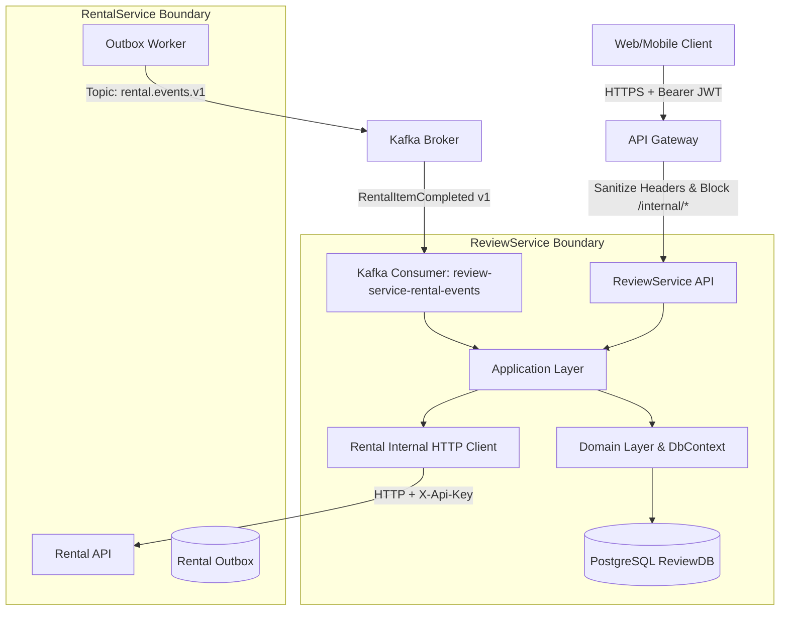

# Kiến trúc hệ thống và Ranh giới Dịch vụ ReviewService

Tài liệu này xác lập ranh giới kiến trúc, mô hình xác thực/phân quyền, luồng dữ liệu hai nhánh (Dual-path), giao thức đối soát định kỳ và ma trận phụ thuộc cho `ReviewService` trong hệ sinh thái DPRENTAL.

---

## 1. Ranh giới Ngữ cảnh và Phân định Quyền sở hữu (Context Boundaries & Ownership)

Hệ thống `ReviewService` chịu trách nhiệm quản lý đánh giá hai chiều giữa Người thuê (Renter) và Nhà cung cấp/Thiết bị (Supplier/EquipmentListing), thực hiện kiểm duyệt nội dung, tính toán điểm đánh giá tổng hợp (Rating Summary), và quản lý lịch sử kiểm toán (Audit).



### 1.1 Phân định quyền sở hữu nghiệp vụ (Ownership Matrix)

| Khái niệm nghiệp vụ | Service sở hữu authoritative | Vai trò của ReviewService | Trạng thái nguồn |
| :--- | :--- | :--- | :--- |
| **Đơn thuê, Mục thuê (`RentalOrder`, `RentalItem`)** | `RentalService` | Tiêu thụ snapshot qua HTTP client nội bộ; lưu cache chỉ đọc cho projection | `[confirmed-by-source: RentalService/src/Domain/Entities/]` |
| **Quan hệ tham gia (`RenterId`, `SupplierId`, `EquipmentListingId`)** | `RentalService` | Xác thực quan hệ tham gia qua snapshot; cấm client tự khai báo | `[confirmed-by-source: RentalService/src/Domain/Entities/RentalItem.cs]` |
| **Thời điểm hoàn tất nghiệp vụ (`completedAt`)** | `RentalService` | Tiếp nhận và dùng làm mốc tính deadline UTC; không tự tính toán hay suy diễn | `[confirmed-by-source: RentalService/src/Domain/Entities/RentalItem.Settlement.cs]` |
| **Tài khoản người dùng & Role (`UserId`, `Admin`)** | `AuthService` | Nhận diện actor qua claims JWT (`sub`, `roles`); không cấp phát token | `[confirmed-by-source: RentalService/tests/Api.Tests/Contracts/AuthRentalContractAndPolicyTests.cs]` |
| **Nội dung đánh giá, Điểm số, Trạng thái Review** | `ReviewService` | Toàn quyền sở hữu (Authoritative owner), quản lý lifecycle hai trục và hiển thị | `[design-decision]` |
| **Báo cáo vi phạm (Review Reports) & Kiểm duyệt** | `ReviewService` | Toàn quyền sở hữu; Admin thực hiện ẩn/khôi phục trên ReviewService | `[design-decision]` |
| **Tổng hợp điểm (Rating Summary)** | `ReviewService` | Toàn quyền tính toán từ các review đủ điều kiện (`authorState = Active` & `moderationState = Visible`) | `[design-decision]` |

---

## 2. Mô hình Xác thực, Phân quyền và Bảo mật (Security & Boundary Protection)

### 2.1 Xác thực nội bộ qua `X-Api-Key` (Service-to-Service)

Giao tiếp nội bộ giữa `ReviewService` và `RentalService` được thiết kế theo cơ chế **API-key-only**, gọi trực tiếp qua mạng nội bộ mà không đi qua API Gateway và không yêu cầu service token từ AuthService:

1. **Header định danh:** Sử dụng tiêu đề chuẩn `X-Api-Key`.
2. **Cấu hình Credential:**
   - Lấy từ cấu hình `InternalAuthentication:ApiKey` hoặc biến môi trường `INTERNAL_API_KEY` `[confirmed-by-source: RentalService/src/Api/Security/InternalApiKeyMiddleware.cs]`.
   - Bắt buộc kiểm tra (validate) ngay khi ứng dụng khởi động (`startup check`); dừng khởi động nếu thiếu hoặc rỗng.
   - Tuyệt đối không ghi log giá trị API key dưới bất kỳ hình thức nào.
3. **Cơ chế xác thực phía RentalService:**
   - RentalService đã triển khai `InternalApiKeyMiddleware` (`[confirmed-by-source: RentalService/src/Api/Security/InternalApiKeyMiddleware.cs]`). Middleware kiểm tra:
     - Thiếu header hoặc có nhiều giá trị header `X-Api-Key` $\rightarrow$ Trả `401 Unauthorized` (`ProblemDetails`).
     - So khớp chuỗi bằng hàm so sánh thời gian không đổi `CryptographicOperations.FixedTimeEquals` chống tấn công timing $\rightarrow$ Trả `401 Unauthorized` nếu sai key.
     - Khi hợp lệ: gán `context.Items["InternalApiKeyVerified"] = true`.
4. **Vượt rào cản Bearer của Endpoint mới tại RentalService:**
   - Hiện tại, các endpoint nội bộ của RentalService (`RentalInternalOperationsController`) được bảo vệ bởi attribute `[Authorize]` ở cấp controller (`[confirmed-by-source: RentalInternalOperationsController.cs]`), yêu cầu bearer token của human Admin.
   - **Quy tắc thiết kế:** Endpoint snapshot mới `GET /internal/orders/{orderId}/items/{itemId}/review-snapshot` và endpoint đối soát `GET /internal/orders/review-reconciliation` được cấu hình với authorization policy riêng: **API-key-only** (cho phép truy cập khi `context.Items["InternalApiKeyVerified"] == true` mà không đòi hỏi Bearer JWT) `[unimplemented-dependency: RentalService]`.
   - Các endpoint nội bộ hiện hữu của RentalService (như Admin Replay) giữ nguyên yêu cầu Bearer JWT của Admin; không nới lỏng quyền hạn của bất kỳ endpoint nào khác.
5. **Đặc tính cuộc gọi phía ReviewService:**
   - ReviewService sử dụng `HttpClient` có cấu hình timeout hữu hạn (mặc định 5 giây), truyền `CancellationToken` xuyên suốt.
   - **Không mở Database Transaction khi đang gọi HTTP sang RentalService.** Cuộc gọi snapshot phải hoàn tất trước khi mở transaction ghi DB.
   - Phân loại lỗi HTTP và ánh xạ chuẩn:
     - RentalService trả `401 Unauthorized`: Lỗi cấu hình credential giữa hai service $\rightarrow$ ReviewService trả `502 Bad Gateway` với mã lỗi `RENTAL_SERVICE_AUTHENTICATION_FAILED`; ghi log cảnh báo hệ thống mức `Critical` (không ghi log key).
     - RentalService timeout hoặc trả `504`: ReviewService trả `504 Gateway Timeout` với mã lỗi `RENTAL_SERVICE_TIMEOUT`.
     - RentalService không sẵn sàng (`502/503`) hoặc trả payload không đúng schema: ReviewService trả `502 Bad Gateway` với mã lỗi `RENTAL_SERVICE_UNAVAILABLE` hoặc `RENTAL_SERVICE_INVALID_RESPONSE`.
     - RentalService trả `404 Not Found`: Mục thuê không tồn tại hoặc không thuộc đơn hàng $\rightarrow$ ReviewService trả `404 Not Found` với mã lỗi `RENTAL_ITEM_NOT_FOUND`.
     - **Nguyên tắc an toàn:** Lỗi dependency không bao giờ được suy diễn thành mục thuê hợp lệ hay đủ điều kiện đánh giá (`eligible`), và không bao giờ được lưu thành receipt thành công trong bảng idempotency.

### 2.2 Xác thực người dùng (Human Identity & Authorization)

1. **JWT Người dùng:**
   - Client gửi Bearer JWT qua header `Authorization: Bearer <token>`.
   - JWT do `AuthService` phát hành, chứa claim `sub` (UserId) và các claim vai trò `role` / `roles` `[confirmed-by-source: RentalService/tests/Api.Tests/Contracts/AuthRentalContractAndPolicyTests.cs]`.
2. **Xác định quyền sở hữu (Zero Trust Client Input):**
   - Client **không được phép** gửi `authorId`, `subjectId`, `targetId`, hoặc `supplierId` khi tạo/sửa review.
   - `ReviewService` lấy `actorId = JWT.sub`.
   - `ReviewService` truy vấn Rental Snapshot để lấy danh tính chính thức của `RenterId` và `SupplierId`.
   - Phân quyền thực hiện:
     - Nếu `actorId == snapshot.RenterId`: Hướng đánh giá là `renter_to_supplier_listing`.
     - Nếu `actorId == snapshot.SupplierId`: Hướng đánh giá là `supplier_to_renter`.
     - Nếu `actorId` không khớp với bên nào: Trả về `403 Forbidden` (`ACTOR_NOT_PARTICIPANT`).
3. **Thành viên tổ chức (Organization Membership):**
   - Quyết định stakeholder: Tư cách thành viên tổ chức không thay thế `SupplierId`. `SupplierId` trong snapshot là danh tính duy nhất được công nhận cho tác giả phía nhà cung cấp `[stakeholder-approved]`.

### 2.3 Ranh giới bảo vệ của API Gateway

1. **Chặn hoàn toàn Endpoint Service-only:**
   - Gateway sử dụng `ServiceOnlyRouteBlockingMiddleware` (`[confirmed-by-source: Gateway/Middlewares/Security/ServiceOnlyRouteBlockingMiddleware.cs]`).
   - Mọi request công khai từ Internet có segment `internal` sẽ bị chặn với mã `403 Forbidden` hoặc `404 Not Found`.
2. **Làm sạch Header (Header Sanitization):**
   - Gateway sử dụng `HeaderSanitizer` (`[confirmed-by-source: Gateway/Extensions/Security/HeaderSanitizer.cs]`).
   - Loại bỏ hoàn toàn các header nhạy cảm: `X-Api-Key`, `X-User-Id`, `X-Roles`, `X-Internal-*` từ inbound request của client.

---

## 3. Kiến trúc Luồng Dữ liệu Hai Nhánh (Dual-Path Architecture)

ReviewService kết hợp hai luồng dữ liệu bổ trợ nhau để đảm bảo vừa có tính tức thời và tin cậy tuyệt đối khi ghi (write), vừa tối ưu hiệu năng đọc (read):

```
Write Path (Authoritative Synchronous):
Client --POST /api/v1/reviews--> ReviewService --HTTP GET (X-Api-Key)--> RentalService Snapshot
                                        | (Call BEFORE opening DB Transaction)
                                        v
                               [Verify completedAt & Participant]
                                        |
                                        v
                               [Open DB Transaction]
                                        +--> Save Review (Active, Visible, version=1)
                                        +--> Save Idempotency Receipt
                                        +--> Save Audit Log
                                        +--> Commit DB Transaction

Read/Discovery Path (Asynchronous Projection):
RentalService Settlement --> Outbox --> Kafka (rental.events.v1)
                                              |
                                              v
Client <--GET /reviews/pending-- ReviewService Projection <-- Consumer (review-service-rental-events)
                                        ^
                                        | (Hydrate via HTTP BEFORE DB Transaction)
                                        +-- RentalService Snapshot (fetch supplierId)
```

### 3.1 Nhánh Ghi Chính xác (Authoritative Synchronous Path)

Áp dụng cho các thao tác đột biến dữ liệu: `CreateReview`, `EditReview`, `WithdrawReview`.
- **Cơ chế:** Khi nhận yêu cầu tạo review, Application Service gọi đồng bộ sang RentalService qua endpoint `GET /internal/orders/{orderId}/items/{itemId}/review-snapshot`.
- **Thứ tự thực thi:**
  1. Kiểm tra xác thực (JWT) và quyền actor.
  2. Kiểm tra Idempotency receipt trùng theo `(actor_id, key)`. Nếu trùng fingerprint $\rightarrow$ trả về kết quả đã lưu; nếu khác fingerprint $\rightarrow$ trả về `409 Conflict`.
  3. Gọi Rental Snapshot để xác thực `status == Completed` và `completedAt != null` (thực hiện qua HTTP, không mở DB transaction).
  4. Mở DB Transaction:
     - Ghi Review mới với `author_state = 'Active'`, `moderation_state = 'Visible'`, `version = 1`.
     - Ghi Audit log (`Created`).
     - Ghi Idempotency Receipt (`201 Created` + Response Body + ETag `"1"`).
     - Commit DB Transaction nguyên tử.

### 3.2 Nhánh Chiếu Bất đồng bộ (Asynchronous Projection Path)

Áp dụng cho tính năng khám phá danh sách cần đánh giá: `GET /api/v1/reviews/pending`.
- **Cơ chế:**
  - Lắng nghe sự kiện `RentalItemCompleted` (v1) phát từ Outbox của RentalService qua topic `rental.events.v1` `[confirmed-by-source: RentalService/src/Application/Kafka/Contracts/KafkaContractSpec.cs]`.
  - Consumer Group riêng biệt: `review-service-rental-events` `[design-decision]`.
  - Lưu vào bảng chiếu cục bộ `review_projections`.
- **Quy trình Hydration:**
  - Payload sự kiện `RentalItemCompletedPayload` chứa: `UserId` (Renter), `EquipmentListingId`, `EquipmentTypeId`, `RentalOrderId`, `RentalItemId`, `OrderVersion`, `CompletedAt`, nhưng **không chứa `SupplierId`** (`[confirmed-by-source: RentalEvents.cs]`).
  - Consumer bắt buộc phải gọi RentalService để hydrate thông tin `SupplierId` **trước khi mở Database Transaction**.
  - Bảng `review_projections` cho phép `completed_at` và `deadline_at` nullable. Khi chưa hydrate thành công hoặc thiếu timestamp, `is_eligible = false` và mục thuê **không xuất hiện** trên API pending.
- **Xử lý trùng lặp (Inbox Pattern):**
  - Ghi nhận `MessageId` vào bảng `inbox_messages` trong cùng một Database Transaction với bản ghi projection.
  - Chỉ commit Kafka offset sau khi DB Transaction đã commit thành công.

---

## 4. Giao thức Đối soát Toàn Cửa sổ Định kỳ (Periodic Full-Window Sweep Reconciliation)

ReviewService không dùng con trỏ watermark thời gian nghiệp vụ tăng mãi (vì các đơn hàng hoàn tất muộn có thể mang `completedAt` cũ trong quá khứ bị bỏ sót). Thay vào đó, hệ thống áp dụng **Full-Window Sweep**:

1. **Chu kỳ quét:** Một vòng quét mới bắt đầu mỗi **5 phút** sau khi vòng trước kết thúc `[design-decision]`.
2. **Cửa sổ quét:** Cố định `windowStart = sweepStartedAt - 30 ngày (UTC)`. Quét toàn bộ mục thuê có trạng thái `Completed` và có timestamp đáng tin cậy trong cửa sổ 30 ngày qua.
3. **Phân trang Keyset:** Sử dụng cursor opaque mã hóa `(windowStart, lastItemId)`. Mỗi trang tối đa 100 mục (tối đa 500).
4. **Cam kết nguyên tử:** Áp dụng dữ liệu từng trang vào `review_projections` và lưu checkpoint trang vào bảng `reconciliation_checkpoints` trong cùng một Transaction. Nếu crash giữa chừng, lần chạy sau tiếp tục từ checkpoint an toàn.
5. **Kết thúc vòng quét:** Khi duyệt hết trang cuối cùng, vòng quét đánh dấu `is_completed = true`. Vòng quét kế tiếp sau 5 phút sẽ bắt đầu lại từ đầu toàn bộ cửa sổ 30 ngày mới, đảm bảo bắt trọn các mục thuê được ghi nhận muộn (backdated persistence) mà vẫn còn hạn đánh giá.

---

## 5. Ma trận Phụ thuộc Liên Dịch vụ (Cross-Service Dependency Matrix)

| Bên liên quan | Thành phần phụ thuộc | Phương thức giao tiếp | Giao thức xác thực | Tác động khi gặp sự cố | Biện pháp phục hồi / Giảm thiểu rủi ro | Trạng thái triển khai |
| :--- | :--- | :--- | :--- | :--- | :--- | :--- |
| **RentalService** | Endpoint Snapshot `GET /internal/.../review-snapshot` | HTTP REST | `X-Api-Key` (API-key-only policy) | Không thể tạo review mới; pending projection chờ hydrate | Timeout 5s, mapping 502/504; không biến lỗi thành eligible | `[unimplemented-dependency: RentalService]` |
| **RentalService** | Endpoint Reconciliation `GET /internal/orders/review-reconciliation` | HTTP REST | `X-Api-Key` (API-key-only policy) | Chậm trễ cập nhật danh sách pending qua đối soát | Keyset cursor opaque, sweep 5 phút/lần | `[unimplemented-dependency: RentalService]` |
| **RentalService** | Outbox Publisher | Kafka (`rental.events.v1`) | TLS / SASL Kafka | Chậm trễ cập nhật danh sách pending reviews | Consumer group riêng, Inbox dedup, full-window sweep | `[confirmed-by-source: Topic & Outbox hiện có]` |
| **API Gateway** | Route Blocker & Header Sanitizer | Reverse Proxy | Xóa `X-Api-Key`, chặn `/internal/*` | Client không tới được ReviewService hoặc gọi trái phép internal | `ServiceOnlyRouteBlockingMiddleware` & `HeaderSanitizer` | `[confirmed-by-source: Gateway]` |
| **AuthService** | Public Key / JWKS | HTTP REST (`/.well-known/jwks.json`) | Public endpoint | Không thể xác thực JWT người dùng | In-memory key caching, fallback JWKS cục bộ | `[confirmed-by-source: AuthService]` |
| **PostgreSQL** | Database chính ReviewDB | TCP / Socket | Connection string | ReviewService không phục vụ được read/write | Read-replicas, connection pooling, version concurrency token | `[confirmed-by-source: Docker Compose]` |

---

## 6. Bản đồ Bằng chứng Kỹ thuật (Evidence Map)

| Danh mục | Chi tiết kỹ thuật | Trạng thái xác minh | Ghi chú nguồn / Căn cứ |
| :--- | :--- | :--- | :--- |
| **Rental Commit HEAD** | `761db851c3dbb594c4a155d3bcbaf1c7722bd384` | `[confirmed-by-source]` | Commit HEAD trên nhánh chính RentalService |
| **Review Commit HEAD** | `cf6efe5e431ffebfa5ef12e5a80a2eea3c85dd60` | `[confirmed-by-source]` | Commit HEAD trên nhánh chính ReviewService |
| **Working Tree State** | Working tree có 9 unstaged deletions (`.gitkeep`) và các untracked folders từ init | `[confirmed-by-source]` | Giữ nguyên các chỉnh sửa ngoài phạm vi; không can thiệp code |
| **Rental Middleware** | `InternalApiKeyMiddleware.cs` | `[confirmed-by-source]` | Xác thực `X-Api-Key` bằng `FixedTimeEquals`, gán `InternalApiKeyVerified = true` |
| **Rental Controller Auth**| `RentalInternalOperationsController.cs` | `[confirmed-by-source]` | Controller hiện dùng `[Authorize]` ở cấp lớp, cần policy mới cho snapshot |
| **Rental Status Literals** | `RentalItemStatus` enum (0..8) | `[confirmed-by-source]` | `PendingPayment`, `PendingSupplierConfirmation`, `AwaitingHandover`, `InRental`, `PendingSettlement`, `Completed`, `Rejected`, `Expired`, `Cancelled` |
| **Rental Event Topic** | `KafkaContractSpec.RentalEvents = "rental.events.v1"` | `[confirmed-by-source]` | Topic thực tế trong source là `rental.events.v1` |
| **Rental Envelope Serialization** | `KafkaMessageEnvelope<TPayload>` | `[confirmed-by-source]` | `OrganizationId` có cờ `JsonIgnore(Condition = JsonIgnoreCondition.WhenWritingNull)` |
| **Deduction Timeout 48h** | `NeedsDeductionTimeout` trong `RentalItem.Deductions.cs` | `[confirmed-by-source]` | Quá 48h không có đề xuất, worker chốt `FinalDeductionAmount = 0m` (hoàn cọc 100% cho renter), không phải tịch thu cọc |
| **Review DLQ Topic** | `rental.events.review.dlq` | `[design-decision]` | Quyết định thiết kế mới cho ReviewService, chưa có trong source |
| **Vòng đời 2 trục** | `authorState` (`Active`/`Withdrawn`) $\times$ `moderationState` (`Visible`/`Hidden`) | `[design-decision]` | Thiết kế giải quyết triệt để xung đột giữa quyền tác giả và kiểm duyệt |
| **Concurrency Token** | `BIGINT version` tăng rõ ràng bởi Application + Strong ETag `"1"` | `[design-decision]` | Bỏ `xmin`, bắt buộc `If-Match` cho mọi mutation, thiếu trả `428`, sai trả `412` |
| **Idempotency Key & Fingerprint** | `SHA-256(actorId + method + canonicalRoute + body + ifMatch)` | `[design-decision]` | Nhận diện request trùng lặp chính xác, commit atomic cùng mutation |
| **Quy định 30 ngày/7 ngày**| Deadline tạo & sửa UTC exclusive | `[stakeholder-approved]` | Quyết định stakeholder phiên trước, so sánh UTC exclusive |
| **Đánh giá hai chiều** | `renter_to_supplier_listing` & `supplier_to_renter` | `[stakeholder-approved]` | Quyết định stakeholder phiên trước; rating 1–5, comment $\le$ 1.000 Unicode runes |
| **Quyền riêng tư Renter** | Review nhắm renter chỉ tác giả, đối tượng và Admin thấy | `[stakeholder-approved]` | Tuyệt đối không public điểm hoặc danh sách review người thuê |
| **Snapshot Endpoint** | `GET /internal/orders/{orderId}/items/{itemId}/review-snapshot` | `[unimplemented-dependency]` | Cần bổ sung vào RentalService phục vụ ReviewService |
| **Reconciliation Endpoint**| `GET /internal/orders/review-reconciliation` | `[unimplemented-dependency]` | Cần bổ sung vào RentalService phục vụ full-window sweep |
