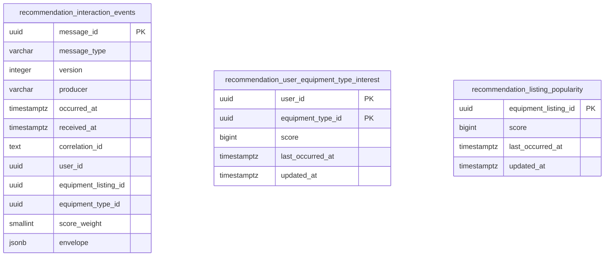

# Freeze Kiến Trúc Và Integration Contract Recommendation Phase 1

Tài liệu này xác lập bộ contract tích hợp và kiến trúc chuẩn hóa cho Phase 1 của `RecommendationService` trong hệ sinh thái DPRENTAL, cho phép ba dịch vụ `InventoryService`, `RentalService`, và `RecommendationService` triển khai độc lập, song song mà không bị phụ thuộc vòng hoặc xung đột hợp đồng dữ liệu.

> **Lưu ý về phạm vi và phê duyệt:**
> 1. Task này bàn giao thiết kế, JSON schemas Draft 2020-12, fixtures và DDL tham chiếu PostgreSQL. Consumer, producer, EF Core entities/migrations, cache worker và ranking integration thuộc các task triển khai kế tiếp; chưa thêm DTO/constants C# hoặc package runtime trong task này.
> 2. Việc các nhóm kỹ thuật chấp thuận contract được ghi nhận thông qua quy trình Code Review và Architecture Review; tài liệu này nằm trong kho mã nguồn của RecommendationService đóng vai trò là bản đặc tả kỹ thuật tham chiếu, không tự chứng minh rằng InventoryService hoặc RentalService đã triển khai hoặc đã kích hoạt trên môi trường chạy thực tế.

---

## 1. Ranh Giới Dịch Vụ & Quyền Sở Hữu (Ownership)

```
┌─────────────────────────┐               ┌────────────────────────┐
│     InventoryService    │               │      RentalService     │
│ ─────────────────────── │               │ ────────────────────── │
│ - Listing & Category    │               │ - Cart & CartItem      │
│ - Pricing & Availability│               │ - Rental Order/Payment │
│ - Filtering & Paging    │               │ - Order State Machine  │
└────────────┬────────────┘               └───────────┬────────────┘
             │ ListingViewed                          │ CartItemAdded
             │ SearchPerformed                        │ RentalItemPaid
             ▼                                        ▼ RentalItemCompleted
    [inventory.behavior.events.v1]             [rental.events.v1]
             │                                        │
             └───────────────────┬────────────────────┘
                                 │ Kafka Consumers
                                 ▼
                 ┌───────────────────────────────┐
                 │     RecommendationService     │
                 │ ───────────────────────────── │
                 │ - Behavioral Signal Store     │
                 │ - Score Weights Calculation   │
                 │ - Projections (Interest/Pop.) │
                 │ - Background Cache Publisher  │
                 └───────────────┬───────────────┘
                                 │ Valkey / Redis Snapshot
                                 ▼
                     rec:v1:user:{id}:equipment-types
                     rec:v1:global:popular-listings
                                 ▲
                     Inventory   │ Read-only
                     Fallback    │ (100ms budget)
                     Engine      │
```

### Phân định trách nhiệm dữ liệu & Ownership

- **CatalogService / Catalog Domain**:
  - Sở hữu định danh và thông tin danh mục (`Category`) và loại thiết bị (`EquipmentType`).
  - Là nguồn chân lý cho cây danh mục và phân loại thiết bị trong toàn hệ thống.

- **InventoryService**:
  - Sở hữu hoàn toàn thông tin thiết bị (`EquipmentListing`), hình ảnh, giá thuê, kho bãi, trạng thái khả dụng.
  - Sử dụng `Category` và `EquipmentType` từ Catalog để phân loại, lọc và tìm kiếm listing.
  - Phát sinh sự kiện hành vi `ListingViewed` khi người dùng xem trang chi tiết và `SearchPerformed` khi người dùng tìm kiếm có chủ đích tại trang đầu tiên (`page = 1`).
  - Đọc cache snapshot đề xuất từ Valkey với vai trò người tiêu dùng chỉ đọc (`read-only consumer`), tự thực thi bộ lọc trạng thái khả dụng, áp dụng phân trang và fallback theo thứ tự ưu tiên mà không phụ thuộc đồng bộ vào RecommendationService.

- **RentalService**:
  - Sở hữu giỏ hàng (`Cart`, `CartItem`), đơn thuê thiết bị (`RentalOrder`, `RentalOrderItem`), quy trình thanh toán và máy trạng thái vòng đời thuê thiết bị.
  - Phát sinh các sự kiện hành vi gắn với cam kết nghiệp vụ: `CartItemAdded`, `RentalItemPaid`, và `RentalItemCompleted`.
  - Tái sử dụng bảng Transactional Outbox hiện có để đảm bảo tính nhất quán giữa trạng thái nghiệp vụ và message Kafka.

- **RecommendationService**:
  - Chỉ lưu trữ các tín hiệu hành vi (`behavioral signals`) cần thiết cho việc xếp hạng và sinh hai hình chiếu (`projections`):
    1. `user_equipment_type_interest`: Điểm quan tâm theo `equipmentTypeId` của từng user đã xác thực.
    2. `listing_popularity`: Điểm phổ biến toàn hệ thống theo từng `equipmentListingId`.
  - Sở hữu bảng trọng số điểm và logic tính điểm; tính toán offline/bất đồng bộ và định kỳ ghi snapshot kết quả lên Valkey (Redis).
  - Không sở hữu thông tin hiển thị của thiết bị, giá tiền, vị trí kho, tình trạng tồn kho hay tính khả dụng.
  - Tuân thủ nghiêm ngặt Clean Architecture 4 project của repository: tầng `Application` điều phối use cases qua repository interfaces; persistence nằm tại `Domain` theo ngoại lệ kiến trúc đã chọn (tham chiếu theo RentalService); tầng `Api` và `Application` không trực tiếp inject `DbContext`.
### Nguyên tắc tích hợp không đồng bộ

1. **Không Enrich Đồng Bộ Trước Khi Phát**: Producer trích xuất dữ liệu từ entity state, snapshot hoặc dữ liệu nghiệp vụ sẵn có trong transaction hiện tại. Tuyệt đối không thực hiện thêm lời gọi mạng đồng bộ (HTTP/gRPC/Kafka request-reply) để thu thập thêm thông tin chỉ nhằm mục đích phát event.
2. **Không Gọi Ngược Khi Consume**: RecommendationService khi nhận event chỉ bóc tách payload nhận được; tuyệt đối không gọi ngược lại API của InventoryService hay RentalService để truy vấn dữ liệu bổ sung.
3. **Bảo Vệ Tính Riêng Tư**: Không đưa từ khóa tự do (`search query text`), thông tin thẻ/tài khoản ngân hàng, địa chỉ giao hàng hoặc thông tin cá nhân (PII) vào contract sự kiện hành vi.

---

## 2. Event Envelope & Semantic Specification

### Wire Format Envelope v1

Mọi thông điệp Kafka truyền tải dạng UTF-8 JSON. Tên trường thuộc envelope dùng quy ước `camelCase`; tên định danh sự kiện tại `messageType` dùng `PascalCase`.

| Trường | Kiểu dữ liệu | Bắt buộc | Mô tả & Ràng buộc kỹ thuật |
|---|---|:---:|---|
| `messageId` | UUID (string) | Có | UUID chuẩn (RFC 4122) **khác rỗng** (không được là `00000000-0000-0000-0000-000000000000`), ổn định khi retry/replay, tương thích với generator tất định hiện có của RentalService. |
| `messageType` | String | Có | Chính xác một trong năm giá trị: `ListingViewed`, `SearchPerformed`, `CartItemAdded`, `RentalItemPaid`, `RentalItemCompleted`. |
| `version` | Integer | Có | Cố định là `1` cho Phase 1. Xác định contract cấu trúc của envelope và payload. |
| `producer` | String | Có | Định danh service phát: `InventoryService` cho view/search; `RentalService` cho cart/paid/completed. |
| `occurredAt` | ISO-8601 (string) | Có | Thời điểm phát sinh hành vi nghiệp vụ theo chuẩn UTC có hậu tố `Z` (ví dụ: `2026-10-19T10:00:00Z` hoặc `2026-10-19T10:00:00.123456Z`). Giữ nguyên giá trị khi phát lại. |
| `correlationId` | String / Null | Không | Chuỗi trace context không rỗng nếu có; cho phép `null` hoặc bỏ qua trường. |
| `payload` | Object | Có | Đối tượng JSON chứa các trường nghiệp vụ cụ thể theo từng loại sự kiện, tuân thủ JSON Schema tương ứng. |

**Quy tắc tương thích mở rộng & Tính đóng kín của Payload v1**:
- **Payload v1 là đóng kín (`additionalProperties: false`)**: Mọi trường trong payload Phase 1 tuân thủ nghiêm ngặt schema đã công bố; không thêm bất kỳ trường tùy ý nào (như query text, giá tiền, PII). Việc thêm trường mới vào payload hoặc thay đổi ngữ nghĩa bắt buộc phải tăng `version` lên `2`.
- **Envelope chấp nhận metadata mở rộng**: Envelope của producer có thể chứa các trường metadata bổ sung đã có sẵn như `aggregateId`, `causationId`, `organizationId`. RecommendationService chấp nhận các trường này nhưng **không dùng chúng để phân vùng nghiệp vụ hay tính điểm**, và consumer bỏ qua mọi trường mở rộng chưa biết ở mức envelope.

---

### Chi Tiết Năm Sự Kiện Phase 1

Mọi trường định danh nghiệp vụ (`Id`) đều là UUID chuẩn khác rỗng. Người dùng ẩn danh được biểu diễn tường minh bằng `userId: null`. Giá trị `userId` phải được trích xuất từ Identity Context đã xác thực (ClaimsPrincipal / JWT Token); tuyệt đối không nhận danh tính do client tự khai trong body request.

| Producer / Event | Payload Structure | Quy tắc phát sinh nghiệp vụ |
|---|---|---|
| **InventoryService**<br>`ListingViewed` | - `userId`: UUID? (nullable)<br>- `equipmentListingId`: UUID<br>- `equipmentTypeId`: UUID | Phát khi người dùng xem trang chi tiết listing công khai thành công (HTTP 200). Bao gồm cả trường hợp cache hit tại tầng Gateway/API của Inventory. |
| **InventoryService**<br>`SearchPerformed` | - `userId`: UUID? (nullable)<br>- `equipmentTypeId`: UUID? (nullable) | Phát khi thao tác tìm kiếm thành công ở trang đầu tiên (`page = 1`) có chỉ định bộ lọc hoặc từ khóa. Chỉ lấy `equipmentTypeId` nếu client chỉ định rõ trong filter. |
| **RentalService**<br>`CartItemAdded` | - `userId`: UUID (bắt buộc)<br>- `equipmentListingId`: UUID<br>- `equipmentTypeId`: UUID? (nullable)<br>- `cartId`: UUID<br>- `cartItemId`: UUID | Phát cho mỗi thao tác thêm thiết bị vào giỏ hàng đã commit thành công vào database, kể cả trường hợp sản phẩm đã có và hệ thống gộp số lượng. |
| **RentalService**<br>`RentalItemPaid` | - `userId`: UUID (bắt buộc)<br>- `equipmentListingId`: UUID<br>- `equipmentTypeId`: UUID? (nullable)<br>- `rentalOrderId`: UUID<br>- `rentalItemId`: UUID | Phát đúng một event cho mỗi item khi RentalService nhận xác nhận thanh toán hợp lệ và chuyển trạng thái ghi nhận mục thuê đã thanh toán. |
| **RentalService**<br>`RentalItemCompleted` | - `userId`: UUID (bắt buộc)<br>- `equipmentListingId`: UUID<br>- `equipmentTypeId`: UUID? (nullable)<br>- `rentalOrderId`: UUID<br>- `rentalItemId`: UUID | Phát đúng một event khi item hoàn tất toàn bộ chu trình thuê và chuyển sang trạng thái `Completed`. |

**Các quy tắc nghiệp vụ ràng buộc**:
1. **Search Signals**: Chỉ ghi nhận `equipmentTypeId` khi tham số truy vấn tìm kiếm có chọn trực tiếp loại thiết bị (`EquipmentTypeId`). Category đơn thuần **không được suy diễn** thành `equipmentTypeId`. Không cố gắng parse hay suy diễn `equipmentTypeId` từ chuỗi từ khóa tự do (`free text`) hoặc từ danh sách kết quả trả về. Nếu tìm kiếm chỉ có raw keyword hoặc category chung chung thì `equipmentTypeId = null`. Việc duyệt danh sách mặc định không bộ lọc (`empty browse`), chỉ đổi tiêu chí sắp xếp (`sort change`), hoặc chuyển trang (`pagination page > 1`) **không được phát** `SearchPerformed`.
2. **Anonymous Users**: Người dùng chưa đăng nhập có `userId = null`. Phase 1 không ghép profile ẩn danh qua cookie, device fingerprint hay session ID; khi người dùng đăng nhập sau đó, các tương tác cũ không được hồi tố gán vào tài khoản.
3. **Cart Modifications**: Thao tác cập nhật số lượng (`PATCH quantity`) hoặc cập nhật khoảng thời gian thuê (`dates change`) không phát lại `CartItemAdded`. Trọng số điểm không nhân với số lượng thuê hay giá trị tiền.
4. **Payment & Refund Constraints**: `RentalItemPaid` không phát cho các giao dịch thanh toán muộn nhưng sau đó bị từ chối hoặc hoàn tiền ngay trong luồng xác thực thanh toán. `RentalItemCompleted` chỉ phát sau khi đã nhận đủ xác nhận hoàn trả thiết bị từ Inventory và tất toán từ Payment theo state machine hiện hữu.
5. **Rental Missing Type**: Trong trường hợp dữ liệu lịch sử hoặc snapshot đơn hàng của RentalService chưa kịp nạp `equipmentTypeId`, sự kiện vẫn được phát với `equipmentTypeId = null`. Tín hiệu này vẫn đóng góp trọn vẹn vào `listing_popularity`, nhưng bỏ qua `user_equipment_type_interest`. Nếu RentalService có sẵn type từ order item snapshot thì bắt buộc phải đưa vào event.

---

## 3. Hạ Tầng Kafka, Định Tuyến & Giao Nhận

### Topology Kafka

- **Topic Inventory**: `inventory.behavior.events.v1` (topic mới dành riêng cho tín hiệu hành vi).
- **Topic Rental**: `rental.events.v1` (tái sử dụng topic sự kiện hiện có của RentalService).
- **Consumer Groups (RecommendationService)**:
  - `recommendation-inventory-behavior-v1` (nghe từ `inventory.behavior.events.v1`)
  - `recommendation-rental-behavior-v1` (nghe từ `rental.events.v1`)
- **Dead Letter Queues**:
  - `inventory.behavior.events.v1.recommendation.dlq`
  - `rental.events.v1.recommendation.dlq`

### Phân Vùng (Partition Keys)

Để bảo đảm tính tuần tự tương đối theo thực thể và phân bổ tải đồng đều giữa các partitions:

| Sự kiện | Partition Key được chọn |
|---|---|
| `ListingViewed` | `equipmentListingId` |
| `SearchPerformed` | `messageId` (phân tán ngẫu nhiên đều) |
| `CartItemAdded` | `cartId` |
| `RentalItemPaid` | `rentalOrderId` |
| `RentalItemCompleted` | `rentalOrderId` |

*Lưu ý: Nếu envelope có chứa trường `aggregateId`, trường này phải mang cùng giá trị với Partition Key tương ứng ở bảng trên.*

### Đảm Bảo Giao Nhận & Khả Năng Chịu Lỗi

1. **Cam kết At-Least-Once**: Hệ thống chấp nhận thông điệp có thể bị gửi lặp do network retry hoặc crash trong quá trình xử lý. Logic xử lý tại RecommendationService không được phụ thuộc vào thứ tự tuyệt đối giữa các topic khác nhau.
2. **Outbox Pattern tại Producer**:
   - `RentalService` bắt buộc ghi nhận event vào bảng Transactional Outbox trong cùng transaction cơ sở dữ liệu với thao tác cập nhật đơn/giỏ hàng. ID của `RentalItemPaid` và `RentalItemCompleted` phải được tạo tất định (`deterministic ID generation`) dựa trên producer, event type và rental item id để chống tạo trùng event khi retry.
   - `InventoryService` sử dụng hàng đợi tín hiệu có giới hạn bộ nhớ (`bounded signal queue`) và bảng outbox. Việc thu thập tín hiệu hành vi không được làm chậm hoặc gây lỗi cho thao tác đọc của khách hàng (nếu outbox/queue quá tải, chấp nhận bỏ qua tín hiệu và ghi nhận metric thất thoát tín hiệu; tuy nhiên khi đã commit vào outbox thành công thì phải retry bền vững với cùng envelope và `messageId`).
3. **Offset Commit & Transaction Boundary**:
   - Consumer chỉ commit Kafka offset sau khi transaction lưu trữ và cập nhật projection trong PostgreSQL hoàn tất thành công.
   - Lỗi kết nối tạm thời (`transient network/DB errors`) được retry với thuật toán exponential backoff có giới hạn (jittered backoff); tuyệt đối không commit offset của record chưa được xử lý thành công.
4. **Xử Lý Dead-Letter Queue (DLQ)**:
   - Các sự kiện thuộc 5 loại đã biết nhưng vi phạm JSON Schema, sai version hoặc xung đột ID dữ liệu (`conflict payload`) sẽ được định tuyến sang topic DLQ tương ứng kèm header lý do lỗi (`x-dlq-error-reason`).
   - Offset trên topic chính chỉ được commit sau khi record đã được ghi bền vững vào DLQ.
   - Các sự kiện khác ngoài 5 loại sự kiện Phase 1 xuất hiện trên topic dùng chung `rental.events.v1` sẽ được consumer bỏ qua an toàn mà không ghi vào DLQ.
5. **Kafka Retention**: Giữ thời gian lưu trữ tin nhắn tối thiểu 7 ngày (`retention.ms = 604800000`). Không thay đổi số lượng partition trên production khi chưa có kế hoạch rebalancing rõ ràng.

---

## 4. Hệ Thống Điểm (Scoring) & Mô Hình Lưu Trữ PostgreSQL

### Bảng Trọng Số Điểm Phase 1

| Sự kiện | Trọng số điểm | Áp dụng User Interest | Áp dụng Listing Popularity |
|---|:---:|:---:|:---:|
| `SearchPerformed` | **+1** | Có (nếu có đủ `userId` và `equipmentTypeId`) | **Không** |
| `ListingViewed` | **+2** | Có (nếu có đủ `userId` và `equipmentTypeId`) | **Có** (mọi view) |
| `CartItemAdded` | **+5** | Có (nếu có `equipmentTypeId`) | **Có** |
| `RentalItemPaid` | **+8** | Có (nếu có `equipmentTypeId`) | **Có** |
| `RentalItemCompleted` | **+10** | Có (nếu có `equipmentTypeId`) | **Có** |

**Nguyên tắc tính toán**:
- **Cộng dồn độc lập**: Điểm được cộng dồn lũy tiến cho mỗi sự kiện hợp lệ đúng một lần. Phase 1 chưa áp dụng hệ số suy giảm thời gian (`time decay`) hay cửa sổ trượt (`sliding window`).
- **Tín hiệu độc lập**: Cùng một món hàng khi được thêm giỏ (+5), thanh toán (+8), và hoàn tất (+10) sẽ đóng góp độc lập $5 + 8 + 10 = 23$ điểm vào độ phổ biến của listing.
- **Không có điểm âm**: Phase 1 không trừ điểm khi hủy đơn, xóa giỏ hàng hoặc hoàn tiền.
- **Recommendation làm chủ trọng số**: Toàn bộ trọng số nằm tại RecommendationService; các producer tuyệt đối không gửi kèm điểm số trong payload.

---

### Mô Hình Dữ Liệu PostgreSQL (Schema `recommendation`)

DDL tham chiếu chi tiết được lưu trữ tại file `docs/contracts/recommendation-v1.sql`.



#### Chi tiết các bảng:
1. `recommendation.interaction_events`:
   - Lưu trữ nhật ký sự kiện thô phục vụ kiểm toán, chống trùng lặp và replay dữ liệu khi cần rebuild.
   - Khóa chính `message_id`. Ràng buộc `CHECK` đảm bảo UUID không rỗng, version = 1, producer chính xác, trọng số điểm dương và khớp logic giữa `message_type` và các trường định danh.
   - Không chứa bất kỳ khóa ngoại (FK) nào sang cơ sở dữ liệu của các service khác.
2. `recommendation.user_equipment_type_interest`:
   - Khóa chính tổng hợp `(user_id, equipment_type_id)`.
   - Lưu `score`, `last_occurred_at`, và `updated_at`.
   - Index tối ưu ranking: `(user_id, score DESC, equipment_type_id ASC)`.
3. `recommendation.listing_popularity`:
   - Khóa chính `equipment_listing_id`.
   - Lưu `score`, `last_occurred_at`, và `updated_at`.
   - Index tối ưu ranking: `(score DESC, equipment_listing_id ASC)`.

#### Xử Lý Atomic Upsert & Thứ Tự Sự Kiện:
Mỗi sự kiện được xử lý trong một transaction duy nhất:
1. Thực hiện chèn vào `interaction_events`. Nếu trùng `message_id`:
   - Nếu nội dung `envelope` khớp chính xác: Bỏ qua an toàn (`DUPLICATE_IGNORED`), không cộng thêm điểm.
   - Nếu nội dung `envelope` khác biệt: Báo lỗi xung đột (`CONFLICT_PAYLOAD_MISMATCH`), chuyển sự kiện vào DLQ.
2. Cập nhật projection tương ứng bằng kỹ thuật `INSERT ... ON CONFLICT DO UPDATE`:
   - Điểm số: `score = current.score + EXCLUDED.score`.
   - Thời gian: `last_occurred_at = GREATEST(current.last_occurred_at, EXCLUDED.last_occurred_at)` để ngăn chặn trường hợp sự kiện đến muộn làm lùi mốc thời gian của hành vi mới nhất.
   - Mốc cập nhật: `updated_at = clock_timestamp()`.
3. PostgreSQL đóng vai trò là nguồn chân lý duy nhất để rebuild projection: khi cần tái tạo dữ liệu, thủ tục `rebuild_projections()` sẽ `TRUNCATE` các bảng projection và tính toán lại từ bảng `interaction_events` thông qua hàm gom nhóm `SUM(score_weight)` và `MAX(occurred_at)`.

---

## 5. Cache Contract & Cơ Chế Fallback Của Inventory

RecommendationService là bên duy nhất sinh và cập nhật cache; InventoryService truy cập cache với vai trò người đọc (read-only).

### Cấu Trúc Cache Key & Snapshot Format

Các key được lưu trữ trên Valkey (Redis compatible) dưới dạng JSON snapshot hoàn chỉnh:

| Key Pattern | Cấu trúc JSON Snapshot |
|---|---|
| `rec:v1:user:{userId}:equipment-types` | `{"version": 1, "generatedAt": "...", "items": [{"equipmentTypeId": "...", "score": 45}]}` |
| `rec:v1:global:popular-listings` | `{"version": 1, "generatedAt": "...", "items": [{"equipmentListingId": "...", "score": 150}]}` |

**Quy chuẩn dữ liệu cache**:
- `{userId}` trong key là chuỗi UUID chuẩn định dạng D (lowercase, có dấu gạch ngang, ví dụ: `rec:v1:user:22222222-2222-4222-8222-222222222222:equipment-types`).
- Giới hạn kích thước danh sách:
  - Cache user interest: Tối đa **20** `equipmentTypeId`.
  - Cache global popularity: Tối đa **100** `equipmentListingId`.
- Định dạng danh sách `items`:
  - Không chứa ID trùng lặp.
  - Điểm `score` là số nguyên dương (`int64 > 0`).
  - Sắp xếp: Điểm `score` giảm dần (`DESC`). Trong trường hợp hòa điểm (`tie-break`), sắp xếp theo UUID chuẩn hóa tăng dần (`ASC`).
- Nguyên tử, chu kỳ và hạn sử dụng:
  - Ghi đè toàn bộ snapshot bằng thao tác `SET key json EX 300` nguyên tử; Time-To-Live (TTL) là **300 giây**.
  - Snapshot hết hạn khi tuổi `generatedAt` đạt 300 giây.
  - Từ chối snapshot cũ ghi đè snapshot mới: background worker chỉ ghi đè khi snapshot mới có `generatedAt >= snapshot hiện tại`.
  - Worker định kỳ làm mới snapshot tối đa mỗi **60 giây** trong điều kiện bình thường.
  - Tuyệt đối không dùng lệnh `INCR` trực tiếp trên Redis để tính điểm hoặc coi cache là nơi lưu trữ trạng thái gốc.
---

### Chiến Lược Fallback Ba Tầng Tại InventoryService

Khi phục vụ các yêu cầu khám phá danh mục (`Discovery / Home Feed` không có từ khóa tìm kiếm và không có sort tường minh), InventoryService áp dụng quy trình fallback 3 tầng với **tổng ngân sách thời gian tối đa là 100 ms**, không thực hiện retry đồng bộ:

```mermaid
flowchart TD
    Start([Khách truy cập Discovery]) --> IsAuth{Đã đăng nhập?}

    IsAuth -- Có --> ReadPersonalized[Đọc Cache rec:v1:user:{id}:equipment-types]
    IsAuth -- Không --> ReadGlobal[Đọc Cache rec:v1:global:popular-listings]

    ReadPersonalized --> CheckPersonalized{Hợp lệ & còn ứng viên khả dụng?}
    CheckPersonalized -- Có --> ApplyPersonalized[Ưu tiên Listing thuộc Top EquipmentType đề xuất]
    CheckPersonalized -- Không / Miss / Timeout --> ReadGlobal

    ReadGlobal --> CheckGlobal{Hợp lệ & còn ứng viên khả dụng?}
    CheckGlobal -- Có --> ApplyGlobal[Ưu tiên Top Listing đề xuất toàn hệ thống]
    CheckGlobal -- Không / Miss / Timeout --> ApplyDefault[Sử dụng Inventory Default Ranking]

    ApplyPersonalized --> FillRemaining[Điền phần còn lại bằng Inventory Default]
    ApplyGlobal --> FillRemaining
    FillRemaining --> Paginate[Thực hiện Phân trang Trang & Trả kết quả]
    ApplyDefault --> Paginate
```

#### Quy tắc xếp hạng và ghép dữ liệu:
1. **Ưu tiên phân tầng, không trộn điểm**: Khi một tầng cung cấp danh sách ứng viên hợp lệ sau khi đã lọc qua điều kiện khả dụng của Inventory, tầng đó được dùng làm ưu tiên hàng đầu. Các listing còn lại được xếp tiếp theo sau bằng thuật toán `Inventory Default`. Tuyệt đối không trộn lẫn điểm số giữa tầng cá nhân hóa và tầng toàn hệ thống.
2. **Bộ lọc luôn đi trước phân trang và thực thi tại Database Engine**:
   - Mọi thao tác lọc tính khả dụng (Active, còn hàng, không khóa), sắp xếp ưu tiên và phân trang bắt buộc phải được biên dịch và thực thi trực tiếp tại database engine (`server-side evaluation`).
   - Kết quả phân trang trả về **tối đa `pageSize`**, có thể ít hơn khi tập listing hợp lệ không đủ; không bao giờ tải toàn bộ danh sách vào bộ nhớ rồi mới lọc hay cắt trang.
3. **Phạm vi áp dụng**:
   - Chỉ áp dụng cơ chế đề xuất cho màn hình khám phá (Browse/Discovery) mặc định.
   - Khi người dùng nhập từ khóa tìm kiếm, áp dụng xếp hạng theo mức độ phù hợp tìm kiếm (`Search Relevance`).
   - Khi người dùng chủ động chọn bộ lọc sắp xếp (ví dụ: `Price ASC`, `Newest`), áp dụng đúng thứ tự người dùng chọn.
4. **Inventory Default**: Thuật toán mặc định của Inventory tiếp tục là thứ tự hiện hữu: `created_at DESC, id DESC`.
5. **Cách ly cache response**: Cache tầng HTTP của Inventory cho màn hình Discovery nhận diện snapshot bằng **hash nội dung snapshot** kết hợp với `userId` và query filter; tuyệt đối không dùng `version=1` làm dấu hiệu snapshot đã thay đổi.
6. **Ngân sách 100 ms**: Khi hết tổng ngân sách đọc 100 ms hoặc cache gặp lỗi/timeout, Inventory chuyển thẳng sang fallback `Inventory Default`, không retry đồng bộ.
7. **Thu thập tín hiệu ngoài cache factory**: Luồng bắt tín hiệu xem trang (`ListingViewed`) và tìm kiếm (`SearchPerformed`) phải được kích hoạt độc lập ở pipeline ngoài, đảm bảo khi response được phục vụ từ cache hit của Inventory thì sự kiện vẫn được ghi nhận đầy đủ.

---

## 6. Ma Trận Kịch Bản Kiểm Thử & Biên Nghiệp Vụ

Tất cả các thành phần triển khai phải thỏa mãn 4 nhóm kịch bản kiểm thử bắt buộc sau:

### Kịch bản 1: Phát sinh tín hiệu hành vi
- **Search có type**: Người dùng lọc theo danh mục -> Phát `SearchPerformed` mang `equipmentTypeId`. User Interest tăng 1 điểm cho type đó; Popularity không đổi.
- **Search không có type**: Người dùng tìm từ khóa chung không lọc danh mục -> Phát `SearchPerformed` với `equipmentTypeId = null`. Sự kiện được lưu lại nhưng cả hai projection đều không tăng điểm.
- **Xem ẩn danh**: Người xem chưa đăng nhập -> Phát `ListingViewed` với `userId = null`. Listing Popularity tăng 2 điểm; User Interest không đổi.
- **Thêm giỏ hàng gộp dòng**: Người dùng thêm món hàng đã có sẵn trong giỏ -> Vẫn phát `CartItemAdded` mới cho thao tác commit đó. Cả User Interest (nếu có type) và Popularity đều tăng 5 điểm độc lập với số lượng sản phẩm.
- **Thanh toán & Hoàn tất thuê**: Khi đơn hàng được xác nhận thanh toán -> Phát `RentalItemPaid` (+8 điểm). Khi khách trả thiết bị và đơn hoàn tất -> Phát `RentalItemCompleted` (+10 điểm). Tổng điểm đóng góp cho chu trình là +18 điểm.

### Kịch bản 2: Khả năng chịu lỗi, lặp tin & phục hồi dữ liệu
- **Duplicate Message Delivery**: Broker gửi lại cùng một thông điệp do consumer timeout -> RecommendationService phát hiện `message_id` đã tồn tại với cùng nội dung `envelope` -> Bỏ qua thành công, không tăng điểm lần 2.
- **Conflict Message ID**: Xuất hiện message có cùng `message_id` nhưng payload bên trong khác biệt -> Ghi nhận lỗi xung đột, chuyển ngay sang DLQ, không phá hỏng projection hiện tại.
- **Concurrent Ingestion**: Nhiều sự kiện liên quan đến cùng một `equipmentListingId` đến đồng thời trên các partition/consumer khác nhau -> Ràng buộc atomic upsert của PostgreSQL xử lý tranh chấp an toàn, không làm mất điểm (`lost update`).
- **Sự kiện đến sai thứ tự**: Một sự kiện có `occurredAt` cũ hơn đến sau sự kiện mới -> Logic `GREATEST(last_occurred_at, EXCLUDED.last_occurred_at)` giữ nguyên mốc thời gian mới nhất, đồng thời vẫn cộng dồn điểm chính xác.
- **Crash trước và sau commit**: Nếu consumer sập trước khi DB transaction commit -> Offset chưa commit, tin nhắn được xử lý lại sau khi hồi phục. Nếu sập sau khi DB commit nhưng trước khi commit offset -> Tin nhắn được gửi lại nhưng cơ chế deduplication sẽ bảo vệ dữ liệu.
- **Toàn vẹn Rebuild**: Thực thi quy trình `rebuild_projections()` xóa trắng 2 bảng projection và tính toán lại từ `interaction_events` -> Kết quả điểm số và thứ tự ranking đầu ra phải trùng khớp 100% với trạng thái tích lũy thời gian thực.

### Kịch bản 3: Fallback & Resilience tầng Discovery
- **Fallback 3 tầng hoàn chỉnh**:
  - Tầng 1: User đăng nhập có danh sách type quan tâm trong cache -> Lấy sản phẩm theo các type này trước.
  - Tầng 2: User mới đăng nhập chưa có lịch sử (cache rỗng) -> Fallback sang Top Global Popular Listings.
  - Tầng 3: Cache toàn hệ thống gặp sự cố/timeout -> Fallback về danh sách Inventory Default (`created_at DESC, id DESC`). Khách hàng vẫn xem được hàng hóa bình thường mà không thấy thông báo lỗi.
- **Listing không còn khả dụng & phân trang**: Listing được Recommendation xếp hạng cao nhưng đã bị xóa hoặc hết hàng trong kho -> Inventory lọc bỏ listing này trước khi phân trang; kết quả trang trả về tối đa `pageSize` bản ghi khả dụng, có thể ít hơn nếu toàn bộ tập hợp lệ không đủ.
- **Timeout Cache 100ms**: Valkey bị nghẽn mạng phản hồi quá 100ms -> Inventory ngắt kết nối đọc cache ngay lập tức, chuyển sang fallback mặc định, không làm chậm response của người dùng cuối.

### Kịch bản 4: Cô lập sự cố hệ thống
- **RecommendationService hoặc Valkey sập hoàn toàn**: InventoryService và RentalService vẫn duy trì trạng thái Ready (HTTP 200 trên endpoint `/health`). Các thao tác nghiệp vụ cốt lõi như duyệt kho, tạo đơn, thanh toán, thuê đồ diễn ra bình thường, chỉ chuyển sang chế độ fallback danh mục mặc định.
- **Kafka ngừng hoạt động tạm thời**: Producer lưu trữ sự kiện trong outbox/buffer cục bộ. Không có bất kỳ ngoại lệ nào từ message broker được phép lan truyền làm hỏng kết quả trả về của các API đọc hoặc ghi nghiệp vụ.

---

## 7. Ví Dụ Wire JSON, Cache JSON & Projection Delta

### Wire JSON Mẫu (Kèm Envelope Chuẩn)

#### 1. `ListingViewed` (InventoryService phát)
```json
{
  "messageId": "11111111-1111-4111-8111-111111111111",
  "messageType": "ListingViewed",
  "version": 1,
  "producer": "InventoryService",
  "occurredAt": "2026-10-19T10:00:00Z",
  "correlationId": "corr-view-1001",
  "payload": {
    "userId": "22222222-2222-4222-8222-222222222222",
    "equipmentListingId": "33333333-3333-4333-8333-333333333333",
    "equipmentTypeId": "44444444-4444-4444-8444-444444444444"
  }
}
```

#### 2. `SearchPerformed` (InventoryService phát)
```json
{
  "messageId": "11111111-1111-4111-8111-111111111121",
  "messageType": "SearchPerformed",
  "version": 1,
  "producer": "InventoryService",
  "occurredAt": "2026-10-19T10:05:00Z",
  "correlationId": "corr-search-2001",
  "payload": {
    "userId": "22222222-2222-4222-8222-222222222222",
    "equipmentTypeId": "44444444-4444-4444-8444-444444444444"
  }
}
```

#### 3. `CartItemAdded` (RentalService phát)
```json
{
  "messageId": "11111111-1111-4111-8111-111111111131",
  "messageType": "CartItemAdded",
  "version": 1,
  "producer": "RentalService",
  "occurredAt": "2026-10-19T10:10:00Z",
  "correlationId": "corr-cart-3001",
  "aggregateId": "55555555-5555-4555-8555-555555555555",
  "payload": {
    "userId": "22222222-2222-4222-8222-222222222222",
    "equipmentListingId": "33333333-3333-4333-8333-333333333333",
    "equipmentTypeId": "44444444-4444-4444-8444-444444444444",
    "cartId": "55555555-5555-4555-8555-555555555555",
    "cartItemId": "66666666-6666-4666-8666-666666666666"
  }
}
```

#### 4. `RentalItemPaid` (RentalService phát)
```json
{
  "messageId": "11111111-1111-4111-8111-111111111141",
  "messageType": "RentalItemPaid",
  "version": 1,
  "producer": "RentalService",
  "occurredAt": "2026-10-19T10:15:00Z",
  "correlationId": "corr-paid-4001",
  "aggregateId": "77777777-7777-4777-8777-777777777777",
  "payload": {
    "userId": "22222222-2222-4222-8222-222222222222",
    "equipmentListingId": "33333333-3333-4333-8333-333333333333",
    "equipmentTypeId": "44444444-4444-4444-8444-444444444444",
    "rentalOrderId": "77777777-7777-4777-8777-777777777777",
    "rentalItemId": "88888888-8888-4888-8888-888888888888"
  }
}
```

#### 5. `RentalItemCompleted` (RentalService phát)
```json
{
  "messageId": "11111111-1111-4111-8111-111111111151",
  "messageType": "RentalItemCompleted",
  "version": 1,
  "producer": "RentalService",
  "occurredAt": "2026-10-19T10:20:00Z",
  "correlationId": "corr-comp-5001",
  "aggregateId": "77777777-7777-4777-8777-777777777777",
  "payload": {
    "userId": "22222222-2222-4222-8222-222222222222",
    "equipmentListingId": "33333333-3333-4333-8333-333333333333",
    "equipmentTypeId": "44444444-4444-4444-8444-444444444444",
    "rentalOrderId": "77777777-7777-4777-8777-777777777777",
    "rentalItemId": "88888888-8888-4888-8888-888888888888"
  }
}
```

---

### Cache JSON Snapshot Mẫu

#### 1. User Equipment Type Interest
Key: `rec:v1:user:22222222-2222-4222-8222-222222222222:equipment-types`
```json
{
  "version": 1,
  "generatedAt": "2026-10-19T10:30:00Z",
  "items": [
    {
      "equipmentTypeId": "44444444-4444-4444-8444-444444444444",
      "score": 26
    },
    {
      "equipmentTypeId": "aaaaaaaa-aaaa-4aaa-8aaa-aaaaaaaaaaaa",
      "score": 12
    },
    {
      "equipmentTypeId": "bbbbbbbb-bbbb-4bbb-8bbb-bbbbbbbbbbbb",
      "score": 12
    }
  ]
}
```
*(Ghi chú: Hai type có cùng score 12 được xếp theo thứ tự `equipmentTypeId` tăng dần `aaaa...` trước `bbbb...`)*

#### 2. Global Listing Popularity
Key: `rec:v1:global:popular-listings`
```json
{
  "version": 1,
  "generatedAt": "2026-10-19T10:30:00Z",
  "items": [
    {
      "equipmentListingId": "33333333-3333-4333-8333-333333333333",
      "score": 25
    },
    {
      "equipmentListingId": "99999999-9999-4999-8999-999999999999",
      "score": 18
    }
  ]
}
```

---

### Bảng Minh Họa Projection Delta (Trạng Thái Trước/Sau)

Giả định User `U1`, Listing `L1` (thuộc Type `T1`):

| Bước | Sự kiện đến | Điểm cộng | Trạng thái `user_equipment_type_interest` (U1, T1) | Trạng thái `listing_popularity` (L1) | Ghi chú |
|---|---|:---:|---|---|---|
| **0** | *Khởi tạo ban đầu* | - | Chưa có bản ghi | Chưa có bản ghi | Hệ thống trống |
| **1** | `ListingViewed` (ẩn danh, L1, T1) | +2 | Chưa có bản ghi (do `userId = null`) | `score: 2` | Chỉ tăng popularity |
| **2** | `SearchPerformed` (U1, type T1) | +1 | `score: 1` | `score: 2` | Search không tăng popularity |
| **3** | `CartItemAdded` (U1, L1, T1) | +5 | `score: 6` ($1 + 5$) | `score: 7` ($2 + 5$) | Cả hai projection tăng 5 |
| **4** | `RentalItemPaid` (U1, L1, T1) | +8 | `score: 14` ($6 + 8$) | `score: 15` ($7 + 8$) | Cả hai projection tăng 8 |
| **5** | `RentalItemCompleted` (U1, L1, T1) | +10 | `score: 24` ($14 + 10$) | `score: 25` ($15 + 10$) | Cả hai projection tăng 10 |
| **6** | `RentalItemCompleted` (Duplicate bước 5) | +0 | `score: 24` | `score: 25` | Phát hiện trùng `messageId`, bỏ qua an toàn |

---

## 8. Checklist Trách Nhiệm Từng Service

### Checklist Dành Cho InventoryService
- [ ] Tạo topic Kafka `inventory.behavior.events.v1` với retention tối thiểu 7 ngày.
- [ ] Triển khai producer phát `ListingViewed` khi trả về chi tiết listing công khai thành công (kể cả cache hit).
- [ ] Triển khai producer phát `SearchPerformed` cho lượt tìm kiếm tại `page = 1` có từ khóa hoặc bộ lọc; chỉ trích xuất `equipmentTypeId` khi có trong filter rõ ràng.
- [ ] Thiết lập boundary an toàn cho việc phát event: không làm hỏng response người dùng nếu hàng đợi tín hiệu bị nghẽn; tái sử dụng transactional outbox hiện có để retry khi đã commit outbox.
- [ ] Xây dựng client đọc Valkey cho hai cache key: `rec:v1:user:{userId}:equipment-types` và `rec:v1:global:popular-listings`.
- [ ] Thiết lập timeout nghiêm ngặt **100 ms** cho toàn bộ thao tác đọc cache đề xuất, không retry đồng bộ.
- [ ] Triển khai cơ chế Fallback 3 tầng (Personalized -> Global -> Inventory Default).
- [ ] Đảm bảo bộ lọc trạng thái khả dụng và phân trang luôn được áp dụng sau khi lấy ứng viên từ đề xuất.
- [ ] Cách ly cache HTTP discovery theo `userId` để chống rò rỉ dữ liệu cá nhân hóa.

### Checklist Dành Cho RentalService
- [ ] Xác nhận topic `rental.events.v1` sẵn sàng nhận các loại sự kiện mới.
- [ ] Triển khai producer phát `CartItemAdded` khi thao tác thêm giỏ hàng được commit thành công (kể cả khi gộp dòng).
- [ ] Triển khai producer phát `RentalItemPaid` một event cho mỗi item khi thanh toán được chấp nhận.
- [ ] Triển khai producer phát `RentalItemCompleted` một event cho mỗi item khi hoàn tất toàn bộ chu kỳ thuê.
- [ ] Tái sử dụng bảng Transactional Outbox hiện có, ghi cùng database transaction với thay đổi nghiệp vụ đơn hàng.
- [ ] Đảm bảo `messageId` của `RentalItemPaid` và `RentalItemCompleted` được sinh tất định từ ID nghiệp vụ để chống phát trùng lặp.
- [ ] Đảm bảo không đưa dữ liệu nhạy cảm (thanh toán, địa chỉ, PII) vào event payload.

### Checklist Dành Cho RecommendationService
- [ ] Áp dụng DDL chuẩn cho PostgreSQL trong namespace `recommendation` (`interaction_events`, `user_equipment_type_interest`, `listing_popularity`) theo file `recommendation-v1.sql`.
- [ ] Khởi tạo consumer groups `recommendation-inventory-behavior-v1` và `recommendation-rental-behavior-v1`.
- [ ] Triển khai cơ chế bóc tách envelope, validate JSON Schema Draft 2020-12 và phân loại sự kiện.
- [ ] Triển khai cơ chế deduplication và xử lý transaction an toàn với atomic upsert (`GREATEST` trên `last_occurred_at`).
- [ ] Định tuyến các thông điệp sai schema, sai version hoặc xung đột ID sang `${topic}.recommendation.dlq`.
- [ ] Triển khai Background Service định kỳ (mỗi 60 giây) tính toán và ghi đè snapshot nguyên tử lên Valkey với TTL 300 giây.
- [ ] Tuân thủ ranh giới Clean Architecture: persistence thuộc `Domain`, điều phối use case thuộc `Application`, không để `Api` hay `Application` thao tác trực tiếp với `DbContext`.
- [ ] Cung cấp thủ tục rebuild toàn bộ projection từ bảng lịch sử `interaction_events`.
