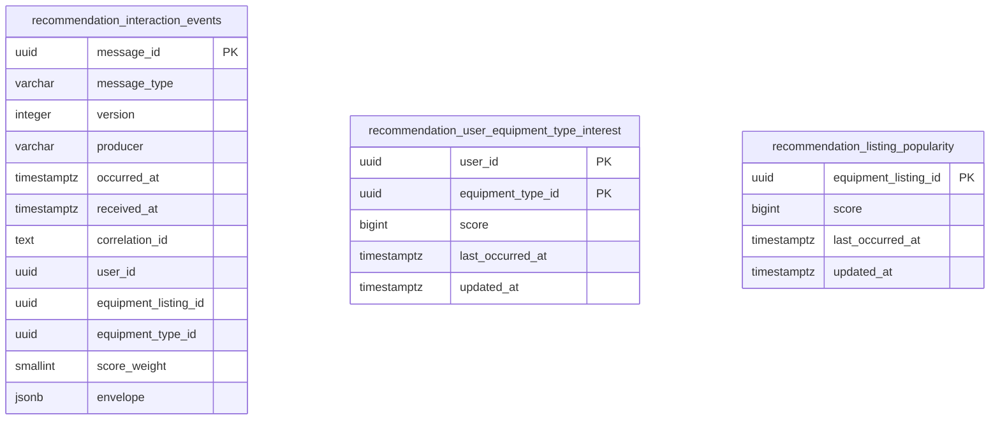
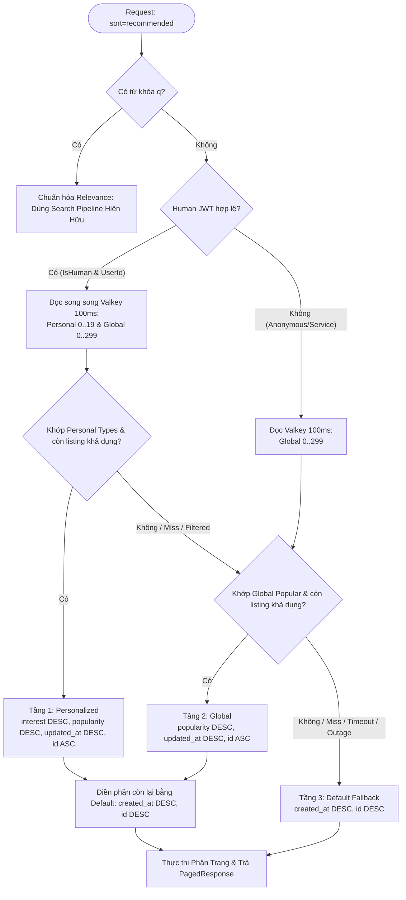

# Freeze Kiến Trúc Và Integration Contract Recommendation Phase 1

Tài liệu này xác lập bộ contract tích hợp và kiến trúc chuẩn hóa cho Phase 1 của `RecommendationService` trong hệ sinh thái DPRENTAL, cho phép ba dịch vụ `InventoryService`, `RentalService`, và `RecommendationService` triển khai độc lập, song song mà không bị phụ thuộc vòng hoặc xung đột hợp đồng dữ liệu.

> **Lưu ý về phạm vi và phê duyệt:**
> 1. Task này bàn giao thiết kế, JSON schemas Draft 2020-12, fixtures và DDL tham chiếu PostgreSQL. Consumer, producer, EF Core entities/migrations, cache worker và ranking integration thuộc các task triển khai kế tiếp; chưa thêm DTO/constants C# hoặc package runtime trong task này.
> 2. Việc các nhóm kỹ thuật chấp thuận contract được ghi nhận thông qua quy trình Code Review và Architecture Review; tài liệu này nằm trong kho mã nguồn của RecommendationService đóng vai trò là bản đặc tả kỹ thuật tham chiếu, không tự chứng minh rằng InventoryService hoặc RentalService đã triển khai hoặc đã kích hoạt trên môi trường chạy thực tế.

---

## 1. Ranh Giới Dịch Vụ & Quyền Sở Hữu (Ownership)

```
┌─────────────────────────┐               ┌────────────────────────┐
│     InventoryService    │               │      RentalService     │
│ ─────────────────────── │               │ ────────────────────── │
│ - Listing & Category    │               │ - Cart & CartItem      │
│ - Pricing & Availability│               │ - Rental Order/Payment │
│ - Filtering & Paging    │               │ - Order State Machine  │
└────────────┬────────────┘               └───────────┬────────────┘
             │ ListingViewed                          │ CartItemAdded
             │ SearchPerformed                        │ RentalItemPaid
             ▼                                        ▼ RentalItemCompleted
    [inventory.behavior.events.v1]             [rental.events.v1]
             │                                        │
             └───────────────────┬────────────────────┘
                                 │ Kafka Consumers
                                 ▼
                 ┌───────────────────────────────┐
                 │     RecommendationService     │
                 │ ───────────────────────────── │
                 │ - Behavioral Signal Store     │
                 │ - Score Weights Calculation   │
                 │ - Projections (Interest/Pop.) │
                 │ - Background Cache Publisher  │
                 └───────────────┬───────────────┘
                                 │ Valkey / Redis Snapshot
                                 ▼
                     rec:v1:user:{id}:equipment-types
                     rec:v1:global:popular-listings
                                 ▲
                     Inventory   │ Read-only (sort=recommended)
                     Fallback    │ (100ms budget)
                     Engine      │
```

### Phân định trách nhiệm dữ liệu & Ownership

- **CatalogService / Catalog Domain**:
  - Sở hữu định danh và thông tin danh mục (`Category`) và loại thiết bị (`EquipmentType`).
  - Là nguồn chân lý cho cây danh mục và phân loại thiết bị trong toàn hệ thống.

- **InventoryService**:
  - Sở hữu hoàn toàn thông tin thiết bị (`EquipmentListing`), hình ảnh, giá thuê, kho bãi, trạng thái khả dụng.
  - Sử dụng `Category` và `EquipmentType` từ Catalog để phân loại, lọc và tìm kiếm listing.
  - Phát sinh sự kiện hành vi `ListingViewed` khi người dùng xem trang chi tiết và `SearchPerformed` khi người dùng tìm kiếm có chủ đích tại trang đầu tiên (`page = 1`).
-   - Đọc cache snapshot đề xuất từ Valkey với vai trò người tiêu dùng chỉ đọc (`read-only consumer`) khi người dùng opt-in qua query parameter `sort=recommended`. Tự thực thi bộ lọc trạng thái khả dụng, áp dụng phân trang, owner exclusion và fallback theo thứ tự ưu tiên (Personalized -> Global -> Inventory Default) mà không phụ thuộc đồng bộ vào RecommendationService.

- **RentalService**:
  - Sở hữu giỏ hàng (`Cart`, `CartItem`), đơn thuê thiết bị (`RentalOrder`, `RentalOrderItem`), quy trình thanh toán và máy trạng thái vòng đời thuê thiết bị.
  - Phát sinh các sự kiện hành vi gắn với cam kết nghiệp vụ: `CartItemAdded`, `RentalItemPaid`, và `RentalItemCompleted`.
  - Tái sử dụng bảng Transactional Outbox hiện có để đảm bảo tính nhất quán giữa trạng thái nghiệp vụ và message Kafka.

- **RecommendationService**:
  - Chỉ lưu trữ các tín hiệu hành vi (`behavioral signals`) cần thiết cho việc xếp hạng và sinh hai hình chiếu (`projections`):
    1. `user_equipment_type_interest`: Điểm quan tâm theo `equipmentTypeId` của từng user đã xác thực.
    2. `listing_popularity`: Điểm phổ biến toàn hệ thống theo từng `equipmentListingId`.
  - Sở hữu bảng trọng số điểm và logic tính điểm; tính toán offline/bất đồng bộ và định kỳ ghi snapshot kết quả lên Valkey (Redis).
  - Không sở hữu thông tin hiển thị của thiết bị, giá tiền, vị trí kho, tình trạng tồn kho hay tính khả dụng.
  - Tuân thủ nghiêm ngặt Clean Architecture 4 project của repository: tầng `Application` điều phối use cases qua repository interfaces; persistence nằm tại `Domain` theo ngoại lệ kiến trúc đã chọn (tham chiếu theo RentalService); tầng `Api` và `Application` không trực tiếp inject `DbContext`.
### Nguyên tắc tích hợp không đồng bộ

1. **Không Enrich Đồng Bộ Trước Khi Phát**: Producer trích xuất dữ liệu từ entity state, snapshot hoặc dữ liệu nghiệp vụ sẵn có trong transaction hiện tại. Tuyệt đối không thực hiện thêm lời gọi mạng đồng bộ (HTTP/gRPC/Kafka request-reply) để thu thập thêm thông tin chỉ nhằm mục đích phát event.
2. **Không Gọi Ngược Khi Consume**: RecommendationService khi nhận event chỉ bóc tách payload nhận được; tuyệt đối không gọi ngược lại API của InventoryService hay RentalService để truy vấn dữ liệu bổ sung.
3. **Bảo Vệ Tính Riêng Tư & Dữ Liệu Phân Tích**: Ngoại lệ thống nhất cho `SearchPerformed` v1: cho phép truyền trường `query` (từ khóa tìm kiếm thô) và `filterContext` phục vụ raw analytics; tuyệt đối không đưa thông tin thẻ/tài khoản ngân hàng, địa chỉ giao hàng hoặc thông tin cá nhân (PII) vào contract sự kiện hành vi.

---

## 2. Event Envelope & Semantic Specification

### Wire Format Envelope v1

Mọi thông điệp Kafka truyền tải dạng UTF-8 JSON. Tên trường thuộc envelope dùng quy ước `camelCase`; tên định danh sự kiện tại `messageType` dùng `PascalCase`.

| Trường | Kiểu dữ liệu | Bắt buộc | Mô tả & Ràng buộc kỹ thuật |
|---|---|:---:|---|
| `messageId` | UUID (string) | Có | UUID chuẩn (RFC 4122) **khác rỗng** (không được là `00000000-0000-0000-0000-000000000000`), ổn định khi retry/replay, tương thích với generator tất định hiện có của RentalService. |
| `messageType` | String | Có | Chính xác một trong năm giá trị: `ListingViewed`, `SearchPerformed`, `CartItemAdded`, `RentalItemPaid`, `RentalItemCompleted`. |
| `version` | Integer | Có | Cố định là `1` cho Phase 1. Xác định contract cấu trúc của envelope và payload. |
| `producer` | String | Có | Định danh service phát: `InventoryService` cho view/search; `RentalService` cho cart/paid/completed. |
| `occurredAt` | ISO-8601 (string) | Có | Thời điểm phát sinh hành vi nghiệp vụ theo chuẩn UTC có hậu tố `Z` (ví dụ: `2026-10-19T10:00:00Z` hoặc `2026-10-19T10:00:00.123456Z`). Giữ nguyên giá trị khi phát lại. |
| `correlationId` | String / Null | Không | Chuỗi trace context không rỗng nếu có; cho phép `null` hoặc bỏ qua trường. |
| `payload` | Object | Có | Đối tượng JSON chứa các trường nghiệp vụ cụ thể theo từng loại sự kiện, tuân thủ JSON Schema tương ứng. |

**Quy tắc tương thích mở rộng & Tính đóng kín của Payload v1**:
- **Payload v1 là đóng kín (`additionalProperties: false`)**: Mọi trường trong payload Phase 1 tuân thủ nghiêm ngặt schema đã công bố. Ngoại lệ mở rộng tương thích ngược cho `SearchPerformed` v1: cho phép bổ sung các trường analytics (`query`, `categoryId`, `filterContext`, `resultCount`) với `additionalProperties: false` cho cả payload và `filterContext`. Consumer coi các trường mới này là tùy chọn để tiếp tục tương thích với event v1 tối giản trước đó.
- **Envelope chấp nhận metadata mở rộng**: Envelope của producer có thể chứa các trường metadata bổ sung đã có sẵn như `aggregateId`, `causationId`, `organizationId`. RecommendationService chấp nhận các trường này nhưng **không dùng chúng để phân vùng nghiệp vụ hay tính điểm**, và consumer bỏ qua mọi trường mở rộng chưa biết ở mức envelope.

---

### Chi Tiết Năm Sự Kiện Phase 1

Mọi trường định danh nghiệp vụ (`Id`) đều là UUID chuẩn khác rỗng. Người dùng ẩn danh được biểu diễn tường minh bằng `userId: null`. Giá trị `userId` phải được trích xuất từ Identity Context đã xác thực (ClaimsPrincipal / JWT Token); tuyệt đối không nhận danh tính do client tự khai trong body request.

| Producer / Event | Payload Structure | Quy tắc phát sinh nghiệp vụ |
|---|---|---|
| **InventoryService**<br>`ListingViewed` | - `userId`: UUID? (nullable)<br>- `equipmentListingId`: UUID<br>- `equipmentTypeId`: UUID | Phát khi người dùng xem trang chi tiết listing công khai thành công (HTTP 200). Bao gồm cả trường hợp cache hit tại tầng Gateway/API của Inventory. |
| **InventoryService**<br>`SearchPerformed` | - `userId`: UUID? (nullable)<br>- `equipmentTypeId`: UUID? (nullable)<br>- `query`: string? (nullable, từ khóa tìm kiếm thô)<br>- `categoryId`: UUID? (nullable)<br>- `filterContext`: object? (chứa context: brandId, provinceCode, wardCode, sort, filters, from, to, requestedQuantity, page=1, pageSize)<br>- `resultCount`: integer? (tổng số kết quả phù hợp từ `TotalCount`, không âm) | Phát khi thao tác tìm kiếm thành công ở trang đầu tiên (`page = 1`) có chỉ định bộ lọc hoặc từ khóa. Chỉ lấy `equipmentTypeId` nếu client chỉ định rõ trong filter. Không suy diễn `equipmentTypeId` từ `query` hay `categoryId`. |
| **RentalService**<br>`CartItemAdded` | - `userId`: UUID (bắt buộc)<br>- `equipmentListingId`: UUID<br>- `equipmentTypeId`: UUID? (nullable)<br>- `cartId`: UUID<br>- `cartItemId`: UUID | Phát cho mỗi thao tác thêm thiết bị vào giỏ hàng đã commit thành công vào database, kể cả trường hợp sản phẩm đã có và hệ thống gộp số lượng. |
| **RentalService**<br>`RentalItemPaid` | - `userId`: UUID (bắt buộc)<br>- `equipmentListingId`: UUID<br>- `equipmentTypeId`: UUID? (nullable)<br>- `rentalOrderId`: UUID<br>- `rentalItemId`: UUID | Phát đúng một event cho mỗi item khi RentalService nhận xác nhận thanh toán hợp lệ và chuyển trạng thái ghi nhận mục thuê đã thanh toán. |
| **RentalService**<br>`RentalItemCompleted` | - `userId`: UUID (bắt buộc)<br>- `equipmentListingId`: UUID<br>- `equipmentTypeId`: UUID? (nullable)<br>- `rentalOrderId`: UUID<br>- `rentalItemId`: UUID | Phát đúng một event khi item hoàn tất toàn bộ chu trình thuê và chuyển sang trạng thái `Completed`. |

**Các quy tắc nghiệp vụ ràng buộc**:
1. **Search Signals**: Chỉ ghi nhận `equipmentTypeId` khi tham số truy vấn tìm kiếm có chọn trực tiếp loại thiết bị (`EquipmentTypeId`). Category đơn thuần **không được suy diễn** thành `equipmentTypeId`. Không cố gắng parse hay suy diễn `equipmentTypeId` từ chuỗi từ khóa tự do (`free text`) hoặc từ danh sách kết quả trả về. Nếu tìm kiếm chỉ có raw keyword hoặc category chung chung thì `equipmentTypeId = null`. Việc duyệt danh sách mặc định không bộ lọc (`empty browse`), chỉ đổi tiêu chí sắp xếp (`sort change`), hoặc chuyển trang (`pagination page > 1`) **không được phát** `SearchPerformed`.
2. **Anonymous Users**: Người dùng chưa đăng nhập có `userId = null`. Phase 1 không ghép profile ẩn danh qua cookie, device fingerprint hay session ID; khi người dùng đăng nhập sau đó, các tương tác cũ không được hồi tố gán vào tài khoản.
3. **Cart Modifications**: Thao tác cập nhật số lượng (`PATCH quantity`) hoặc cập nhật khoảng thời gian thuê (`dates change`) không phát lại `CartItemAdded`. Trọng số điểm không nhân với số lượng thuê hay giá trị tiền.
4. **Payment & Refund Constraints**: `RentalItemPaid` không phát cho các giao dịch thanh toán muộn nhưng sau đó bị từ chối hoặc hoàn tiền ngay trong luồng xác thực thanh toán. `RentalItemCompleted` chỉ phát sau khi đã nhận đủ xác nhận hoàn trả thiết bị từ Inventory và tất toán từ Payment theo state machine hiện hữu.
5. **Rental Missing Type**: Trong trường hợp dữ liệu lịch sử hoặc snapshot đơn hàng của RentalService chưa kịp nạp `equipmentTypeId`, sự kiện vẫn được phát với `equipmentTypeId = null`. Tín hiệu này vẫn đóng góp trọn vẹn vào `listing_popularity`, nhưng bỏ qua `user_equipment_type_interest`. Nếu RentalService có sẵn type từ order item snapshot thì bắt buộc phải đưa vào event.

---

## 3. Hạ Tầng Kafka, Định Tuyến & Giao Nhận

### Topology Kafka

- **Topic Inventory**: `inventory.behavior.events.v1` (topic mới dành riêng cho tín hiệu hành vi).
- **Topic Rental**: `rental.events.v1` (tái sử dụng topic sự kiện hiện có của RentalService).
- **Consumer Groups (RecommendationService)**:
  - `recommendation-inventory-behavior-v1` (nghe từ `inventory.behavior.events.v1`)
  - `recommendation-rental-behavior-v1` (nghe từ `rental.events.v1`)
- **Dead Letter Queues**:
  - `inventory.behavior.events.v1.recommendation.dlq`
  - `rental.events.v1.recommendation.dlq`

### Phân Vùng (Partition Keys)

Để bảo đảm tính tuần tự tương đối theo thực thể và phân bổ tải đồng đều giữa các partitions:

| Sự kiện | Partition Key được chọn |
|---|---|
| `ListingViewed` | `equipmentListingId` |
| `SearchPerformed` | `messageId` (phân tán ngẫu nhiên đều) |
| `CartItemAdded` | `cartId` |
| `RentalItemPaid` | `rentalOrderId` |
| `RentalItemCompleted` | `rentalOrderId` |

*Lưu ý: Nếu envelope có chứa trường `aggregateId`, trường này phải mang cùng giá trị với Partition Key tương ứng ở bảng trên.*

### Đảm Bảo Giao Nhận & Khả Năng Chịu Lỗi

1. **Cam kết At-Least-Once**: Hệ thống chấp nhận thông điệp có thể bị gửi lặp do network retry hoặc crash trong quá trình xử lý. Logic xử lý tại RecommendationService không được phụ thuộc vào thứ tự tuyệt đối giữa các topic khác nhau.
2. **Outbox Pattern tại Producer**:
   - `RentalService` bắt buộc ghi nhận event vào bảng Transactional Outbox trong cùng transaction cơ sở dữ liệu với thao tác cập nhật đơn/giỏ hàng. ID của `RentalItemPaid` và `RentalItemCompleted` phải được tạo tất định (`deterministic ID generation`) dựa trên producer, event type và rental item id để chống tạo trùng event khi retry.
   - `InventoryService` sử dụng hàng đợi tín hiệu trong bộ nhớ có giới hạn dung lượng (`bounded signal queue` best-effort, mặc định 1.024 sự kiện) cho tín hiệu duyệt/tìm kiếm (`ListingViewed`, `SearchPerformed`), không thêm outbox hay migration database riêng. Việc thu thập tín hiệu hành vi không được làm chậm hoặc gây lỗi cho thao tác đọc công khai (nếu hàng đợi đầy, publish lỗi hoặc host dừng thì chấp nhận drop signal và ghi nhận metric thất thoát). Đối với `RentalService`, vẫn bắt buộc ghi nhận event vào Transactional Outbox trong cùng transaction cơ sở dữ liệu.
3. **Offset Commit & Transaction Boundary**:
   - Consumer chỉ commit Kafka offset sau khi transaction lưu trữ và cập nhật projection trong PostgreSQL hoàn tất thành công.
   - Lỗi kết nối tạm thời (`transient network/DB errors`) được retry với thuật toán exponential backoff có giới hạn (jittered backoff); tuyệt đối không commit offset của record chưa được xử lý thành công.
4. **Xử Lý Dead-Letter Queue (DLQ)**:
   - Các sự kiện thuộc 5 loại đã biết nhưng vi phạm JSON Schema, sai version hoặc xung đột ID dữ liệu (`conflict payload`) sẽ được định tuyến sang topic DLQ tương ứng kèm header lý do lỗi (`x-dlq-error-reason`).
   - Offset trên topic chính chỉ được commit sau khi record đã được ghi bền vững vào DLQ.
   - Các sự kiện khác ngoài 5 loại sự kiện Phase 1 xuất hiện trên topic dùng chung `rental.events.v1` sẽ được consumer bỏ qua an toàn mà không ghi vào DLQ.
5. **Kafka Retention**: Giữ thời gian lưu trữ tin nhắn tối thiểu 7 ngày (`retention.ms = 604800000`). Không thay đổi số lượng partition trên production khi chưa có kế hoạch rebalancing rõ ràng.

---

## 4. Hệ Thống Điểm (Scoring) & Mô Hình Lưu Trữ PostgreSQL

### Bảng Trọng Số Điểm Phase 1

| Sự kiện | Trọng số điểm | Áp dụng User Interest | Áp dụng Listing Popularity |
|---|:---:|:---:|:---:|
| `SearchPerformed` | **+1** | Có (nếu có đủ `userId` và `equipmentTypeId`) | **Không** |
| `ListingViewed` | **+2** | Có (nếu có đủ `userId` và `equipmentTypeId`) | **Có** (mọi view) |
| `CartItemAdded` | **+5** | Có (nếu có `equipmentTypeId`) | **Có** |
| `RentalItemPaid` | **+8** | Có (nếu có `equipmentTypeId`) | **Có** |
| `RentalItemCompleted` | **+10** | Có (nếu có `equipmentTypeId`) | **Có** |

**Nguyên tắc tính toán**:
- **Cộng dồn độc lập**: Điểm được cộng dồn lũy tiến cho mỗi sự kiện hợp lệ đúng một lần. Phase 1 chưa áp dụng hệ số suy giảm thời gian (`time decay`) hay cửa sổ trượt (`sliding window`).
- **Tín hiệu độc lập**: Cùng một món hàng khi được thêm giỏ (+5), thanh toán (+8), và hoàn tất (+10) sẽ đóng góp độc lập $5 + 8 + 10 = 23$ điểm vào độ phổ biến của listing.
- **Không có điểm âm**: Phase 1 không trừ điểm khi hủy đơn, xóa giỏ hàng hoặc hoàn tiền.
- **Recommendation làm chủ trọng số**: Toàn bộ trọng số nằm tại RecommendationService; các producer tuyệt đối không gửi kèm điểm số trong payload.

---

### Mô Hình Dữ Liệu PostgreSQL (Schema `recommendation`)

DDL tham chiếu chi tiết được lưu trữ tại file `docs/contracts/recommendation-v1.sql`.



#### Chi tiết các bảng:
1. `recommendation.interaction_events`:
   - Lưu trữ nhật ký sự kiện thô phục vụ kiểm toán, chống trùng lặp và replay dữ liệu khi cần rebuild.
   - Khóa chính `message_id`. Ràng buộc `CHECK` đảm bảo UUID không rỗng, version = 1, producer chính xác, trọng số điểm dương và khớp logic giữa `message_type` và các trường định danh.
   - Không chứa bất kỳ khóa ngoại (FK) nào sang cơ sở dữ liệu của các service khác.
2. `recommendation.user_equipment_type_interest`:
   - Khóa chính tổng hợp `(user_id, equipment_type_id)`.
   - Lưu `score`, `last_occurred_at`, và `updated_at`.
   - Index tối ưu ranking: `(user_id, score DESC, equipment_type_id ASC)`.
3. `recommendation.listing_popularity`:
   - Khóa chính `equipment_listing_id`.
   - Lưu `score`, `last_occurred_at`, và `updated_at`.
   - Index tối ưu ranking: `(score DESC, equipment_listing_id ASC)`.

#### Xử Lý Atomic Upsert & Thứ Tự Sự Kiện:
Mỗi sự kiện được xử lý trong một transaction duy nhất:
1. Thực hiện chèn vào `interaction_events`. Nếu trùng `message_id`:
   - Nếu nội dung `envelope` khớp chính xác: Bỏ qua an toàn (`DUPLICATE_IGNORED`), không cộng thêm điểm.
   - Nếu nội dung `envelope` khác biệt: Báo lỗi xung đột (`CONFLICT_PAYLOAD_MISMATCH`), chuyển sự kiện vào DLQ.
2. Cập nhật projection tương ứng bằng kỹ thuật `INSERT ... ON CONFLICT DO UPDATE`:
   - Điểm số: `score = current.score + EXCLUDED.score`.
   - Thời gian: `last_occurred_at = GREATEST(current.last_occurred_at, EXCLUDED.last_occurred_at)` để ngăn chặn trường hợp sự kiện đến muộn làm lùi mốc thời gian của hành vi mới nhất.
   - Mốc cập nhật: `updated_at = clock_timestamp()`.
3. PostgreSQL đóng vai trò là nguồn chân lý duy nhất để rebuild projection: khi cần tái tạo dữ liệu, thủ tục `rebuild_projections()` sẽ `TRUNCATE` các bảng projection và tính toán lại từ bảng `interaction_events` thông qua hàm gom nhóm `SUM(score_weight)` và `MAX(occurred_at)`.

---

## 5. Cache Contract & Cơ Chế Fallback Của Inventory

RecommendationService là bên duy nhất sinh và cập nhật cache; InventoryService truy cập cache với vai trò người đọc (read-only).

### Cấu Trúc Serving Cache Key & ZSET Contract

Các key được lưu trữ trên Valkey (Redis compatible) dưới dạng ZSET phục vụ Inventory đọc trực tiếp theo rank:

| Key Pattern | Member | Score | Limit | Thứ tự đọc |
|---|---|---|---|---|
| `rec:v1:user:{userId}:equipment-types` | `EquipmentTypeId` (UUID lowercase định dạng D) | Score persist từ PostgreSQL ($1 \le \text{score} \le 2^{53}$) | Top 20 | score DESC, UUID DESC |
| `rec:v1:global:popular-listings` | `ListingId` (UUID lowercase định dạng D) | Score persist từ PostgreSQL ($1 \le \text{score} \le 2^{53}$) | Top 300 | score DESC, UUID DESC |

**Lệnh đọc của InventoryService**:
```bash
# Personal: Human user đọc song song Top 20 equipment types
ZRANGE rec:v1:user:<userId>:equipment-types 0 19 REV WITHSCORES

# Global: Anonymous hoặc fallback đọc Top 300 popular listings
ZRANGE rec:v1:global:popular-listings 0 299 REV WITHSCORES
```
*(Lưu ý: InventoryService đọc toàn bộ snapshot Top 20/300 và truyền vào SQL parameters của PostgreSQL để thực thi lọc tính khả dụng, owner exclusion, sắp xếp lexicographic, backfill default và phân trang tại database engine; tuyệt đối không phân trang trực tiếp bằng offset trên Valkey).*

**Quy chuẩn dữ liệu cache**:
- `{userId}` trong key là chuỗi UUID chuẩn định dạng D (lowercase, không chứa dấu ngoặc nhọn, ví dụ: `rec:v1:user:22222222-2222-4222-8222-222222222222:equipment-types`).
- Không chứa JSON, envelope version, `generatedAt` hoặc metadata dưới dạng member.
- Member không trùng lặp; không encode score hoặc thứ tự vào member.
- Tập ranking rỗng được biểu diễn bằng key không tồn tại (Valkey không giữ empty ZSET).
- Giới hạn kích thước danh sách:
  - User interest: Tối đa **20** `equipmentTypeId`.
  - Global popularity: Tối đa **300** `equipmentListingId`.
- Độ chính xác score: PostgreSQL tiếp tục dùng bigint. Cache chỉ nhận $1 \le \text{score} \le 9.007.199.254.740.992$ ($2^{53}$), giới hạn bảo toàn số nguyên của ZSET. Nếu ranking chứa score ngoài miền này, từ chối publish ranking đó, ghi log lỗi và giữ nguyên dữ liệu PostgreSQL.
- Concurrency và Lease:
  - Dùng lease Valkey riêng cho mỗi data key: `rec:v1:lease:{<dataKey>}` (hash tag chứa toàn bộ data key để bảo đảm cùng hash slot trong cluster).
  - Thay ranking nguyên tử bằng Lua script kiểm tra lease token: xóa key cũ (kể cả string JSON cũ), ghi toàn bộ ZSET bằng score tuyệt đối, đặt TTL **300 giây**, và giải phóng lease.
  - Worker định kỳ làm mới serving cache tối đa mỗi **60 giây** (mặc định) trong điều kiện bình thường.
  - Tuyệt đối không dùng lệnh `ZINCRBY` từ event delta để cập nhật ZSET; mỗi lần publish đọc lại toàn bộ top N từ PostgreSQL.
---

### Chiến Lược Tích Hợp Recommendation Ranking & Fallback Ba Tầng Tại InventoryService

InventoryService mở rộng endpoint duyệt thiết bị công khai hiện hữu:
```http
GET /api/v1/inventory/public/equipment-listings?sort=recommended
```
Endpoint giữ nguyên attribute `[AllowAnonymous]`, kiểu trả về `PagedResponse<PublicEquipmentListingResponse>`, và toàn bộ các query parameter hiện hữu (`categoryId`, `equipmentTypeId`, `brandId`, `provinceCode`, `wardCode`, `minPrice`, `maxPrice`, `from`, `to`, `requestedQuantity`, `page`, `pageSize`, `q`, `sort`).

#### Ma Trận Kích Hoạt & Thứ Tự Ưu Tiên (Precedence)

| Request Query | Danh Tính Người Gọi | Hành Vi Xếp Hạng & Nguồn Dữ Liệu |
|---|---|---|
| Không truyền `sort` | Mọi đối tượng | Giữ nguyên logic mặc định hiện tại (`created_at DESC, id DESC`), **không đọc Valkey** |
| `sort` hiện hữu (`price_asc`, `newest`, ...) | Mọi đối tượng | Giữ nguyên logic sắp xếp người dùng chọn, **không đọc Valkey** |
| `sort=recommended` và `q=keyword` (sau trim không rỗng) | Mọi đối tượng | Chuẩn hóa sang `sort=relevance`, **không đọc Valkey**, dùng pipeline Meilisearch / Full-text search hiện hữu |
| `sort=recommended` và `q` rỗng | Anonymous / Service Principal / Non-Human | Kích hoạt Recommendation: Đọc Global Popular Listings (`ranks 0..299`), ưu tiên Top Popularity |
| `sort=recommended` và `q` rỗng | Human JWT hợp lệ (`IsHuman == true`, `UserId` GUID hợp lệ) | Kích hoạt Recommendation: Đọc song song Personal Types (`ranks 0..19`) và Global Popular (`ranks 0..299`), xếp hạng lexicographic |
| `sort=recommended`, Valkey timeout / lỗi / rỗng | Mọi đối tượng | Fallback an toàn về `Inventory Default` (`created_at DESC, id DESC`), HTTP 200 |



#### Quy Tắc Xếp Hạng & Thực Thi Truy Vấn Tại Database Engine (Server-Side Evaluation)

1. **Một nguồn chân lý và một đường truy vấn duy nhất**:
   - Toàn bộ quá trình lọc, chọn tầng đề xuất, xếp hạng, backfill và phân trang bắt buộc phải được biên dịch và thực thi trực tiếp tại database engine (`PostgreSQL`) trong một transaction `RepeatableRead` duy nhất.
   - Tuyệt đối không tải toàn bộ danh sách vào bộ nhớ rồi mới lọc hay cắt trang; không thêm endpoint hoặc pipeline hydrate song song.
2. **Bộ lọc đi trước xếp hạng & Owner Exclusion**:
   - Bộ lọc Inventory bắt buộc áp dụng trên toàn bộ listing trước khi tính thứ tự: `status = Active`, category, equipment type, brand, location (tỉnh/huyện/xã), dynamic filters, khoảng ngày thuê khả dụng và số lượng yêu cầu (`requestedQuantity`).
   - **Owner Exclusion**: Đối với human recommendation, bắt buộc loại trừ các listing do chính người dùng sở hữu (`owner_id != userId`). Quy tắc này áp dụng xuyên suốt ở cả tầng Personalized, Global và khi fallback về Default. Request từ khóa (`q`) tiếp tục đi qua search flow hiện hữu và không áp dụng owner exclusion này.
3. **Truyền Score vào SQL Parameters**:
   - Snapshot đọc từ Valkey chỉ tồn tại trong bộ nhớ request và được truyền vào SQL dưới dạng Npgsql parameters (mảng ID và score, join qua `unnest`).
   - Tuyệt đối không ghi dữ liệu ranking snapshot xuống các bảng dữ liệu của Inventory.
4. **Chọn tầng và thứ tự xếp hạng Lexicographic**:
   - Tầng được xác định trên toàn bộ tập listing hợp lệ trước khi áp dụng `OFFSET` / `LIMIT`:
     - **Tầng Personalized** (khi có ít nhất một listing hợp lệ thuộc personal equipment types):
       - Nhóm thuộc personal types: `interest DESC, popularity DESC, updated_at DESC, id ASC`
       - Nhóm còn lại (backfill): `created_at DESC, id DESC`
       *(Listing không có trong global snapshot được gán popularity = 0; listing thuộc global snapshot nhưng nằm ngoài personal types vẫn nằm ở phần backfill default).*
     - **Tầng Global** (khi không có personal match nhưng có ít nhất một listing khớp global snapshot):
       - Nhóm thuộc global snapshot: `popularity DESC, updated_at DESC, id ASC`
       - Nhóm còn lại (backfill): `created_at DESC, id DESC`
     - **Tầng Default** (khi không còn match nào, key miss hoặc outage):
       - `created_at DESC, id DESC`
5. **Backfill và tính ổn định phân trang (Pagination)**:
   - Các listing được đề xuất đứng trước; toàn bộ phần còn lại của trang được điền đầy đủ bằng các listing hợp lệ theo thứ tự Default (`created_at DESC, id DESC`), bảo đảm trang không bị thiếu hụt khi trong kho vẫn còn hàng.
   - Mỗi listing chỉ xuất hiện duy nhất một lần trong toàn bộ kết quả (`no duplicates`).
   - `TotalCount` và `TotalPages` phản ánh toàn bộ tập listing hợp lệ sau bộ lọc và owner exclusion.
   - Nếu số trang vượt quá tổng số trang, trả về danh sách rỗng (`items: []`); không chuyển tầng chỉ vì trang hiện tại rỗng.
6. **Cách Ly Cache Response**:
   - Toàn bộ các request chứa `sort=recommended` **bắt buộc bypass HTTP response cache công khai của Inventory** (kể cả khi đã fallback về default), nhằm ngăn ngừa rò rỉ dữ liệu cá nhân hóa hoặc phục vụ nhầm kết quả giữa các users.
   - Giữ nguyên cơ chế cache metadata, schema và categories hiện có. Nhánh duyệt mặc định và tìm kiếm từ khóa tiếp tục sử dụng response cache hiện hữu (request `q + sort=recommended` dùng cache key với effective sort `relevance`).
7. **Ngân Sách Đọc & Failure Modes**:
   - Tổng thời gian chờ đọc Valkey tối đa là **100 ms** cho toàn bộ request, dùng chung một deadline duy nhất; không retry đồng bộ trong request.
   - Nếu timeout, lỗi kết nối, unconfigured hoặc dữ liệu ZSET không hợp lệ: bỏ ranking cho request đó và chuyển sang `Inventory Default`, trả HTTP 200 bình thường.
   - Personal key miss vẫn cho phép sử dụng Global popular snapshot đã đọc.
   - Request cancellation token từ client tiếp tục được propagate; không chuyển request bị hủy thành fallback thành công.
8. **Bảo Mật Danh Tính & Không Làm Lộ Metadata Hạ Tầng**:
   - Bắt buộc trích xuất `UserId` từ `IInventoryCallerContext` đã xác thực; tuyệt đối không đọc từ query parameter hoặc các header không tin cậy như `X-User-Id`.
   - Response công khai giữ nguyên schema `PagedResponse<PublicEquipmentListingResponse>`, không thêm trường score, điểm số hay thông tin ranking nội bộ.
   - Header `X-Search-Backend` giữ nguyên ý nghĩa hạ tầng PostgreSQL.
---

## 6. Ma Trận Kịch Bản Kiểm Thử & Biên Nghiệp Vụ

Tất cả các thành phần triển khai phải thỏa mãn 4 nhóm kịch bản kiểm thử bắt buộc sau:

### Kịch bản 1: Phát sinh tín hiệu hành vi
- **Search có type**: Người dùng lọc theo danh mục -> Phát `SearchPerformed` mang `equipmentTypeId`. User Interest tăng 1 điểm cho type đó; Popularity không đổi.
- **Search không có type**: Người dùng tìm từ khóa chung không lọc danh mục -> Phát `SearchPerformed` với `equipmentTypeId = null`. Sự kiện được lưu lại nhưng cả hai projection đều không tăng điểm.
- **Xem ẩn danh**: Người xem chưa đăng nhập -> Phát `ListingViewed` với `userId = null`. Listing Popularity tăng 2 điểm; User Interest không đổi.
- **Thêm giỏ hàng gộp dòng**: Người dùng thêm món hàng đã có sẵn trong giỏ -> Vẫn phát `CartItemAdded` mới cho thao tác commit đó. Cả User Interest (nếu có type) và Popularity đều tăng 5 điểm độc lập với số lượng sản phẩm.
- **Thanh toán & Hoàn tất thuê**: Khi đơn hàng được xác nhận thanh toán -> Phát `RentalItemPaid` (+8 điểm). Khi khách trả thiết bị và đơn hoàn tất -> Phát `RentalItemCompleted` (+10 điểm). Tổng điểm đóng góp cho chu trình là +18 điểm.

### Kịch bản 2: Khả năng chịu lỗi, lặp tin & phục hồi dữ liệu
- **Duplicate Message Delivery**: Broker gửi lại cùng một thông điệp do consumer timeout -> RecommendationService phát hiện `message_id` đã tồn tại với cùng nội dung `envelope` -> Bỏ qua thành công, không tăng điểm lần 2.
- **Conflict Message ID**: Xuất hiện message có cùng `message_id` nhưng payload bên trong khác biệt -> Ghi nhận lỗi xung đột, chuyển ngay sang DLQ, không phá hỏng projection hiện tại.
- **Concurrent Ingestion**: Nhiều sự kiện liên quan đến cùng một `equipmentListingId` đến đồng thời trên các partition/consumer khác nhau -> Ràng buộc atomic upsert của PostgreSQL xử lý tranh chấp an toàn, không làm mất điểm (`lost update`).
- **Sự kiện đến sai thứ tự**: Một sự kiện có `occurredAt` cũ hơn đến sau sự kiện mới -> Logic `GREATEST(last_occurred_at, EXCLUDED.last_occurred_at)` giữ nguyên mốc thời gian mới nhất, đồng thời vẫn cộng dồn điểm chính xác.
- **Crash trước và sau commit**: Nếu consumer sập trước khi DB transaction commit -> Offset chưa commit, tin nhắn được xử lý lại sau khi hồi phục. Nếu sập sau khi DB commit nhưng trước khi commit offset -> Tin nhắn được gửi lại nhưng cơ chế deduplication sẽ bảo vệ dữ liệu.
- **Toàn vẹn Rebuild**: Thực thi quy trình `rebuild_projections()` xóa trắng 2 bảng projection và tính toán lại từ `interaction_events` -> Kết quả điểm số và thứ tự ranking đầu ra phải trùng khớp 100% với trạng thái tích lũy thời gian thực.

### Kịch bản 3: Tích hợp Recommendation Ranking, Opt-in sort=recommended & Fallback
- **Opt-in tường minh**:
  - Request không truyền `sort` -> Inventory dùng default (`created_at DESC, id DESC`), không đọc Valkey.
  - Request `sort=recommended` và `q=keyword` -> Chuẩn hóa sang `sort=relevance`, không đọc Valkey, đi qua pipeline search hiện hữu.
  - Request `sort=recommended` không keyword:
    - Anonymous / Service Principal -> Chỉ đọc snapshot `rec:v1:global:popular-listings` (`ranks 0..299`).
    - Human JWT hợp lệ -> Đọc song song `rec:v1:user:{id}:equipment-types` (`ranks 0..19`) và `rec:v1:global:popular-listings` (`ranks 0..299`).
- **Xếp hạng Lexicographic & Backfill tại Database**:
  - Personal candidates: Interest cao hơn luôn đứng trước; cùng interest thì popularity quyết định; tie-break bằng `updated_at DESC, id ASC`.
  - Giá trị popularity bị thiếu trong global snapshot được gán mặc định bằng 0.
  - Backfill: Các listing được đề xuất đứng trước; phần còn lại của trang được điền bằng default (`created_at DESC, id DESC`), không trùng lặp item.
  - Dynamic filters, availability/dates áp dụng trước khi chọn tầng; nếu candidate bị xóa/hết hàng/không khả dụng -> tự động bị loại bỏ trước khi phân trang.
- **Owner Exclusion**: Listing do chính user sở hữu bị loại trừ khỏi kết quả đề xuất (áp dụng cho personalized, global và khi fallback default).
- **Fallback 3 tầng hoàn chỉnh**:
  - Tầng 1 (Personalized): Có ít nhất 1 listing khả dụng khớp personal types -> Dùng tầng cá nhân hóa.
  - Tầng 2 (Global): Không có personal match hoặc personal candidate bị lọc hết, nhưng có global match -> Fallback sang tầng Global.
  - Tầng 3 (Default): Toàn bộ candidates bị lọc hết, cache miss, timeout hoặc outage -> Fallback về Inventory Default (`created_at DESC, id DESC`).
- **Ngân sách 100ms & Outage Resilience**:
  - Đọc Valkey quá 100ms hoặc mất kết nối -> Ngắt ngay, fallback về Inventory Default, trả HTTP 200, không gây HTTP 500.
  - Request cancellation token được propagate chính xác.
- **Cách ly Response Cache**:
  - Request `sort=recommended` bypass hoàn toàn HTTP response cache công khai của Inventory; user A không bao giờ nhận nhầm kết quả đề xuất của user B.
### Kịch bản 4: Cô lập sự cố hệ thống
- **RecommendationService hoặc Valkey sập hoàn toàn**: InventoryService và RentalService vẫn duy trì trạng thái Ready (HTTP 200 trên endpoint `/health`). Các thao tác nghiệp vụ cốt lõi như duyệt kho, tạo đơn, thanh toán, thuê đồ diễn ra bình thường, chỉ chuyển sang chế độ fallback danh mục mặc định.
- **Kafka ngừng hoạt động tạm thời**: Producer lưu trữ sự kiện trong outbox/buffer cục bộ. Không có bất kỳ ngoại lệ nào từ message broker được phép lan truyền làm hỏng kết quả trả về của các API đọc hoặc ghi nghiệp vụ.

---

## 7. Ví Dụ Wire JSON, Cache JSON & Projection Delta

### Wire JSON Mẫu (Kèm Envelope Chuẩn)

#### 1. `ListingViewed` (InventoryService phát)
```json
{
  "messageId": "11111111-1111-4111-8111-111111111111",
  "messageType": "ListingViewed",
  "version": 1,
  "producer": "InventoryService",
  "occurredAt": "2026-10-19T10:00:00Z",
  "correlationId": "corr-view-1001",
  "payload": {
    "userId": "22222222-2222-4222-8222-222222222222",
    "equipmentListingId": "33333333-3333-4333-8333-333333333333",
    "equipmentTypeId": "44444444-4444-4444-8444-444444444444"
  }
}
```

#### 2. `SearchPerformed` (InventoryService phát - Định dạng mở rộng và tối giản tương thích)

Định dạng mở rộng chứa đầy đủ thông tin tìm kiếm analytics:
```json
{
  "messageId": "55555555-5555-4555-8555-555555555555",
  "messageType": "SearchPerformed",
  "version": 1,
  "producer": "InventoryService",
  "occurredAt": "2026-10-19T10:01:00.0000000Z",
  "correlationId": "55555555-5555-4555-8555-555555555555",
  "aggregateId": "55555555-5555-4555-8555-555555555555",
  "payload": {
    "userId": "22222222-2222-4222-8222-222222222222",
    "equipmentTypeId": null,
    "query": "máy khoan",
    "categoryId": null,
    "filterContext": {
      "brandId": null,
      "provinceCode": null,
      "wardCode": null,
      "sort": null,
      "filters": null,
      "from": null,
      "to": null,
      "requestedQuantity": null,
      "page": 1,
      "pageSize": 20
    },
    "resultCount": 37
  }
}
```

Định dạng v1 tối giản (vẫn được Recommendation consumer chấp nhận hợp lệ):
```json
{
  "messageId": "11111111-1111-4111-8111-111111111121",
  "messageType": "SearchPerformed",
  "version": 1,
  "producer": "InventoryService",
  "occurredAt": "2026-10-19T10:05:00Z",
  "correlationId": "corr-search-2001",
  "payload": {
    "userId": "22222222-2222-4222-8222-222222222222",
    "equipmentTypeId": "44444444-4444-4444-8444-444444444444"
  }
}
```

#### 3. `CartItemAdded` (RentalService phát)
```json
{
  "messageId": "11111111-1111-4111-8111-111111111131",
  "messageType": "CartItemAdded",
  "version": 1,
  "producer": "RentalService",
  "occurredAt": "2026-10-19T10:10:00Z",
  "correlationId": "corr-cart-3001",
  "aggregateId": "55555555-5555-4555-8555-555555555555",
  "payload": {
    "userId": "22222222-2222-4222-8222-222222222222",
    "equipmentListingId": "33333333-3333-4333-8333-333333333333",
    "equipmentTypeId": "44444444-4444-4444-8444-444444444444",
    "cartId": "55555555-5555-4555-8555-555555555555",
    "cartItemId": "66666666-6666-4666-8666-666666666666"
  }
}
```

#### 4. `RentalItemPaid` (RentalService phát)
```json
{
  "messageId": "11111111-1111-4111-8111-111111111141",
  "messageType": "RentalItemPaid",
  "version": 1,
  "producer": "RentalService",
  "occurredAt": "2026-10-19T10:15:00Z",
  "correlationId": "corr-paid-4001",
  "aggregateId": "77777777-7777-4777-8777-777777777777",
  "payload": {
    "userId": "22222222-2222-4222-8222-222222222222",
    "equipmentListingId": "33333333-3333-4333-8333-333333333333",
    "equipmentTypeId": "44444444-4444-4444-8444-444444444444",
    "rentalOrderId": "77777777-7777-4777-8777-777777777777",
    "rentalItemId": "88888888-8888-4888-8888-888888888888"
  }
}
```

#### 5. `RentalItemCompleted` (RentalService phát)
```json
{
  "messageId": "11111111-1111-4111-8111-111111111151",
  "messageType": "RentalItemCompleted",
  "version": 1,
  "producer": "RentalService",
  "occurredAt": "2026-10-19T10:20:00Z",
  "correlationId": "corr-comp-5001",
  "aggregateId": "77777777-7777-4777-8777-777777777777",
  "payload": {
    "userId": "22222222-2222-4222-8222-222222222222",
    "equipmentListingId": "33333333-3333-4333-8333-333333333333",
    "equipmentTypeId": "44444444-4444-4444-8444-444444444444",
    "rentalOrderId": "77777777-7777-4777-8777-777777777777",
    "rentalItemId": "88888888-8888-4888-8888-888888888888"
  }
}
```

---

### Serving Cache ZSET Mẫu

#### 1. User Equipment Type Interest
Key: `rec:v1:user:22222222-2222-4222-8222-222222222222:equipment-types` (Type: `zset`, TTL: 300s)

Truy vấn đọc:
```bash
ZRANGE rec:v1:user:22222222-2222-4222-8222-222222222222:equipment-types 0 19 REV WITHSCORES
```

Kết quả trả về:
```text
1) "44444444-4444-4444-8444-444444444444"
2) "26"
3) "bbbbbbbb-bbbb-4bbb-8bbb-bbbbbbbbbbbb"
4) "12"
5) "aaaaaaaa-aaaa-4aaa-8aaa-aaaaaaaaaaaa"
6) "12"
```
*(Ghi chú: Khi đọc với `REV`, hai type cùng score 12 được xếp theo thứ tự `equipmentTypeId` giảm dần `bbbb...` trước `aaaa...`)*

#### 2. Global Listing Popularity
Key: `rec:v1:global:popular-listings` (Type: `zset`, TTL: 300s)

Truy vấn đọc toàn bộ ranking snapshot (tối đa 300 entries):
```bash
ZRANGE rec:v1:global:popular-listings 0 299 REV WITHSCORES
```

Kết quả trả về:
```text
1) "33333333-3333-4333-8333-333333333333"
2) "25"
3) "99999999-9999-4999-8999-999999999999"
4) "18"
```

---

### Bảng Minh Họa Projection Delta (Trạng Thái Trước/Sau)

Giả định User `U1`, Listing `L1` (thuộc Type `T1`):

| Bước | Sự kiện đến | Điểm cộng | Trạng thái `user_equipment_type_interest` (U1, T1) | Trạng thái `listing_popularity` (L1) | Ghi chú |
|---|---|:---:|---|---|---|
| **0** | *Khởi tạo ban đầu* | - | Chưa có bản ghi | Chưa có bản ghi | Hệ thống trống |
| **1** | `ListingViewed` (ẩn danh, L1, T1) | +2 | Chưa có bản ghi (do `userId = null`) | `score: 2` | Chỉ tăng popularity |
| **2** | `SearchPerformed` (U1, type T1) | +1 | `score: 1` | `score: 2` | Search không tăng popularity |
| **3** | `CartItemAdded` (U1, L1, T1) | +5 | `score: 6` ($1 + 5$) | `score: 7` ($2 + 5$) | Cả hai projection tăng 5 |
| **4** | `RentalItemPaid` (U1, L1, T1) | +8 | `score: 14` ($6 + 8$) | `score: 15` ($7 + 8$) | Cả hai projection tăng 8 |
| **5** | `RentalItemCompleted` (U1, L1, T1) | +10 | `score: 24` ($14 + 10$) | `score: 25` ($15 + 10$) | Cả hai projection tăng 10 |
| **6** | `RentalItemCompleted` (Duplicate bước 5) | +0 | `score: 24` | `score: 25` | Phát hiện trùng `messageId`, bỏ qua an toàn |

---

## 8. Checklist Trách Nhiệm Từng Service

### Checklist Dành Cho InventoryService
- [ ] Bổ sung giá trị `Recommended` vào whitelist enum/sort tại validator của public listings; từ chối `recommended` tại các endpoint owner/admin.
- [ ] Triển khai `IRecommendationRankingReader` (thuộc tầng Application) đọc `rec:v1:user:{userId:D}:equipment-types` (ranks 0..19) và `rec:v1:global:popular-listings` (ranks 0..299) với deadline 100 ms qua kết nối `ConnectionStrings:RecommendationRedis`.
- [ ] Chuẩn hóa `sort=recommended` khi có `q` thành `Relevance` và bypass đọc Valkey; chỉ kích hoạt recommendation khi `q` rỗng.
- [ ] Phân biệt danh tính qua `IInventoryCallerContext`: chỉ personalized khi `IsHuman == true` và `UserId` GUID hợp lệ; anonymous hoặc service principal chỉ đọc global.
- [ ] Áp dụng Owner Exclusion (`owner_id != userId`) cho human recommendation trên cả 3 tầng.
- [ ] Truyền snapshot ID và score vào SQL parameters (unnest) trong một truy vấn duy nhất tại PostgreSQL; thực thi lọc, xếp hạng lexicographic, backfill default và phân trang tại server-side.
- [ ] Bypass hoàn toàn HTTP response cache công khai của Inventory cho mọi request `sort=recommended`.
- [ ] Bổ sung metrics thời gian đọc Valkey và phân bổ tầng kết quả (personalized/global/default) kèm lý do fallback có bounded cardinality, không chứa PII/userId.
- [ ] Giữ nguyên các luồng sự kiện hành vi: producer phát `ListingViewed` và `SearchPerformed` qua bounded memory queue best-effort lên topic `inventory.behavior.events.v1`.
### Checklist Dành Cho RentalService
- [ ] Xác nhận topic `rental.events.v1` sẵn sàng nhận các loại sự kiện mới.
- [ ] Triển khai producer phát `CartItemAdded` khi thao tác thêm giỏ hàng được commit thành công (kể cả khi gộp dòng).
- [ ] Triển khai producer phát `RentalItemPaid` một event cho mỗi item khi thanh toán được chấp nhận.
- [ ] Triển khai producer phát `RentalItemCompleted` một event cho mỗi item khi hoàn tất toàn bộ chu kỳ thuê.
- [ ] Tái sử dụng bảng Transactional Outbox hiện có, ghi cùng database transaction với thay đổi nghiệp vụ đơn hàng.
- [ ] Đảm bảo `messageId` của `RentalItemPaid` và `RentalItemCompleted` được sinh tất định từ ID nghiệp vụ để chống phát trùng lặp.
- [ ] Đảm bảo không đưa dữ liệu nhạy cảm (thanh toán, địa chỉ, PII) vào event payload.

### Checklist Dành Cho RecommendationService
- [ ] Áp dụng DDL chuẩn cho PostgreSQL trong namespace `recommendation` (`interaction_events`, `user_equipment_type_interest`, `listing_popularity`) theo file `recommendation-v1.sql`.
- [ ] Khởi tạo consumer groups `recommendation-inventory-behavior-v1` và `recommendation-rental-behavior-v1`.
- [ ] Triển khai cơ chế bóc tách envelope, validate JSON Schema Draft 2020-12 và phân loại sự kiện.
- [ ] Triển khai cơ chế deduplication và xử lý transaction an toàn với atomic upsert (`GREATEST` trên `last_occurred_at`).
- [ ] Định tuyến các thông điệp sai schema, sai version hoặc xung đột ID sang `${topic}.recommendation.dlq`.
- [ ] Triển khai Background Service định kỳ (mỗi 60 giây) tính toán và ghi đè snapshot nguyên tử lên Valkey với TTL 300 giây.
- [ ] Cung cấp cấu hình ACL `inventory_user` với quyền chỉ đọc trên namespace `~rec:*` (`zrange`, `zcard`, `get`, `ttl`) theo file `valkey-acl.conf`.
- [ ] Tuân thủ ranh giới Clean Architecture: persistence thuộc `Domain`, điều phối use case thuộc `Application`, không để `Api` hay `Application` thao tác trực tiếp với `DbContext`.
- [ ] Cung cấp thủ tục rebuild toàn bộ projection từ bảng lịch sử `interaction_events`.
