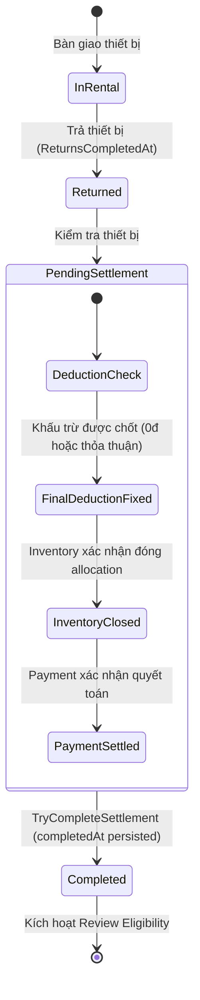

# Hợp đồng Điều kiện Đánh giá và Snapshot Dữ liệu (Eligibility & Snapshot Contract v1)

Tài liệu này quy định chi tiết các điều kiện tiên quyết để một mục thuê (`RentalItem`) đủ điều kiện được đánh giá, hợp đồng API snapshot giữa ReviewService và RentalService, công thức tính toán thời hạn (deadline) và các ca biên thời gian UTC.

---

## 1. Hợp đồng API Snapshot Nội bộ (`GET /internal/.../review-snapshot`)

Để xác thực điều kiện đánh giá một cách độc lập và bảo mật, ReviewService gọi trực tiếp RentalService qua endpoint nội bộ sau:

### 1.1 Chi tiết Endpoint

- **Phương thức:** `GET`
- **Đường dẫn:** `/internal/orders/{orderId}/items/{itemId}/review-snapshot`
- **Chính sách Xác thực (Authentication Policy):**
  - **API-key-only:** Chỉ yêu cầu header `X-Api-Key` hợp lệ.
  - **Vượt rào cản Bearer:** Endpoint này được cấu hình bỏ qua attribute `[Authorize]` bearer token truyền thống, dựa trên middleware `InternalApiKeyMiddleware` đã gán `context.Items["InternalApiKeyVerified"] = true` `[confirmed-by-source: RentalService/src/Api/Security/InternalApiKeyMiddleware.cs]`.
  - Không nới lỏng quyền hạn của các endpoint nội bộ khác (ví dụ: Admin Replay tại RentalService vẫn yêu cầu Bearer JWT của Admin).
  - Không công khai qua API Gateway (bị chặn bởi `ServiceOnlyRouteBlockingMiddleware`).
- **Headers yêu cầu:**
  - `X-Api-Key: <configured_internal_api_key>`
  - `Accept: application/json`

### 1.2 Cấu trúc DTO Tối thiểu (`RentalItemReviewSnapshot`)

DTO được thiết kế theo nguyên tắc tối thiểu hóa dữ liệu (Data Minimization), đã loại bỏ các trường không cần thiết như `orderCode` `[design-decision]`:

```json
{
  "orderId": "4a713833-2882-4df3-a185-1bf035fe85d1",
  "itemId": "b8f0474c-4da6-466d-a2dc-bf61dd3147f7",
  "renterId": "11111111-1111-1111-1111-111111111111",
  "supplierId": "22222222-2222-2222-2222-222222222222",
  "equipmentListingId": "33333333-3333-3333-3333-333333333333",
  "status": "Completed",
  "completedAt": "2026-10-15T10:00:00.000Z",
  "orderVersion": 5
}
```

### 1.3 Chuẩn hóa Trạng thái Mục thuê (`RentalItemStatus` Literals)

Chuỗi trạng thái trả về trong trường `status` phải khớp chính xác với enum trong mã nguồn RentalService (`[confirmed-by-source: RentalService/src/Common/Enums/RentalItemStatus.cs]`):

| Giá trị Enum Literal | Ý nghĩa nghiệp vụ | Đủ điều kiện đánh giá? |
| :--- | :--- | :---: |
| `PendingPayment` | Chờ người thuê thanh toán cọc và phí thuê | **KHÔNG** |
| `PendingSupplierConfirmation` | Chờ nhà cung cấp xác nhận đơn thuê | **KHÔNG** |
| `AwaitingHandover` | Đã xác nhận, chờ giao nhận máy | **KHÔNG** |
| `InRental` | Thiết bị đang trong thời gian thuê | **KHÔNG** |
| `PendingSettlement` | Đã trả thiết bị, đang chờ chốt khấu trừ và quyết toán | **KHÔNG** |
| **`Completed`** | **Đã hoàn tất toàn bộ quy trình hoàn trả, đóng kho và quyết toán** | **CÓ** *(nếu có `completedAt` hợp lệ)* |
| `Rejected` | Nhà cung cấp từ chối cung cấp thiết bị | **KHÔNG** |
| `Expired` | Hết hạn xác nhận đơn hoặc hết hạn thanh toán | **KHÔNG** |
| `Cancelled` | Đơn hoặc mục thuê bị hủy | **KHÔNG** |

### 1.4 Phân loại Mã phản hồi và Ánh xạ Lỗi Chuẩn

| Phản hồi từ RentalService | Mã lỗi ReviewService trả về | Mã lỗi chi tiết (`code`) | Hành vi xử lý của ReviewService |
| :--- | :--- | :--- | :--- |
| **`200 OK` (Khớp snapshot)** | `200 OK` / `201 Created` | - | Tiếp tục kiểm tra điều kiện nghiệp vụ (`status == Completed` và `completedAt != null`) |
| **`401 Unauthorized`** | `502 Bad Gateway` | `RENTAL_SERVICE_AUTHENTICATION_FAILED` | Lỗi cấu hình credential giữa hai service; ghi log Critical (không log key) |
| **`404 Not Found` (Mã nghiệp vụ: `RENTAL_ITEM_NOT_FOUND`)** | `404 Not Found` | `RENTAL_ITEM_NOT_FOUND` | Mục thuê không tồn tại hoặc không thuộc đơn hàng chỉ định |
| **`404 Not Found` (Chung / Thiếu route)** | `502 Bad Gateway` | `RENTAL_SERVICE_INVALID_RESPONSE` | Endpoint snapshot/reconciliation không tồn tại tại RentalService |
| **Timeout / `504`** | `504 Gateway Timeout` | `RENTAL_SERVICE_TIMEOUT` | Cuộc gọi HTTP vượt quá timeout 5 giây |
| **`500/502/503` / Invalid JSON / Schema mismatch** | `502 Bad Gateway` | `RENTAL_SERVICE_UNAVAILABLE` hoặc `RENTAL_SERVICE_INVALID_RESPONSE` | Dịch vụ Rental gặp sự cố hoặc trả payload sai schema / thiếu ID bắt buộc |
---

## 2. Tiêu chuẩn Hoàn tất Nghiệp vụ của RentalService (`completedAt`)

Để bảo đảm tính khách quan, trung thực và công bằng cho cả hai bên, ReviewService không tự ý phán đoán trạng thái hoàn tất mà tuân thủ nghiêm ngặt các quy định nghiệp vụ từ RentalService:



### 2.1 Ba điều kiện tiên quyết xác lập `completedAt` tại RentalService

Theo mã nguồn authoritative của RentalService (`[confirmed-by-source: RentalService/src/Domain/Entities/RentalItem.Settlement.cs]`):

1. **Số tiền khấu trừ đã được chốt (Final Deduction Finalized):**
   - `FinalDeductionAmount.HasValue == true`.
   - Có thể bằng 0 (trả nguyên vẹn hoặc quá hạn 48 giờ không đề xuất) hoặc số tiền bồi thường đã thỏa thuận/giải quyết tranh chấp.
2. **Kho vận xác nhận đóng hoàn tất (Inventory Closure Confirmed):**
   - `InventoryClosureConfirmedAt.HasValue == true`.
   - Thiết bị đã được hoàn nhập kho hoặc thanh lý xử lý đền bù hoàn tất.
3. **Thanh toán xác nhận quyết toán thành công (Payment Settlement Confirmed):**
   - `FinancialClosureConfirmedAt.HasValue == true`.
   - Phương thức `RecordPaymentSettlementConfirmed` được gọi với mã tham chiếu giao dịch `SettlementRef` hợp lệ từ PaymentService.

Chỉ khi cả 3 điều kiện trên được thỏa mãn đồng thời, hàm `TryCompleteSettlement` mới chuyển trạng thái sang `RentalItemStatus.Completed` và ghi nhận mốc thời gian hoàn tất `completedAt`.
- **Nguyên tắc đồng nhất mốc thời gian:** RentalService bắt buộc phải lưu trữ bền vững (persist) giá trị `completedAt` vào database và phát ra Kafka Outbox với **cùng một giá trị chính xác đó**. ReviewService không giả định thời điểm chuyển trạng thái và thời điểm Payment quyết toán luôn tương đương nếu RentalService chưa xác nhận.

### 2.2 Các suy diễn BỊ CẤM TUYỆT ĐỐI (Prohibited Inferences)

1. **Không suy diễn từ thời điểm trả máy (`ReturnsCompletedAt`):**
   - Thiết bị vừa được nhận lại ở quầy nhưng chưa qua kiểm định kỹ thuật hoặc đang phát sinh tranh chấp đền bù thì **chưa được phép đánh giá**.
2. **Không suy diễn từ HTTP 200 ACK hoặc Event nhận:**
   - Việc nhận được gói tin mạng hoặc lưu outbox không thay thế được sự kiện quyết toán thành công.
3. **Không suy diễn từ trạng thái Đơn hàng cha (`Order.Status == Completed`):**
   - Một đơn hàng có thể có nhiều mục thuê (`RentalItem`) hoàn tất ở các thời điểm khác nhau. Mỗi mục thuê độc lập về tiến trình hoàn tất và thời hạn đánh giá.

---

## 3. Công thức Thời hạn Đánh giá (Eligibility Window Formulas)

Tất cả các mốc thời gian đều được tính toán và so sánh theo múi giờ chuẩn quốc tế UTC (`DateTimeOffset.UtcNow`). Giới hạn biên là **Exclusive (nhỏ hơn nghiêm ngặt `<`)**.

### 3.1 Thời hạn Tạo mới Đánh giá (Creation Deadline)

Người thuê và Nhà cung cấp chỉ được phép gửi đánh giá trong vòng **30 ngày** kể từ thời điểm mục thuê hoàn tất nghiệp vụ:

$$\text{CanCreate}(\text{now}) \iff \text{completedAt} \neq \text{null} \quad \land \quad \text{now} < \text{CreationDeadline}$$

Trong đó:
$$\text{CreationDeadline} = \text{completedAt} + 30\text{ ngày (UTC)}$$

### 3.2 Thời hạn Chỉnh sửa Đánh giá (Edit Deadline)

Tác giả chỉ được phép chỉnh sửa đánh giá của mình trong khoảng thời gian ngắn hơn giữa **7 ngày kể từ khi tạo review** và **hạn chót 30 ngày của mục thuê**:

$$\text{CanEdit}(\text{now}) \iff \text{authorState} == \text{'Active'} \quad \land \quad \text{now} < \text{EditDeadline}$$

Trong đó:
$$\text{EditDeadline} = \min\Big(\text{createdAt} + 7\text{ ngày}, \; \text{completedAt} + 30\text{ ngày}\Big) \quad \text{(UTC)}$$

*Lưu ý vòng đời hai trục:* Nếu review đang bị Admin ẩn (`moderationState == 'Hidden'`), tác giả vẫn được phép chỉnh sửa nếu chưa rút và còn trong `EditDeadline`. Việc sửa không làm thay đổi `moderationState`.

---

## 4. Bảng Kiểm chứng Ca Biên Thời gian UTC (UTC Boundary Test Scenarios)

Giả định mục thuê có thời điểm hoàn tất:
$$\text{completedAt} = \text{2026-10-15T10:00:00.000Z}$$
Suy ra hạn chót tạo đánh giá:
$$\text{CreationDeadline} = \text{2026-11-14T10:00:00.000Z}$$

| Kịch bản | Thời điểm gửi Request (`now` UTC) | Trạng thái Review | Kết quả kiểm tra | Mã phản hồi HTTP & Lý do |
| :--- | :--- | :--- | :--- | :--- |
| **Hợp lệ: Sớm hơn hạn 1 giây** | `2026-11-14T09:59:59.000Z` | Chưa có | $\text{now} < \text{Deadline}$ | `201 Created` - Hợp lệ |
| **Hợp lệ: Sớm hơn hạn 1 mili-giây** | `2026-11-14T09:59:59.999Z` | Chưa có | $\text{now} < \text{Deadline}$ | `201 Created` - Hợp lệ cận biên |
| **Biên loại trừ: Đúng tích tắc hạn chót** | `2026-11-14T10:00:00.000Z` | Chưa có | $\text{now} == \text{Deadline}$ | `422 Unprocessable Entity` (`REVIEW_CREATION_WINDOW_EXPIRED`) |
| **Quá hạn: Muộn hơn 1 mili-giây** | `2026-11-14T10:00:00.001Z` | Chưa có | $\text{now} > \text{Deadline}$ | `422 Unprocessable Entity` (`REVIEW_CREATION_WINDOW_EXPIRED`) |

---

## 5. Các Luồng Nghiệp vụ Đặc thù và Xử lý Lệch Dữ liệu (Mismatch Handling)

### 5.1 Luồng Quá hạn Khấu trừ 48 giờ (Deduction Timeout 48h)

Theo mã nguồn RentalService (`[confirmed-by-source: RentalService/src/Domain/Entities/RentalItem.Deductions.cs]`):
- Nếu thiết bị có hư hại nhưng Nhà cung cấp không gửi đề xuất khấu trừ trong vòng 48 giờ kể từ khi hoàn tất trả máy:
- Background worker (`DeductionDeadlineWorker`) sẽ **chốt khấu trừ bằng 0 (`FinalDeductionAmount = 0m`)**, đồng nghĩa với việc **hoàn trả 100% tiền cọc cho Người thuê**.
- **Không có việc tự động tịch thu cọc.** Sau khi Payment quyết toán hoàn tiền cọc, mục thuê chuyển sang `Completed` và kích hoạt thời hạn đánh giá 30 ngày bình thường.

### 5.2 Xử lý Mâu thuẫn giữa Event và Snapshot Authoritative (Event-Snapshot Mismatch)

Khi ReviewService nhận được sự kiện Kafka `RentalItemCompleted`:
1. ReviewService gọi Rental Snapshot authoritative để kiểm tra chéo.
2. Snapshot authoritative phải khớp chính xác: `RentalItemId`, `RentalOrderId`, `RenterId`, `SupplierId`, `EquipmentListingId`, có `status == 'Completed'` và có timestamp `completedAt` đáng tin cậy.
3. **Nếu có mâu thuẫn (Mismatch):**
   - Ví dụ: Event báo Completed nhưng Snapshot báo `PendingSettlement` hoặc `Cancelled`.
   - Event **tuyệt đối không được cấp eligibility** cho mục thuê.
   - Chuyển bản ghi sang hàng đợi xử lý lệch dữ liệu (Mismatch Queue) kèm theo bản ghi kiểm toán (Audit Log) để đối soát kỹ thuật.

### 5.3 Dữ liệu Lịch sử và Phục hồi Dữ liệu (Historical Data & Replay)

1. **Bản ghi lịch sử thiếu timestamp đáng tin cậy:**
   - Các đơn hàng lịch sử thiếu mốc thời gian hoàn tất chính xác sẽ giữ `completedAt = null` $\rightarrow$ **Không đủ điều kiện đánh giá**.
2. **Nguyên tắc Phục hồi Dữ liệu:**
   - Chỉ được phép phục hồi giá trị `completedAt` khi có bằng chứng xác thực từ nhật ký giao dịch ngân hàng (Settlement Outbox / Payment Ledger) của PaymentService.
3. **Replay không gia hạn thời hạn (Replay Invariance):**
   - Khi chạy lại replay Kafka hoặc chạy reconciliation sweep, `completedAt` giữ nguyên giá trị gốc từ RentalService.
   - Replay **tuyệt đối không reset deadline**; nếu mốc `completedAt + 30 ngày` đã qua trong quá khứ, mục thuê lập tức được xếp vào diện đã hết hạn đánh giá.
