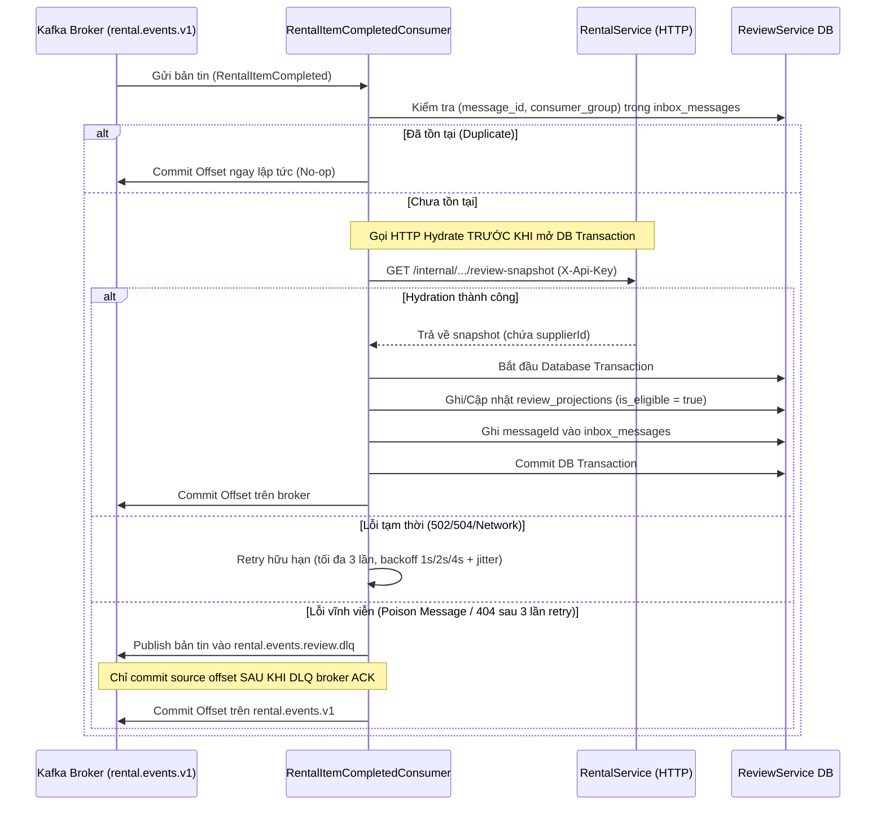
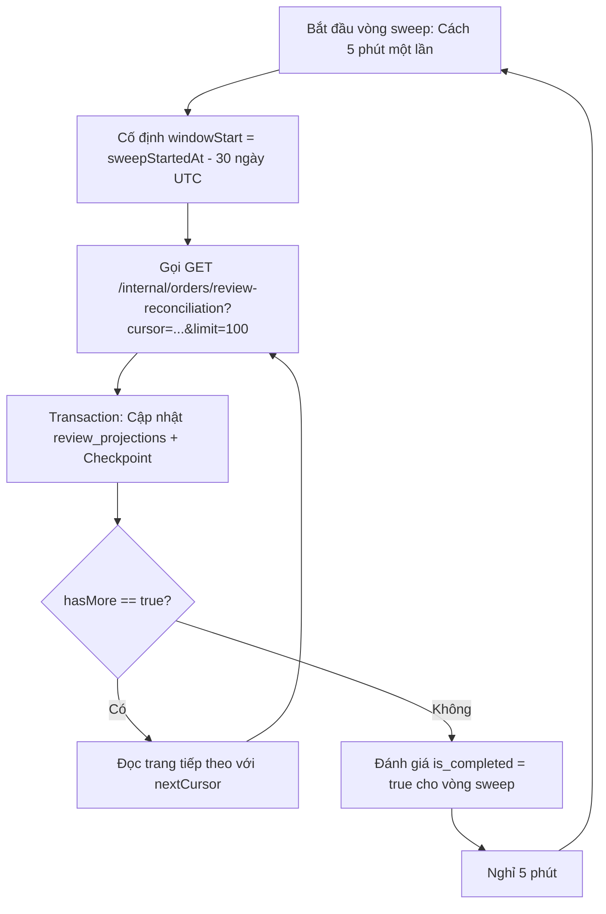

# Hợp đồng Tích hợp Sự kiện và Đối soát (Event-Driven & Reconciliation Contract v1)

Tài liệu này quy định cấu trúc vỏ bản tin (Kafka Envelope v1), nội dung sự kiện (`RentalItemCompleted`), cơ chế chống trùng lặp (Inbox Pattern), quy trình bổ sung dữ liệu (Hydration) và giao thức đối soát định kỳ toàn cửa sổ (Periodic Full-Window Sweep Reconciliation).

---

## 1. Cấu hình Kafka Topic và Consumer Group

1. **Topic nhận sự kiện:** `rental.events.v1` `[confirmed-by-source: RentalService/src/Application/Kafka/Contracts/KafkaContractSpec.cs]`.
   - Đây là topic phát các sự kiện vòng đời đơn thuê từ Transactional Outbox của RentalService.
2. **Consumer Group riêng biệt của ReviewService:** `review-service-rental-events` `[design-decision]`.
   - Hoàn toàn độc lập với các consumer group khác (như `payment-service`, `inventory-service`, `analytics-service`).
   - Việc commit offset của ReviewService không ảnh hưởng đến tiến trình đọc của các service khác.
3. **Topic Dead-Letter Queue (DLQ):** `rental.events.review.dlq` `[design-decision]`.
   - Quyết định thiết kế mới phục vụ ReviewService để cô lập các bản tin độc (poison messages) sau khi đã retry tối đa.

---

## 2. Đặc tả Vỏ bản tin Kafka v1 (`KafkaMessageEnvelope`)

ReviewService tuân thủ cấu trúc envelope v1 chuẩn đã được triển khai tại RentalService (`[confirmed-by-source: RentalService/src/Application/Kafka/Contracts/KafkaMessageEnvelope.cs]`):

### 2.1 Cấu trúc Envelope JSON Thực tế (Khi `organizationId` là null)

Do `KafkaMessageEnvelope` cấu hình `[property: JsonIgnore(Condition = JsonIgnoreCondition.WhenWritingNull)] Guid? OrganizationId = null`, khi giá trị là `null`, trường `organizationId` **hoàn toàn không xuất hiện** trong chuỗi JSON được serialize từ RentalService:

```json
{
  "messageId": "7f8b9c0d-1e2f-4a3b-8c5d-6e7f8a9b0c1d",
  "messageType": "RentalItemCompleted",
  "version": 1,
  "producer": "RentalService",
  "aggregateId": "4a713833-2882-4df3-a185-1bf035fe85d1",
  "occurredAt": "2026-10-15T10:00:00.000Z",
  "correlationId": "corr-8f12a34b-9c78-43de",
  "causationId": "3b2a1c0d-9e8f-7a6b-5c4d-3e2f1a0b9c8d",
  "payload": {
    "userId": "11111111-1111-1111-1111-111111111111",
    "equipmentListingId": "33333333-3333-3333-3333-333333333333",
    "equipmentTypeId": "55555555-5555-5555-5555-555555555555",
    "rentalOrderId": "4a713833-2882-4df3-a185-1bf035fe85d1",
    "rentalItemId": "b8f0474c-4da6-466d-a2dc-bf61dd3147f7",
    "orderVersion": 5,
    "completedAt": "2026-10-15T10:00:00.000Z"
  }
}
```

### 2.2 Ý nghĩa các trường Envelope

| Trường | Kiểu dữ liệu | Bắt buộc | Mô tả |
| :--- | :--- | :--- | :--- |
| `messageId` | `UUID` | Có | Định danh duy nhất toàn cục của bản tin, dùng để chống xử lý trùng (Inbox key). |
| `messageType` | `string` | Có | Tên sự kiện nghiệp vụ (`RentalItemCompleted`). |
| `version` | `int` | Có | Phiên bản của vỏ bản tin (`1`). Khác với `orderVersion`. |
| `producer` | `string` | Có | Dịch vụ phát hành bản tin (`RentalService`). |
| `aggregateId`| `string` | Có | Mã định danh của aggregate gốc (`RentalOrderId`). |
| `occurredAt` | `ISO 8601 UTC` | Có | Thời điểm sự kiện phát sinh tại source. |
| `correlationId` | `string` | Không | Mã định danh chuỗi giao dịch liên dịch vụ. |
| `causationId` | `UUID` | Không | `messageId` của sự kiện trực tiếp dẫn tới sự kiện này. |
| `organizationId` | `UUID` | Tùy chọn | Tổ chức liên quan; tự động bị loại bỏ khỏi JSON nếu `null`. |
| `payload` | `Object` | Có | Dữ liệu nghiệp vụ chi tiết của sự kiện. |

---

## 3. Cơ chế Khử trùng lặp và Bổ sung Dữ liệu (Inbox & Hydration Pattern)

Do Kafka hoạt động theo cơ chế *at-least-once delivery*, ReviewService áp dụng quy trình xử lý an toàn:



### 3.1 Bảng lưu trữ `inbox_messages`

- **Khóa chính:** `(message_id, consumer_group)`.
- **Thứ tự thực thi bắt buộc:**
  1. Kiểm tra tồn tại `message_id` trong `inbox_messages`.
  2. Thực hiện cuộc gọi HTTP sang RentalService để hydrate `supplierId`. **Tuyệt đối không giữ DB transaction mở trong lúc gọi mạng.**
  3. Mở DB Transaction: Ghi dữ liệu vào `review_projections` và lưu `inbox_messages`.
  4. Commit DB Transaction.
  5. Chỉ sau khi DB Transaction commit thành công mới commit Kafka offset về broker.

### 3.2 Quy trình Bổ sung Dữ liệu (Hydration) và Xử lý Lệch Dữ liệu

1. **Lỗ hổng của Payload gốc:** `RentalItemCompletedPayload` thiếu trường `supplierId`.
2. **Bảng `review_projections`:** Cho phép `completed_at` và `deadline_at` nhận giá trị `nullable`.
   - Nếu chưa hoàn tất hydration: `is_eligible = false`.
   - Nếu thiếu timestamp hợp lệ: `is_eligible = false`.
   - **Quy tắc hiển thị:** Chỉ các mục có `is_eligible = true` và `deadline_at > now` mới xuất hiện trên API `GET /api/v1/reviews/pending`.
3. **Cập nhật mốc thời gian:**
   - Cho phép cập nhật chuyển từ `completed_at: null` sang timestamp khi nhận được bằng chứng authoritative từ RentalService.
   - Nếu timestamp đã được xác minh trước đó mà có sự kiện gửi giá trị khác $\rightarrow$ Ghi nhận lỗi lệch dữ liệu (Mismatch Log), **tuyệt đối không âm thầm ghi đè timestamp đã chốt**.

---

## 4. Xử lý Thử lại Hữu hạn và Dead-Letter Queue (DLQ)

ReviewService không nuốt lỗi và không retry vô hạn:

1. **Chính sách Retry:** Tối đa **3 lần** sau lần thử đầu tiên, áp dụng Exponential Backoff có Jitter ngẫu nhiên (Lần 1: 1s, Lần 2: 2s, Lần 3: 4s).
2. **Quy tắc đẩy DLQ:**
   - Khi vượt quá 3 lần retry hoặc phát hiện bản tin sai định dạng nghiêm trọng: Consumer đóng gói vào `DeadLetterPayload` và publish tới `rental.events.review.dlq`.
   - **Bảo đảm an toàn giao vận:** Consumer **chỉ commit offset của topic chính sau khi đã nhận được ACK xác nhận lưu trữ từ broker của topic DLQ**.
   - Replay từ DLQ bảo toàn nguyên vẹn `messageId` và `completedAt` nghiệp vụ ban đầu.

---

## 5. Tính Độc lập Mục thuê và Thứ tự Sự kiện (`orderVersion` Invariance)

1. **`orderVersion` thuộc cấp Đơn hàng, không đại diện cho Mục thuê:**
   - Trong đơn hàng nhiều món (Multi-item Order), mỗi mục thuê có vòng đời và thời điểm hoàn tất riêng.
   - Sự kiện hoàn tất của Mục B với `orderVersion` cao hơn **tuyệt đối không được dùng làm watermark để loại bỏ sự kiện hoàn tất của Mục A**.
2. **Khử trùng lặp đa tầng:**
   - Dedup tầng 1: Bằng `messageId` qua bảng `inbox_messages`.
   - Dedup tầng 2: Bằng `itemId` qua ràng buộc duy nhất trong bảng `review_projections` (`uq_projections_item_id`).

---

## 6. Giao thức Đối soát Toàn Cửa sổ Định kỳ (Periodic Full-Window Sweep Reconciliation)

ReviewService áp dụng cơ chế **Full-Window Sweep** để đảm bảo không bỏ sót bất kỳ mục thuê nào hoàn tất muộn (backdated persistence) mà vẫn còn hạn đánh giá:



### 6.1 Endpoint Đối soát tại RentalService (`GET /internal/orders/review-reconciliation`)

- **Phương thức:** `GET`
- **Đường dẫn:** `/internal/orders/review-reconciliation`
- **Xác thực:** `X-Api-Key` (API-key-only policy, không cần Bearer JWT).
- **Query Parameters:**
  - `cursor`: Chuỗi con trỏ opaque (mã hóa `windowStart` và `lastItemId` cho keyset pagination; rỗng ở trang đầu).
  - `limit`: Số bản ghi mỗi trang (mặc định `100`, tối đa `500`).
- **Response Body (`ReviewReconciliationBatchResponse`):**
  ```json
  {
    "items": [
      {
        "orderId": "4a713833-2882-4df3-a185-1bf035fe85d1",
        "itemId": "b8f0474c-4da6-466d-a2dc-bf61dd3147f7",
        "renterId": "11111111-1111-1111-1111-111111111111",
        "supplierId": "22222222-2222-2222-2222-222222222222",
        "equipmentListingId": "33333333-3333-3333-3333-333333333333",
        "status": "Completed",
        "completedAt": "2026-10-15T10:00:00.000Z",
        "orderVersion": 5
      }
    ],
    "nextCursor": "eyJXaW5kb3dTdGFydCI6IjIwMjYtMTAtMDJUMDg6MzA6MDBaIiwiTGFzdEl0ZW1JZCI6ImI4ZjA0NzRjLTRkYTYtNDY2ZC1hMmRjLWJmNjFkZDMxNDdmNyJ9",
    "hasMore": true
  }
  ```

### 6.2 Chu kỳ và Quy tắc Vận hành Full-Window Sweep

1. **Chu kỳ quét:** Vòng quét mới chạy sau **5 phút** kể từ khi vòng trước kết thúc thành công `[design-decision]`.
2. **Cửa sổ thời gian:** Mỗi vòng cố định `windowStart = sweepStartedAt - 30 ngày (UTC)`. Quét lại toàn bộ cửa sổ 30 ngày từ đầu.
3. **Phân trang Keyset & Transaction:**
   - Mỗi trang kết quả được cập nhật vào `review_projections` và lưu checkpoint trang vào bảng `reconciliation_checkpoints` trong **cùng một Transaction**.
   - Nếu hệ thống khởi động lại giữa chừng: Tiến trình sweep đọc checkpoint và tiếp tục trang dang dở một cách an toàn.
4. **Kết thúc vòng:** Trang cuối cùng (`hasMore == false`) đánh dấu hoàn thành vòng sweep. **Không lưu cursor cuối cùng làm watermark vĩnh viễn**; vòng quét sau 5 phút sẽ bắt đầu một cửa sổ 30 ngày mới.
5. **Khôi phục Lịch sử:** Nếu RentalService khôi phục được timestamp hợp lệ cho các đơn hàng cũ, vòng quét tiếp theo của ReviewService sẽ tự động cập nhật vào `review_projections`. Các giao dịch đã quá hạn 30 ngày sẽ không được gia hạn thêm thời gian.
