# Hợp đồng Hiển thị, Quyền riêng tư và Kiểm duyệt (Visibility & Moderation Contract v1)

Tài liệu này quy định ma trận hiển thị (Visibility Matrix) cho 4 tổ hợp trạng thái hai trục (`authorState` $\times$ `moderationState`), chính sách bảo vệ quyền riêng tư của Người thuê (Renter Privacy Policy), vòng đời đánh giá (Review Lifecycle), quy trình kiểm duyệt (Moderation) và cơ chế tính toán điểm tổng hợp (Rating Summary).

---

## 1. Mô hình Vòng đời Hai Trục (Two-Axis State Model)

Thay vì dùng một enum duy nhất gây xung đột quyền giữa tác giả và quản trị viên, ReviewService phân tách vòng đời thành hai trục độc lập `[design-decision]`:

1. **Trục Tác giả (`authorState`):** `Active` | `Withdrawn`
   - Do chính tác giả sở hữu và điều khiển.
   - `Active`: Tác giả duy trì đánh giá.
   - `Withdrawn`: Tác giả chủ động rút đánh giá (soft-delete). Khóa vĩnh viễn cặp `(itemId, direction)`, không thể tạo lại.
2. **Trục Kiểm duyệt (`moderationState`):** `Visible` | `Hidden`
   - Do Quản trị viên (`Admin`) sở hữu và điều khiển.
   - `Visible`: Đánh giá đạt tiêu chuẩn cộng đồng, được phép hiển thị nếu tác giả `Active`.
   - `Hidden`: Đánh giá bị Quản trị viên ẩn do vi phạm nội dung hoặc đang chờ xem xét.

---

## 2. Ma trận Phân quyền Hiển thị cho 4 Tổ hợp Trạng thái (Visibility Matrix)

| Hướng đánh giá | `authorState` | `moderationState` | Khách vãng lai (Public) | Tác giả (Author) | Đối tượng nhận (Subject) | Người dùng khác | Quản trị viên (Admin) | Xuất hiện trên Listing/Supplier | Tính vào Rating Summary |
| :--- | :--- | :--- | :---: | :---: | :---: | :---: | :---: | :---: | :---: |
| **`renter_to_supplier_listing`** | **`Active`** | **`Visible`** | **CÓ** | **CÓ** | **CÓ** | **CÓ** | **CÓ** | **CÓ** | **CÓ** |
| `renter_to_supplier_listing` | `Active` | `Hidden` | KHÔNG | CÓ *(báo bị ẩn)* | KHÔNG | KHÔNG | CÓ *(kèm lý do)* | KHÔNG | KHÔNG |
| `renter_to_supplier_listing` | `Withdrawn` | `Visible` | KHÔNG | CÓ *(báo đã rút)* | KHÔNG | KHÔNG | CÓ | KHÔNG | KHÔNG |
| `renter_to_supplier_listing` | `Withdrawn` | `Hidden` | KHÔNG | CÓ *(báo đã rút)* | KHÔNG | KHÔNG | CÓ *(kèm lý do)* | KHÔNG | KHÔNG |
| **`supplier_to_renter`** | **`Active`** | **`Visible`** | **KHÔNG** | **CÓ** | **CÓ** | **KHÔNG** | **CÓ** | **KHÔNG** | **KHÔNG** |
| `supplier_to_renter` | `Active` | `Hidden` | KHÔNG | CÓ *(báo bị ẩn)* | KHÔNG | KHÔNG | CÓ *(kèm lý do)* | KHÔNG | KHÔNG |
| `supplier_to_renter` | `Withdrawn` | `Visible` | KHÔNG | CÓ *(báo đã rút)* | KHÔNG | KHÔNG | CÓ | KHÔNG | KHÔNG |
| `supplier_to_renter` | `Withdrawn` | `Hidden` | KHÔNG | CÓ *(báo đã rút)* | KHÔNG | KHÔNG | CÓ *(kèm lý do)* | KHÔNG | KHÔNG |

### 2.1 Quy tắc Tương tác giữa Hai Trục

1. **Tác giả sửa Review bị Hidden:**
   - Nếu review có `authorState == 'Active'` và `moderationState == 'Hidden'`, tác giả **vẫn được quyền chỉnh sửa nội dung (`PUT`)** nếu còn trong thời hạn chỉnh sửa (`now < canEditUntil`).
   - **Bảo toàn trạng thái kiểm duyệt:** Thao tác sửa của tác giả **tuyệt đối không tự động khôi phục `moderationState`** (vẫn giữ nguyên `Hidden`). Review cần được Admin kiểm tra và khôi phục độc lập.
2. **Tác giả rút Review bị Hidden:**
   - Tác giả có toàn quyền rút đánh giá (`POST .../withdraw`) ngay cả khi review đó đang bị Admin ẩn (`Hidden`). Sau thao tác này, review chuyển sang tổ hợp `Withdrawn` + `Hidden`.
3. **Admin Khôi phục Review đã bị Withdrawn:**
   - Nếu Admin thực hiện `POST .../restore` trên một review có `authorState == 'Withdrawn'`, thao tác này chỉ thay đổi `moderationState` từ `Hidden` sang `Visible`.
   - Vì `authorState` vẫn là `Withdrawn`, review **tuyệt đối không xuất hiện trở lại** trên public listings, supplier reviews hay bảng tính điểm summary! Quyền rút của tác giả được tôn trọng tối thượng.

---

## 3. Chính sách Bảo vệ Quyền riêng tư của Người thuê (Renter Privacy Protection)

Theo phê duyệt của stakeholder `[stakeholder-approved]`:

1. **Đánh giá chiều `supplier_to_renter` là thông tin RIÊNG TƯ (Private):**
   - Đánh giá của Nhà cung cấp về Người thuê (về ý thức bảo quản thiết bị, giao tiếp, hoàn trả) chỉ phục vụ kiểm soát nội bộ.
   - **Chỉ có 3 chủ thể được phép đọc:**
     1. Chính Nhà cung cấp viết đánh giá đó (`Author`).
     2. Người thuê nhận đánh giá (`Subject`).
     3. Quản trị viên có role Admin (`Admin`).
   - Người dùng chưa đăng nhập gọi API nhận `401 Unauthorized`.
   - Người dùng đã xác thực nhưng không thuộc 3 chủ thể trên sẽ nhận `404 Not Found` (tuyệt đối không trả `403 Forbidden` để không để lộ sự tồn tại của review).
2. **Endpoint Chi tiết Riêng tư (`GET /api/v1/reviews/{reviewId}`):**
   - Được bổ sung để cho phép `Subject` và `Admin` (cũng như `Author`) đọc đầy đủ thông tin review riêng tư và lấy giá trị Strong ETag (`version`) phục vụ kiểm duyệt hoặc đối soát `[design-decision]`.
3. **Tuyệt đối KHÔNG công khai Điểm số Người thuê (No Public Renter Score):**
   - Không tồn tại endpoint công khai để xem điểm trung bình, xếp hạng tín nhiệm hay danh sách review về Người thuê.
4. **Bảo mật Ghi chú Kiểm duyệt (No Moderation Notes Leak):**
   - Lý do ẩn đánh giá (`adminReason`) và danh tính Moderator chỉ hiển thị cho Quản trị viên.

---

## 4. Vòng đời Trạng thái Đánh giá (Review Lifecycle Diagram)

```mermaid
stateDiagram-v2
    [*] --> Active_Visible: CreateReview (author=Active, mod=Visible, v=1)

    state Active_Visible {
        direction LR
        PublicDisplay: Hiển thị công khai & Tính Summary
    }

    Active_Visible --> Active_Visible: UpdateReview (v=v+1, trong hạn 7d/30d)
    Active_Visible --> Withdrawn_Visible: WithdrawReview (author=Withdrawn, v=v+1)
    Active_Visible --> Active_Hidden: AdminHide (mod=Hidden, v=v+1)

    state Active_Hidden {
        direction LR
        HiddenByAdmin: Ẩn khỏi Public; Tác giả vẫn được sửa hoặc rút
    }

    Active_Hidden --> Active_Hidden: UpdateReview (v=v+1, mod vẫn giữ Hidden)
    Active_Hidden --> Withdrawn_Hidden: WithdrawReview (author=Withdrawn, v=v+1)
    Active_Hidden --> Active_Visible: AdminRestore (mod=Visible, v=v+1)

    state Withdrawn_Visible {
        direction LR
        WithdrawnByAuthor: Ẩn vĩnh viễn khỏi Public & Summary
    }

    Withdrawn_Visible --> Withdrawn_Hidden: AdminHide (mod=Hidden, v=v+1)

    state Withdrawn_Hidden {
        direction LR
        WithdrawnAndHidden: Vừa bị tác giả rút, vừa bị Admin ẩn
    }

    Withdrawn_Hidden --> Withdrawn_Visible: AdminRestore (mod=Visible, KHÔNG phục hồi Public)
```

---

## 5. Quy trình Báo cáo Vi phạm và Kiểm duyệt (Reporting & Moderation)

1. **Báo cáo vi phạm từ người dùng (`POST /api/v1/reviews/{reviewId}/reports`):**
   - Người dùng đăng nhập có quyền báo cáo vi phạm nội dung.
   - **Quy tắc chống thao túng (Anti-Brigading):** Việc người dùng gửi báo cáo **tuyệt đối KHÔNG tự động ẩn review**.
   - Báo cáo được lưu vào bảng `review_reports` với trạng thái `PendingReview` để chờ Admin xử lý.
2. **Kiểm duyệt bởi Quản trị viên:**
   - Admin kiểm tra báo cáo và nội dung review.
   - Nếu vi phạm: Gọi `POST /api/v1/reviews/admin/{reviewId}/hide` kèm `If-Match: "<version>"` $\rightarrow$ Đổi `moderationState = 'Hidden'`, tăng `version = version + 1`, ghi audit log.
   - Nếu không vi phạm: Đóng báo cáo với trạng thái `ReviewedDismissed`.

---

## 6. Quy tắc Tính toán Điểm Tổng hợp (Authoritative Rating Summary)

Điểm tổng hợp được tính toán **trực tiếp từ các review đủ điều kiện hiển thị** trong cơ sở dữ liệu `[design-decision]`:

### 6.1 Điều kiện Lọc dữ liệu Khắt khe

$$\text{ReviewHopLe} \iff \text{targetId} == \text{@TargetId} \quad \land \quad \text{direction} == \text{'renter\_to\_supplier\_listing'} \quad \land \quad \mathbf{author\_state == 'Active'} \quad \land \quad \mathbf{moderation\_state == 'Visible'}$$

### 6.2 Công thức Tính toán

1. **Tổng số đánh giá (`reviewCount`):**
   $$\text{reviewCount} = \sum 1 \quad (\text{với các review thỏa mãn})$$
2. **Điểm trung bình (`averageRating`):**
   - Nếu $\text{reviewCount} == 0$:
     $$\text{averageRating} = \mathbf{null}$$
     *(Tuyệt đối không trả về 0.0 để tránh gây hiểu lầm là đánh giá 0 sao).*
   - Nếu $\text{reviewCount} > 0$:
     $$\text{averageRating} = \text{Round}\left(\frac{\sum \text{rating}}{\text{reviewCount}}, \; 1\right)$$
3. **Phân bổ sao (`ratingDistribution`):** Đếm riêng số lượng đánh giá cho từng mức sao từ 1 đến 5.
4. **Không sử dụng bảng cộng dồn (No Counter Table):** Truy vấn trực tiếp từ bảng `reviews` có chỉ mục tối ưu, cho phép Rebuild tức thời và không bị rủi ro drift số liệu.
