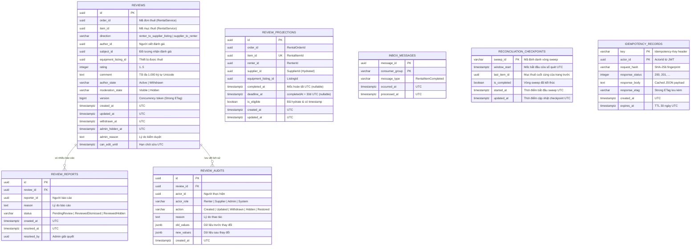

# Mô hình Dữ liệu và Thiết kế ERD (Entity-Relationship Diagram & Database Schema)

Tài liệu này đặc tả thiết kế cơ sở dữ liệu PostgreSQL cho `ReviewService`, bao gồm sơ đồ thực thể liên kết (ERD), định nghĩa bảng (DDL), ràng buộc toàn vẹn (Constraints), chỉ mục tối ưu truy vấn (Indexes) và cơ chế khóa phiên bản (Concurrency Token với Strong ETag).

---

## 1. Sơ đồ Thực thể Liên kết (Mermaid ERD)



---

## 2. Nguyên tắc Ranh giới Cơ sở Dữ liệu (Database Boundary Invariants)

1. **Tuyệt đối KHÔNG có Khóa ngoại Liên dịch vụ (No Cross-Database Foreign Keys):**
   - Các trường `order_id`, `item_id`, `author_id`, `subject_id`, `equipment_listing_id` chỉ lưu trữ dưới dạng giá trị `UUID` độc lập `[confirmed-by-source: Microservice Boundary Rule]`.
   - Không tạo ràng buộc `FOREIGN KEY` sang cơ sở dữ liệu của `RentalService`, `AuthService` hay `CatalogService`.
2. **Khóa ngoại Nội bộ Đầy đủ (Strict Internal Referential Integrity):**
   - Bảng `review_reports` và `review_audits` có ràng buộc khóa ngoại `FOREIGN KEY (review_id) REFERENCES reviews(id) ON DELETE RESTRICT`.
3. **Bảo toàn Tính duy nhất (Strict Uniqueness Invariant):**
   - Ràng buộc `UNIQUE (item_id, direction)` trên bảng `reviews` có hiệu lực trên **toàn bộ các dòng**, bao gồm cả các dòng có `author_state = 'Withdrawn'` `[design-decision]`.
   - Điều này đảm bảo mỗi bên chỉ có thể đánh giá một lần duy nhất cho mỗi mục thuê; việc rút đánh giá không cho phép người dùng tạo lại đánh giá khác để thao túng điểm số.
4. **Loại bỏ Cờ Phản ánh Trạng thái Khép kín trên Projection:**
   - Bảng `review_projections` **không lưu trữ** các cờ `has_renter_reviewed` hay `has_supplier_reviewed` để tránh rủi ro phân rã thành hai nguồn sự thật (split-brain state).
   - Truy vấn danh sách chờ đánh giá (`Pending Reviews`) thực hiện phép kiểm tra tồn tại qua `NOT EXISTS` sang bảng `reviews` (kể cả review đã rút).

---

## 3. Mã nguồn Định nghĩa Bảng PostgreSQL (SQL DDL Specification)

```sql
-- Kích hoạt extension hỗ trợ UUID nếu chưa có
CREATE EXTENSION IF NOT EXISTS "pgcrypto";

-- ============================================================================
-- 1. BẢNG REVIEWS: Bảng chính lưu trữ thông tin đánh giá
-- ============================================================================
CREATE TABLE reviews (
    id UUID PRIMARY KEY DEFAULT gen_random_uuid(),
    order_id UUID NOT NULL,
    item_id UUID NOT NULL,
    direction VARCHAR(32) NOT NULL,
    author_id UUID NOT NULL,
    subject_id UUID NOT NULL,
    equipment_listing_id UUID NOT NULL,
    rating INTEGER NOT NULL,
    comment TEXT NULL,
    author_state VARCHAR(32) NOT NULL DEFAULT 'Active',
    moderation_state VARCHAR(32) NOT NULL DEFAULT 'Visible',
    version BIGINT NOT NULL DEFAULT 1,
    created_at TIMESTAMPTZ NOT NULL DEFAULT CURRENT_TIMESTAMP,
    updated_at TIMESTAMPTZ NULL,
    withdrawn_at TIMESTAMPTZ NULL,
    admin_hidden_at TIMESTAMPTZ NULL,
    admin_reason TEXT NULL,
    can_edit_until TIMESTAMPTZ NOT NULL,

    -- Ràng buộc hướng đánh giá
    CONSTRAINT chk_reviews_direction CHECK (
        direction IN ('renter_to_supplier_listing', 'supplier_to_renter')
    ),

    -- Ràng buộc thang điểm đánh giá từ 1 đến 5 sao
    CONSTRAINT chk_reviews_rating CHECK (
        rating >= 1 AND rating <= 5
    ),

    -- Ràng buộc trục trạng thái tác giả
    CONSTRAINT chk_reviews_author_state CHECK (
        author_state IN ('Active', 'Withdrawn')
    ),

    -- Ràng buộc trục trạng thái kiểm duyệt
    CONSTRAINT chk_reviews_moderation_state CHECK (
        moderation_state IN ('Visible', 'Hidden')
    ),

    -- Ràng buộc duy nhất: Mỗi mục thuê chỉ có duy nhất 1 review cho mỗi chiều
    CONSTRAINT uq_reviews_item_direction UNIQUE (item_id, direction)
);

-- Chỉ mục hỗ trợ xem đánh giá của thiết bị (Listing Reviews) & tính điểm tổng hợp
CREATE INDEX idx_reviews_listing_active_visible
ON reviews (equipment_listing_id, created_at DESC)
WHERE direction = 'renter_to_supplier_listing' AND author_state = 'Active' AND moderation_state = 'Visible';

-- Chỉ mục hỗ trợ xem đánh giá của nhà cung cấp (Supplier Reviews) & tính điểm tổng hợp
CREATE INDEX idx_reviews_supplier_active_visible
ON reviews (subject_id, created_at DESC)
WHERE direction = 'renter_to_supplier_listing' AND author_state = 'Active' AND moderation_state = 'Visible';

-- Chỉ mục hỗ trợ tìm kiếm đánh giá do người dùng viết (My Reviews)
CREATE INDEX idx_reviews_author
ON reviews (author_id, created_at DESC);

-- Chỉ mục hỗ trợ tìm kiếm đánh giá nhắm đến người thuê (chỉ author, subject và admin xem)
CREATE INDEX idx_reviews_subject_private
ON reviews (subject_id, created_at DESC)
WHERE direction = 'supplier_to_renter';


-- ============================================================================
-- 2. BẢNG REVIEW_REPORTS: Báo cáo vi phạm từ cộng đồng
-- ============================================================================
CREATE TABLE review_reports (
    id UUID PRIMARY KEY DEFAULT gen_random_uuid(),
    review_id UUID NOT NULL,
    reporter_id UUID NOT NULL,
    reason TEXT NOT NULL,
    status VARCHAR(32) NOT NULL DEFAULT 'PendingReview',
    created_at TIMESTAMPTZ NOT NULL DEFAULT CURRENT_TIMESTAMP,
    resolved_at TIMESTAMPTZ NULL,
    resolved_by UUID NULL,

    CONSTRAINT fk_reports_review FOREIGN KEY (review_id)
        REFERENCES reviews(id) ON DELETE RESTRICT,

    CONSTRAINT chk_reports_status CHECK (
        status IN ('PendingReview', 'ReviewedDismissed', 'ReviewedHidden')
    )
);

CREATE INDEX idx_reports_review_id ON review_reports (review_id);
CREATE INDEX idx_reports_pending ON review_reports (created_at) WHERE status = 'PendingReview';


-- ============================================================================
-- 3. BẢNG REVIEW_AUDITS: Nhật ký kiểm toán mọi thay đổi
-- ============================================================================
CREATE TABLE review_audits (
    id UUID PRIMARY KEY DEFAULT gen_random_uuid(),
    review_id UUID NOT NULL,
    actor_id UUID NOT NULL,
    actor_role VARCHAR(32) NOT NULL,
    action VARCHAR(32) NOT NULL,
    reason TEXT NULL,
    old_values JSONB NULL,
    new_values JSONB NULL,
    created_at TIMESTAMPTZ NOT NULL DEFAULT CURRENT_TIMESTAMP,

    CONSTRAINT fk_audits_review FOREIGN KEY (review_id)
        REFERENCES reviews(id) ON DELETE RESTRICT,

    CONSTRAINT chk_audits_action CHECK (
        action IN ('Created', 'Updated', 'Withdrawn', 'Reported', 'AdminHidden', 'AdminRestored')
    )
);

CREATE INDEX idx_audits_review_id ON review_audits (review_id, created_at DESC);
CREATE INDEX idx_audits_actor_id ON review_audits (actor_id, created_at DESC);


-- ============================================================================
-- 4. BẢNG REVIEW_PROJECTIONS: Bảng chiếu cục bộ phục vụ danh sách chờ đánh giá
-- ============================================================================
CREATE TABLE review_projections (
    id UUID PRIMARY KEY DEFAULT gen_random_uuid(),
    order_id UUID NOT NULL,
    item_id UUID NOT NULL,
    renter_id UUID NOT NULL,
    supplier_id UUID NULL, -- Được điền sau khi hoàn tất hydration từ RentalService
    equipment_listing_id UUID NOT NULL,
    completed_at TIMESTAMPTZ NULL, -- Nullable khi chưa xác minh timestamp
    deadline_at TIMESTAMPTZ NULL, -- Nullable khi completed_at null
    is_eligible BOOLEAN NOT NULL DEFAULT FALSE,
    created_at TIMESTAMPTZ NOT NULL DEFAULT CURRENT_TIMESTAMP,
    updated_at TIMESTAMPTZ NOT NULL DEFAULT CURRENT_TIMESTAMP,

    CONSTRAINT uq_projections_item_id UNIQUE (item_id)
);

-- Chỉ mục phục vụ truy vấn danh sách chờ đánh giá của Người thuê (Pending Reviews)
CREATE INDEX idx_projections_renter_pending
ON review_projections (renter_id, deadline_at)
WHERE is_eligible = TRUE;

-- Chỉ mục phục vụ truy vấn danh sách chờ đánh giá của Nhà cung cấp (Pending Reviews)
CREATE INDEX idx_projections_supplier_pending
ON review_projections (supplier_id, deadline_at)
WHERE is_eligible = TRUE;


-- ============================================================================
-- 5. BẢNG INBOX_MESSAGES: Chống trùng lặp xử lý sự kiện Kafka
-- ============================================================================
CREATE TABLE inbox_messages (
    message_id UUID NOT NULL,
    consumer_group VARCHAR(128) NOT NULL,
    message_type VARCHAR(64) NOT NULL,
    occurred_at TIMESTAMPTZ NOT NULL,
    processed_at TIMESTAMPTZ NOT NULL DEFAULT CURRENT_TIMESTAMP,

    CONSTRAINT pk_inbox_messages PRIMARY KEY (message_id, consumer_group)
);


-- ============================================================================
-- 6. BẢNG RECONCILIATION_CHECKPOINTS: Lưu trữ con trỏ đối soát theo vòng sweep
-- ============================================================================
CREATE TABLE reconciliation_checkpoints (
    sweep_id VARCHAR(64) PRIMARY KEY,
    window_start TIMESTAMPTZ NOT NULL,
    last_item_id UUID NULL,
    is_completed BOOLEAN NOT NULL DEFAULT FALSE,
    started_at TIMESTAMPTZ NOT NULL DEFAULT CURRENT_TIMESTAMP,
    updated_at TIMESTAMPTZ NOT NULL DEFAULT CURRENT_TIMESTAMP
);


-- ============================================================================
-- 7. BẢNG IDEMPOTENCY_RECORDS: Chống trùng lặp API Requests
-- ============================================================================
CREATE TABLE idempotency_records (
    key VARCHAR(128) NOT NULL,
    actor_id UUID NOT NULL,
    request_hash VARCHAR(64) NOT NULL,
    response_status INTEGER NOT NULL,
    response_body TEXT NOT NULL,
    response_etag VARCHAR(64) NOT NULL,
    created_at TIMESTAMPTZ NOT NULL DEFAULT CURRENT_TIMESTAMP,
    expires_at TIMESTAMPTZ NOT NULL,

    CONSTRAINT pk_idempotency_records PRIMARY KEY (key, actor_id)
);

CREATE INDEX idx_idempotency_expires ON idempotency_records (expires_at);
```

---

## 4. Quản lý Khóa Lạc quan bằng Concurrency Token `version` (Strong ETag)

1. **Cột `version BIGINT` (Application-managed Concurrency Token):**
   - Không sử dụng `xmin` `[design-decision]`.
   - Thuộc tính `version` được cấu hình làm concurrency token trong EF Core:
     ```csharp
     builder.Entity<Review>()
         .Property(r => r.Version)
         .IsConcurrencyToken();
     ```
   - **Quy tắc tăng phiên bản:** Application tăng giá trị phiên bản một cách tường minh trong mã nghiệp vụ (`review.Version = review.Version + 1`) trước khi lưu. Hàm `.IsConcurrencyToken()` của EF Core có nhiệm vụ kiểm tra mệnh đề `WHERE version = @originalVersion` khi sinh câu lệnh SQL `UPDATE`, chứ **không tự động tăng giá trị**.
   - Nếu mệnh đề `UPDATE` không tác động dòng nào (0 rows affected), EF Core ném ra ngoại lệ `DbUpdateConcurrencyException`, Application bắt lại và trả về `412 Precondition Failed`.
2. **Khớp nối với Strong ETag:**
   - Khi phản hồi, API trả về header: `ETag: "{version}"` (ví dụ: `ETag: "1"`).
   - Khi client gửi request chỉnh sửa hoặc thay đổi trạng thái, client gửi kèm `If-Match: "{version}"`.
   - Nếu thiếu `If-Match` $\rightarrow$ Trả về `428 Precondition Required`.
   - Nếu `If-Match` không bằng chuỗi biểu diễn của `version` hiện tại $\rightarrow$ Trả về `412 Precondition Failed`.
