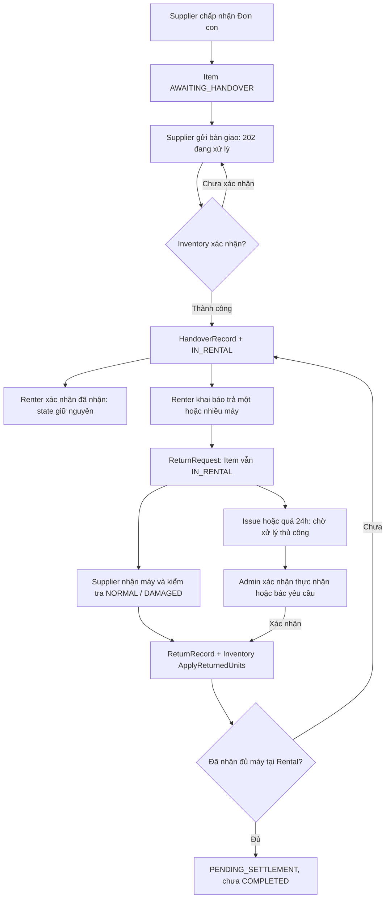

# FE Guide — Bàn giao, yêu cầu trả, thu hồi và bất đồng

Ngày đối chiếu: 28/10/2026. Đối tượng: FE Renter, Supplier và mock API.

## 1. Phạm vi và mức độ sẵn sàng

Tài liệu nối bốn task thành một luồng sản phẩm. **Có code trên branch không đồng nghĩa đã deploy lên môi trường FE đang gọi.**

| Phần | Nguồn đối chiếu | Cách FE sử dụng |
| --- | --- | --- |
| Task 1: handover, acknowledgement, cancel-not-delivered | Branch `rental/feat/direct-handover-completion`, commit `08aafa6b` | Contract đã có implementation; kiểm tra branch đã merge/deploy trước khi tích hợp |
| Task 2: tạo return request | Branch chính `rental/feat/handover-implementaion`, commit `82651ea5` | Có endpoint tạo request |
| Task 2: đọc Units/ReturnRequests, đóng request unit | Branch `rental/fix/partial-return-review`, commit `62705b27` | Có implementation bổ sung; cần deploy branch sửa để FE đọc dữ liệu này |
| Task 3: Supplier inspection và thu hồi | API `/returns` đã tồn tại; phần hoàn thiện theo kế hoạch đã chốt | Mock theo mục 7; DAMAGED bắt buộc mô tả + ảnh là yêu cầu sắp bổ sung |
| Task 4: report issue, deadline, Admin resolution | Kế hoạch, chưa phải contract đã triển khai | Các field/response gắn **DỰ KIẾN** chỉ dùng mock, cần đối chiếu Swagger khi BE bàn giao |

Task 1 và branch sửa Task 2 chưa nằm trong HEAD chính tại thời điểm viết. Không coi tài liệu này là bằng chứng các nhánh đã tích hợp với nhau.

Nguồn nghiệp vụ: [Project Guide](PROJECT_GUIDE.md). Realtime: [hướng dẫn SignalR](rental-realtime-client-integration.md). Chi tiết backend: [Returns](../RentalService/docs/RETURNS.md).

## 2. Khái niệm FE cần phân biệt

- **A = Supplier**, chủ thiết bị; **B = Renter**, người thuê.
- Order có nhiều SubOrder theo Supplier; mỗi SubOrder có nhiều RentalItem.
- RentalItem = một listing + số lượng + khoảng thuê. Ví dụ một item có 3 máy.
- RentalUnitAssignment = một máy được gán cho item. FE dùng AssignmentId khi thao tác từng máy.
- HandoverRecord = Supplier đã bàn giao và Inventory đã xác nhận.
- ReturnRequest = Renter khai báo đã trả. Chưa chứng minh Supplier đã nhận, chưa giải phóng máy.
- ReturnRecord = Supplier/Admin ghi nhận thực nhận và tình trạng. Inventory tiếp tục xử lý bất đồng bộ.
- `ClosedAt` của request unit = đã ghi nhận thu hồi tại Rental, **không** phải bằng chứng Inventory đã giải phóng máy.

Không suy ra trạng thái từng item từ trạng thái Order. Một item đã trả đủ trong khi item khác vẫn đang thuê là hợp lệ.



## 3. Quy ước HTTP, ID và mock

Base path public: **`/api/v1/rental`**. Các route bên dưới viết tương đối với base path.

- Gửi user authentication theo app hiện có; không đưa API key nội bộ lên browser.
- JSON camelCase; timestamp ISO 8601 có offset, ưu tiên UTC `Z`. Hiển thị theo `Asia/Ho_Chi_Minh`.
- Enum có kiểu enum thực tế serialize `UPPER_SNAKE_CASE`: `IN_RENTAL`, `PENDING_SETTLEMENT`, `NORMAL`, `RETURNED_DAMAGED`.
- Field kiểu string không tự đổi case: handover operation có thể là `Processing`, `Pending`, `Succeeded`; cancel response dùng `Cancelled`. Không dùng chung enum item cho operation status.
- Header `Idempotency-Key`: bắt buộc cho handover, cancel, return request, Supplier return; tối đa 64 ký tự. Task 4 dự kiến áp dụng tương tự cho report/resolve.
- Mỗi thao tác mới tạo một key. Retry do timeout/mất mạng giữ nguyên key và payload. Khi sửa payload, tạo key mới sau khi đã xác định kết quả operation cũ.
- Acknowledgement không yêu cầu key; server giữ thông tin xác nhận đầu tiên.

Các JSON trong tài liệu là **fragment phục vụ mock**, không phải đầy đủ response order. Khi mock GET thật, đặt item trong `subOrders[].items[]` của Renter hoặc `items[]` của Supplier detail.

Fixture cố định: một item 3 máy, mọi thời điểm đều <= mock clock `2026-10-28T10:00:00Z`:

| Alias | ID |
| --- | --- |
| itemId | `10000000-0000-4000-8000-000000000001` |
| u1 | `20000000-0000-4000-8000-000000000001` |
| u2 | `20000000-0000-4000-8000-000000000002` |
| u3 | `20000000-0000-4000-8000-000000000003` |
| requestId | `30000000-0000-4000-8000-000000000001` |
| mediaId | `40000000-0000-4000-8000-000000000001` |

Ảnh mock chỉ là reference. Khi dùng BE thật, phải upload qua MediaService trước, dùng ảnh Private/Ready do đúng actor tải lên. Tối đa 10 media/unit, không trùng hoặc GUID rỗng. Contract upload/preview thuộc MediaService, không tự dựng URL từ MediaId.

## 4. Màn hình và điều kiện thao tác

| Vai trò / nút | Điều kiện chính | Sau thao tác |
| --- | --- | --- |
| A — Bàn giao | Item của A, AWAITING_HANDOVER, đủ assignment, chưa có operation đang xử lý | Hiển thị chờ xác nhận, chưa báo thuê đã bắt đầu |
| B — Đã nhận thiết bị | Có HandoverRecord và chưa acknowledgement | Hiển thị thời điểm đã xác nhận; state giữ nguyên |
| B — Hủy vì chưa được giao | AWAITING_HANDOVER, tới mốc D+1 giờ VN | Có thể nhận 409 nếu bàn giao đang xử lý/đối soát |
| B — Khai báo đã trả | IN_RENTAL; chọn unit có canRequestReturn=true | Request hiện ở lịch sử; item vẫn đang thuê |
| A — Xác nhận nhận lại | Unit đã giao và chưa ghi nhận trả | Cho phép chọn một phần, nhập inspection từng máy |
| A/B — Báo vấn đề (Task 4) | Request còn unit actionable | Hiển thị Disputed, không tự đổi Item state |
| Admin — Xử lý thủ công (Task 4) | Có quyền Admin, chọn unit chưa xử lý | ConfirmReceived hoặc RejectRequest |

Đây là điều kiện UI; BE vẫn quyết định cuối cùng. Khi trả 409 do màn hình cũ, reload detail rồi giải thích nguyên nhân. Không ẩn lỗi bằng cách tự đổi state trên client.

### Hạn chưa bàn giao khác hạn xác nhận trả

- Task 1: từ 00:00 giờ VN ngày D+1, B có thể hủy vì chưa nhận máy. D là ExpectedStartDate. Auto-expire mặc định D+2 theo grace cấu hình.
- Bàn giao pending/processing/đối soát chặn hủy, kể cả đã quá hạn. Hiển thị “Đang đối soát bàn giao”.
- Task 4: hạn xác nhận trả dự kiến bằng ReturnRequest.SubmittedAt + 24 giờ. Không dùng ActualReturnAt do B tự khai để tính hạn.
- Hết hạn xác nhận trả chỉ cảnh báo/chuyển xử lý thủ công; không tự xác nhận hoặc trả tiền.

## 5. Task 1 — Bàn giao và xác nhận nhận

### A gửi bàn giao

`POST /items/{itemId}/handover` — `202 Accepted`.

```json
{
  "actualHandoverAt": "2026-10-27T08:00:00Z",
  "note": "Giao đủ 3 máy tại công trình",
  "confirmed": true,
  "units": [
    { "assignmentId": "20000000-0000-4000-8000-000000000001", "condition": "NORMAL", "note": null, "mediaIds": ["40000000-0000-4000-8000-000000000001"] },
    { "assignmentId": "20000000-0000-4000-8000-000000000002", "condition": "NORMAL", "note": null, "mediaIds": ["40000000-0000-4000-8000-000000000001"] },
    { "assignmentId": "20000000-0000-4000-8000-000000000003", "condition": "NORMAL", "note": null, "mediaIds": ["40000000-0000-4000-8000-000000000001"] }
  ]
}
```

Phải gửi đủ 3 assignment; mỗi máy có ảnh; thời điểm không được ở tương lai. ID lấy từ `units[].assignmentId` trong Supplier suborder detail. Mock dùng lại một ảnh chung; UI thực tế nên ghi bằng chứng rõ cho từng máy.

Response mới gửi:

```json
{ "handoverRecordId": null, "handoverAt": "2026-10-27T08:00:00Z", "status": "Processing" }
```

UI: “Đã gửi bàn giao — đang chờ hệ thống xác nhận”. Chặn submit mới. Inventory lỗi/chưa trả lời không được mock thành thành công ngay.

Sau Inventory xác nhận: GET detail có `status: "IN_RENTAL"` và `handover` khác null. Replay POST cùng key có thể trả `Succeeded` kèm HandoverRecordId. `handover` trong GET hiện không chứa record ID, nên nút B xác nhận dựa trên sự tồn tại object này, không đòi ID từ GET.

### B xác nhận nhận

`POST /items/{itemId}/acknowledge-receipt`, body `{"note":"Đã nhận đủ máy"}` — `200 OK`:

```json
{
  "itemId": "10000000-0000-4000-8000-000000000001",
  "handoverRecordId": "50000000-0000-4000-8000-000000000001",
  "receivedAt": "2026-10-27T08:15:00Z",
  "receivedBy": "60000000-0000-4000-8000-000000000001",
  "note": "Đã nhận đủ máy"
}
```

Replay giữ thời điểm/note đầu tiên. Không chuyển IN_RENTAL lần nữa. Không lấy acknowledgement làm điều kiện bắt buộc cho request return: điều kiện BE dựa trên handover đã xác nhận.

### B hủy chưa giao

`POST /items/{itemId}/cancel-not-delivered`, body `{"reason":"Chưa nhận được máy"}` — `202 Accepted`:

```json
{ "itemId": "10000000-0000-4000-8000-000000000001", "status": "Cancelled", "cancelledAt": "2026-10-28T10:00:00Z", "refundAmount": 6000000 }
```

Item đã hủy nhưng refund còn bất đồng bộ. Không hiển thị “Đã nhận tiền hoàn” từ response này. Chỉ item bị hủy được hoàn tiền thuê + cọc tương ứng.

## 6. Task 2 — B khai báo trả một phần

GET `/orders/{orderId}` trả fragment item sau khi branch sửa Task 2 được deploy:

```json
{
  "rentalItemId": "10000000-0000-4000-8000-000000000001",
  "quantity": 3,
  "status": "IN_RENTAL",
  "units": [
    { "assignmentId": "20000000-0000-4000-8000-000000000001", "status": "HANDED_OVER", "hasOpenReturnRequest": false, "canRequestReturn": true },
    { "assignmentId": "20000000-0000-4000-8000-000000000002", "status": "HANDED_OVER", "hasOpenReturnRequest": false, "canRequestReturn": true },
    { "assignmentId": "20000000-0000-4000-8000-000000000003", "status": "HANDED_OVER", "hasOpenReturnRequest": false, "canRequestReturn": true }
  ],
  "returnRequests": []
}
```

Renter không nhận AssetId/AllocationId. AssignmentId là opaque ID để gửi lại; UI không hiển thị UUID như tên máy. Có thể đánh nhãn ổn định “Máy 1/2/3” theo thứ tự assignment; không giả định đã có serial public.

`POST /items/{itemId}/return-requests` — `200 OK`:

```json
{
  "actualReturnAt": "2026-10-28T08:00:00Z",
  "note": "Đã trả máy thứ nhất tại kho",
  "units": [
    { "rentalUnitAssignmentId": "20000000-0000-4000-8000-000000000001", "mediaIds": [] }
  ]
}
```

Ảnh optional ở request của B; cần gửi collection `[]` nếu không có. Không gửi field `condition`; inspection thực tế do A thực hiện.

Response Task 2 sau sửa:

```json
{
  "returnRequestId": "30000000-0000-4000-8000-000000000001",
  "itemId": "10000000-0000-4000-8000-000000000001",
  "actualReturnAt": "2026-10-28T08:00:00Z",
  "note": "Đã trả máy thứ nhất tại kho",
  "submittedAt": "2026-10-28T08:05:00Z",
  "units": [
    { "rentalUnitAssignmentId": "20000000-0000-4000-8000-000000000001", "mediaIds": [], "closedAt": null }
  ]
}
```

Branch sửa còn serialize alias `assignmentId` trên response unit; FE dùng `rentalUnitAssignmentId` làm khóa chính của request unit, không phụ thuộc alias.

Sau POST, reload GET: u1 có `hasOpenReturnRequest=true`, `canRequestReturn=false`; u2/u3 vẫn chọn được. Item vẫn IN_RENTAL, chưa có ReturnRecord và không có lệnh giải phóng Inventory.

Renter/Supplier xem lịch sử qua `returnRequests` trong detail. GET phản ánh ClosedAt mới nhất; replay POST luôn trả snapshot cũ, nên replay có thể vẫn `closedAt: null` sau khi A đã nhận. Không dùng replay response để ghi đè lịch sử GET mới hơn.

## 7. Task 3 — A kiểm tra và ghi nhận thực nhận

**Dự kiến hoàn thiện trên API đã tồn tại:** `POST /items/{itemId}/returns` — `200 OK`. Không gọi `/return-requests/{id}/confirm`; chưa có route này trong phương án đã chốt.

```json
{
  "actualReturnAt": "2026-10-28T09:00:00Z",
  "note": "Nhận lại máy thứ nhất",
  "units": [
    {
      "rentalUnitAssignmentId": "20000000-0000-4000-8000-000000000001",
      "condition": "DAMAGED",
      "description": "Vỏ máy bị nứt",
      "mediaIds": ["40000000-0000-4000-8000-000000000001"]
    }
  ]
}
```

Label UI là “Thời điểm thực nhận”; field API vẫn `actualReturnAt`. Không gửi `actualReceivedAt`. A tự xác minh và nhập thời điểm, không tự động lấy khai báo của B làm sự thật.

| Input | NORMAL | DAMAGED — yêu cầu Task 3 |
| --- | --- | --- |
| Description | Optional, <= 2.000 ký tự | Bắt buộc, không chỉ khoảng trắng, <= 2.000 ký tự |
| MediaIds | Có thể `[]` | Ít nhất một ảnh Private/Ready do A tải lên |
| ActualReturnAt | Không tương lai, không trước handover | Cùng quy tắc |

Trả thành công 1/3 máy:

```json
{ "returnRecordId": "70000000-0000-4000-8000-000000000001", "submittedAt": "2026-10-28T09:05:00Z", "remainingUnits": 2, "status": "IN_RENTAL", "deductionDeadline": null }
```

GET sau đó: request unit u1 có ClosedAt = `2026-10-28T09:05:00Z`, assignment `RETURNED_DAMAGED`. Hai máy còn lại tiếp tục thuê. ReturnRecord được ghi tại Rental, chưa chứng minh Inventory đã block/giải phóng.

Đếm “A đã nhận X/3 máy” từ assignment đã ghi nhận trả; đếm “B đã khai báo trả” riêng từ request. Không dùng số unit trong ReturnRequests làm số máy đã thu hồi.

| Sau A nhận | Item | Khấu trừ |
| --- | --- | --- |
| Còn máy chưa nhận | IN_RENTAL | Chưa chốt chỉ vì một batch NORMAL |
| Đã nhận đủ, bất kỳ batch nào có damage + có cọc | PENDING_SETTLEMENT | Deadline = server time ghi nhận đủ + 48h |
| Đã nhận đủ, không damage | PENDING_SETTLEMENT | FinalDeductionAmount = 0 |
| Đã nhận đủ, damage nhưng không cọc | PENDING_SETTLEMENT | FinalDeductionAmount = 0, không mở deadline |

Chưa hiển thị COMPLETED hoặc “Đã hoàn cọc” từ POST này. Inventory xử lý NORMAL bằng đóng allocation; DAMAGED bằng đóng allocation và chặn đơn mới. Settlement/Payment tiếp tục riêng.

Task 3 chưa chốt field public cho trạng thái operation Inventory. Nếu API detail chưa cung cấp, hiển thị “Đã ghi nhận thu hồi”, không suy ra “Đã đồng bộ Inventory” từ assignment hoặc ClosedAt. Mock có thể giữ cờ nội bộ của mock server; không tự thêm cờ đó vào contract BE hiện có.

## 8. Task 4 — DỰ KIẾN: bất đồng, quá hạn và xử lý thủ công

### Báo vấn đề

`POST /items/{itemId}/return-requests/{returnRequestId}/report-issue`, Idempotency-Key bắt buộc. **Route/body theo kế hoạch; response dưới đây là đề xuất mock, chưa freeze.**

```json
{
  "reason": "Chưa được xác nhận dù đã trả tại kho",
  "note": "Đề nghị kiểm tra với nhân viên nhận máy",
  "mediaIds": [],
  "assignmentIds": ["20000000-0000-4000-8000-000000000001"]
}
```

A hoặc B được báo trên unit còn actionable. Reason bắt buộc <= 500; Note <= 2.000; MediaIds optional tối đa 10, đúng actor upload. Bỏ assignmentIds nghĩa là áp dụng cho toàn bộ unit còn actionable của request. Unit đã confirmed/rejected không báo mới.

**Mock projection DỰ KIẾN**, có thể gắn vào item.returnRequests thay cho request Task 2:

```json
{
  "returnRequestId": "30000000-0000-4000-8000-000000000001",
  "itemId": "10000000-0000-4000-8000-000000000001",
  "actualReturnAt": "2026-10-28T08:00:00Z",
  "note": "Đã trả máy thứ nhất tại kho",
  "submittedAt": "2026-10-28T08:05:00Z",
  "status": "DISPUTED",
  "confirmationDeadlineAt": "2026-10-29T08:05:00Z",
  "overdueConfirmation": false,
  "units": [
    { "rentalUnitAssignmentId": "20000000-0000-4000-8000-000000000001", "mediaIds": [], "closedAt": null, "rejectedAt": null, "status": "DISPUTED" }
  ]
}
```

Mock report trả `200` với projection trên là lựa chọn của mock; không khẳng định BE sẽ trả đúng shape này. Tách DTO mock Task 4 khỏi DTO đã có để dễ điều chỉnh khi contract được freeze.

### Status và badge

Unit: `PENDING_SUPPLIER_CONFIRMATION` → `DISPUTED` → `CONFIRMED` hoặc `REJECTED`. Supplier có thể xác nhận trực tiếp từ pending.

Request tổng: còn unit mở và có disputed → DISPUTED; còn unit mở khác → PENDING_SUPPLIER_CONFIRMATION; tất cả confirmed → CONFIRMED; tất cả rejected → REJECTED; đã xử lý hết nhưng kết quả hỗn hợp → RESOLVED.

OverdueConfirmation là badge độc lập: có thể vừa “Có bất đồng” vừa “Quá hạn xác nhận”. Chỉ còn unit actionable mới overdue hiện tại; giữ lịch sử cảnh báo sau xử lý.

Khi mock clock tới deadline + request còn mở: bật badge quá hạn và CTA “Chờ hỗ trợ xử lý”. Không chuyển RentalItem, không tạo ReturnRecord, không release/refund. Request có dispute vẫn được Supplier xác nhận; giữ lịch sử issue.

### Admin API — DỰ KIẾN, chưa cần Admin UI Phase 1

- `GET /admin/return-requests`: hàng đợi có phân trang, lọc disputed/overdue.
- `GET /admin/return-requests/{returnRequestId}`: chi tiết xử lý.
- `POST /items/{itemId}/return-requests/{returnRequestId}/resolve`: quyết định có audit và Idempotency-Key.
- ConfirmReceived: chọn assignment, actualReturnAt, inspection từng máy theo Task 3; DAMAGED có mô tả/ảnh. Tạo ReturnRecord qua cùng nghiệp vụ Task 3.
- RejectRequest: chọn assignment, DecisionNote bắt buộc; không tạo ReturnRecord hoặc gọi Inventory. RejectedAt khác ClosedAt. B có thể tạo request mới nếu máy vẫn đủ điều kiện.

Chưa freeze JSON resolve/list/filter; FE mock hành vi, không coi tên field nội bộ ngoài projection ví dụ là contract triển khai. Không cho UI cập nhật state item tùy ý.

## 9. Đồng bộ, lỗi và retry

GET nguồn dữ liệu chính:

- B: `/orders/{orderId}`.
- A: `/supplier/sub-orders/{subOrderId}`.
- SignalR chỉ báo cần reload: `RenterOrderChanged`, `SupplierSubOrderChanged`.
- Task 1: HANDOVER_CONFIRMED, HANDOVER_ACKNOWLEDGED, ITEM_CANCELLED/HANDOVER_EXPIRED.
- Branch sửa Task 2: RETURN_REQUESTED. Thu hồi: RETURN_SUBMITTED; Inventory xác nhận: RETURN_RECORDED.
- Task 4 chưa freeze changeType mới; mock invalidation và reload, không hard-code tên event chưa có vào production.

Sau mutation reload detail. Khi reconnect/focus tab cũng reload; notification không có replay đảm bảo. So sánh Renter `version`, Supplier `orderVersion` theo đúng resource. Không dùng một global version cho nhiều SubOrder.

Trong lúc chờ handover, có thể polling detail mỗi 5 giây khi màn hình đang mở, dừng sau 60 giây và cho nút “Kiểm tra lại”; timeout UI không đồng nghĩa operation BE thất bại. Không tự gửi lại mutation bằng key mới.

ProblemDetails business error hiện có dùng **title làm mã lỗi**, không mặc định có `code`:

```json
{ "title": "HANDOVER_IN_PROGRESS", "status": 409, "detail": "Yêu cầu bàn giao đang chờ xử lý hoặc đối soát." }
```

Đây là fragment; response có thể thêm type, instance, traceId hoặc errors với model validation.

| Trường hợp | HTTP/mã đã có | Xử lý FE |
| --- | --- | --- |
| Key đổi payload | 409 IDEMPOTENCY_CONFLICT | Không retry mù; tải lại dữ liệu và kiểm tra thao tác trước |
| Request unit đã có yêu cầu mở | 409 RETURN_REQUEST_ALREADY_OPEN | Reload và mở request hiện có |
| Chưa có HandoverRecord | 409 HANDOVER_NOT_RECORDED | Chưa cho B xác nhận đã nhận |
| Bàn giao pending/đối soát | 409 HANDOVER_IN_PROGRESS | Chờ xử lý; không cho hủy hoặc gửi mới |
| Sai trạng thái handover | 409 INVALID_STATUS | Reload item |
| Thời điểm trả tương lai | 400 Return.FutureTime | Sửa thời điểm |
| Máy đã thu hồi | 409 Return.AlreadyReturned | Reload units; bỏ khỏi selection |
| Hết phiên / sai quyền / không tìm thấy | 401 / 403 / 404 | Theo auth flow; không lộ dữ liệu item khác |
| Media/dependency tạm lỗi | HTTP theo ProblemDetails, thường 503 | Giữ form/key; cho retry đúng operation |

Lỗi Task 4 chưa freeze: mock dựa HTTP và thông điệp sản phẩm, không tự công bố error code BE. Với lỗi không nhận diện được, hiển thị thông điệp chung và traceId nếu có.

## 10. Bộ kịch bản mock FE cần có

Mock server giữ state theo item + assignment + request + idempotency key. Có đồng hồ điều chỉnh được; không dùng timeout thực 24 giờ. Không gọi Kafka/Inventory trực tiếp từ browser.

| Case | Thiết lập / hành động | Kết quả cần thấy |
| --- | --- | --- |
| H01 | A gửi đủ 3 máy, Inventory pending | 202, không có record, item AWAITING_HANDOVER |
| H02 | Cho Inventory xác nhận H01 | IN_RENTAL, handover hiện; B được acknowledgement |
| H03 | Replay handover cùng key | Không thêm record; payload khác trả 409 |
| H04 | A khác gọi; thiếu máy/ảnh; thời điểm tương lai | Thất bại, không đổi state |
| H05 | B acknowledgement hai lần, đổi note lần hai | Giữ thông tin lần đầu, state không đổi |
| H06 | D+1 chưa giao, không pending | B hủy; item Cancelled, chưa khẳng định refund xong |
| H07 | D+1 nhưng bàn giao pending/đối soát | Hủy bị chặn, hiển thị chờ đối soát |
| R01 | B khai trả u1 trong 3 máy | Request mở; item IN_RENTAL; u2/u3 vẫn chọn được |
| R02 | Key mới khai trả u1 lần nữa | 409; replay key cũ trả snapshot |
| R03 | B chọn unit chưa giao/đã nhận lại | Bị từ chối; không tạo request |
| R04 | Request chứa u1,u2; A chỉ nhận u1 | Chỉ u1 ClosedAt; u2 mở; item IN_RENTAL |
| R05 | A nhận NORMAL | Ghi nhận thu hồi; Inventory pending không được hiển thị đã sync |
| R06 | A nhận DAMAGED thiếu mô tả/ảnh | Validation lỗi theo Task 3; không tạo record |
| R07 | A nhận đủ; batch trước có damage + cọc | PENDING_SETTLEMENT, deadline +48h; chưa COMPLETED |
| R08 | A nhận đủ toàn NORMAL hoặc damage không cọc | PENDING_SETTLEMENT, khấu trừ 0; chưa hoàn tất tài chính |
| D01 | A/B report issue trên unit mở | DISPUTED; item/Inventory không đổi |
| D02 | Advance clock tới 24h; còn unit mở | Badge overdue; không auto-confirm |
| D03 | Admin xác nhận u1, bác u2 | u1 Confirmed/ClosedAt; u2 Rejected/RejectedAt; giữ audit |
| D04 | B tạo lại request cho u2 đã bị bác | Được nếu assignment chưa trả và không có request mở khác |
| X01 | Mất mạng sau submit; retry key cũ | Trả cùng response, không duplicate |
| X02 | Mất SignalR/reconnect, GET về chậm | Resync; response cũ không ghi đè version mới |

Tiêu chí FE hoàn thành mock: đủ các màn hình/nhánh trên; phân biệt dữ liệu “B khai báo”, “A/Admin thực nhận”, “Inventory xác nhận”; phần Task 4 có nhãn contract dự kiến trong fixture và adapter. Trước kết nối staging, đối chiếu Swagger và trạng thái deploy của từng branch trong mục 1.
