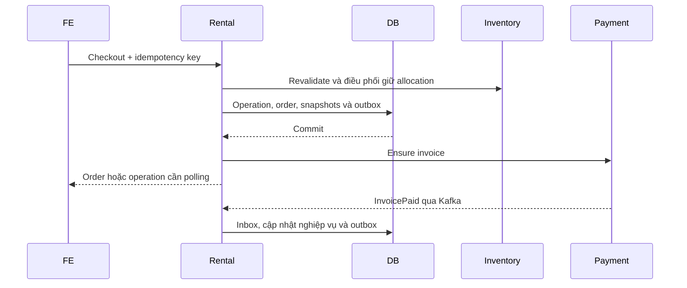
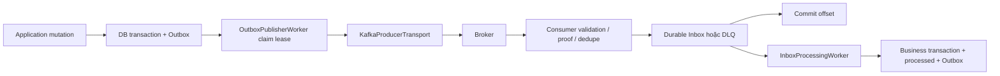

# RentalService: bản đồ source, nghiệp vụ và tích hợp

Tài liệu dành cho developer đọc và debug RentalService. Các đường dẫn trỏ tới implementation để tiếp tục đọc, không phải cam kết rằng hệ thống đã được chạy end-to-end. Quy tắc sản phẩm nằm ở [Project Guide](PROJECT_GUIDE.md); contract và source phải được đối chiếu khi có khác biệt.

## 1. Đọc source theo thứ tự nào?

Gốc source là `RentalService/src`. Bắt đầu từ [Program.cs](../RentalService/src/Api/Program.cs), sau đó đọc [Application DI](../RentalService/src/Application/DependencyInjection/ApplicationServiceCollectionExtensions.cs).

| Phần | Trách nhiệm và cách đọc |
| --- | --- |
| Api | Routing, authentication, ProblemDetails, controllers, hub và composition root. Đi từ action tới Application Service được inject. |
| Application | Use case, policy, client HTTP, producers, dispatchers và workers. Đây là nơi cần lần luồng nghiệp vụ. |
| Domain | Entities, repository contracts, DbContext và repositories theo cấu trúc repo hiện tại. Đây là ngoại lệ persistence đã ghi trong mục lục docs. |
| Common | Result/Error và enums dùng chung. Đọc khi cần hiểu trạng thái hoặc mã lỗi. |
| Maintenance | Entry point bảo trì riêng; không nhầm với các hosted worker của API. |
| tests/Api.Tests | Bằng chứng hành vi, gồm integration PostgreSQL, Kafka và SignalR. Có test không đồng nghĩa đã chạy trong môi trường hiện tại. |

Startup đăng ký persistence, Application, health checks, hub, JWT và HTTP clients. Sau `Build`, middleware internal API key chạy trước origin guard, authentication và authorization; cuối cùng map controllers và hub. `InternalAuthentication:ApiKey` hoặc `INTERNAL_API_KEY` là điều kiện startup. Các URL service được kiểm tra cú pháp nếu có giá trị; điều đó không chứng minh kết nối thực tế thành công.

## 2. Lần vòng đời nghiệp vụ

### Cart và checkout

Đọc [Cart](../RentalService/src/Application/Services/Cart), rồi [Checkout](../RentalService/src/Application/Services/Checkout). `RentalCartUseCases` xử lý thao tác giỏ; `RentalCartItemEvaluator` và `InventoryRentalCartReader` phục vụ đánh giá listing/availability. Cart không phải allocation và không khóa giá.

Trong Checkout, đọc theo thứ tự `CheckoutPreparationService`, `CheckoutService`, `CheckoutOrderWriter`, `CheckoutInvoiceIssuer`. Phân biệt ba mốc: chấp nhận operation, tạo được order, và sẵn sàng thanh toán. `GetOperationStatusAsync` kiểm tra quyền renter và chỉ trả `ReadyForPayment=true` khi order còn PendingPayment, đã có invoice và chưa hết deadline.



Sơ đồ thể hiện các ranh giới logic, không có nghĩa mọi thao tác Inventory đều là HTTP: xem command/result ở phần Kafka. Khi checkout không hoàn tất, `StageCheckoutReleasesAsync` ghi release command với operation key ổn định. Không được coi việc gửi compensation là Inventory đã giải phóng xong.

`CheckoutService` commit order cùng event `RentalOrderCreated` và receipt tạo invoice trước lời gọi Payment. Nếu enqueue event lỗi, transaction bị rollback. Sau commit mới báo `ORDER_CREATED` qua notifier. Invoice có thể còn Pending dù operation tạo order đã Succeeded.

Deadline thanh toán dùng chung với hold; tạo invoice không kéo dài deadline. Chi tiết thanh toán đúng hạn, equality tại deadline, retry invoice và payment đến sau expiry nằm ở [checkout/payment deadline](rental-checkout-payment-deadline.md).

### Thanh toán, supplier và các nhánh kết thúc

| Luồng | Source bắt đầu đọc | Điểm cần phân biệt |
| --- | --- | --- |
| Payment | [PaymentWorkflowService](../RentalService/src/Application/Services/Payments/PaymentWorkflowService.cs) | PaidAt là thời gian nghiệp vụ; publication time không quyết định đúng hạn. Kiểm tra payment ref, recovery và refund. |
| Supplier decision | [SupplierDecision](../RentalService/src/Application/Services/SupplierDecision) | Quyền supplier trên item/suborder; xác nhận allocation và từ chối không chỉ là đổi status. |
| Handover | SupplierDecision và [Handover](../RentalService/src/Application/Services/Handover) | Bằng chứng bàn giao và renter acknowledge là hai thao tác khác nhau. |
| Hủy | [Cancellation](../RentalService/src/Application/Services/Cancellation) | Phân biệt hủy cả order và từng item; theo tiếp release/refund receipts. |
| Expiry/overdue | [Expiry](../RentalService/src/Application/Services/Expiry), [Overdue](../RentalService/src/Application/Services/Overdue) | Payment timeout, supplier timeout, handover overdue và thiết bị quá hạn là những điều kiện khác nhau. |
| Return | [Returns](../RentalService/src/Application/Services/Returns) | Request trả, dispute, admin resolve, biên bản supplier và Inventory xác nhận đóng allocation là các mốc riêng. |
| Settlement/refund | [Settlement](../RentalService/src/Application/Services/Settlement), [Integration](../RentalService/src/Application/Services/Integration) | Đề xuất khấu trừ, phản hồi, settlement và refund completed không được gộp thành một mốc. |

Chi tiết actor, API, payload, các nhánh trả từng unit và mock FE được duy trì tại [hướng dẫn handover/return](rental-handover-return-fe-guide.md). Ma trận mutation → commit → notification nằm ở [realtime guide](rental-realtime-client-integration.md#24-mutation-coverage-matrix).

Đọc [RentalOperationExecutor](../RentalService/src/Application/Services/Operations) khi cần hiểu side effect, receipt, operation key và recovery. Các partial chia theo Inventory, Payment, Cancellation, Confirmation, Supplier, Settlement, SubOrder và Overdue; chúng thuộc cùng một implementation, không phải các executor độc lập.

Application DI đăng ký OperationRecoveryWorker, ExpiryScannerWorker, OverdueProtectionWorker, CheckoutTimeoutScannerWorker, HandoverOverdueWorker, DeductionDeadlineWorker và ReturnConfirmationOverdueWorker. Worker là entrypoint tự động: cần đọc service nó gọi để hiểu quyết định nghiệp vụ, không suy luận chỉ từ tên worker.

## 3. Giao tiếp với service khác

[Clients](../RentalService/src/Application/Clients) chứa interface, HTTP implementation và contract metadata. Trình tự dò là use case → interface được inject → Http client → ContractSpec → response/error mapping.

| Service | Mục đích và source |
| --- | --- |
| Auth | `IAuthRentalClient`, `HttpAuthRentalClient`, CurrentRenter và token propagation đăng ký ở Program. Kiểm tra context người gọi trước khi diễn giải quyền. |
| Inventory | `IInventoryRentalClient`, `InventoryContractSpec`: batch listing snapshots, availability, hold và allocation. Có cả HTTP contracts và Kafka commands; phải lần caller để biết đường đang dùng. |
| Payment | `IPaymentRentalClient`, `PaymentContractSpec`: invoice, cancel, accept-late-payment, refund, settlement. Metadata route/scope trong ContractSpec vẫn ghi PROPOSED; chưa chứng minh phía provider đã triển khai tương thích. |
| Media | `IRentalMediaClient`, `MediaContractSpec`: verify, metadata, private access; header `X-Api-Key`. Kiểm tra Ready, private và uploader của evidence. |

Các URL cấu hình nằm dưới `Services:{Auth,Inventory,Payment,Media}:BaseUrl`, tương ứng biến môi trường như `Services__Inventory__BaseUrl`. Đường dẫn trong ContractSpec có thể là relative path dưới base URL; không tự ghép thêm prefix phỏng đoán.

Application DI tắt auto redirect cho các HTTP clients đăng ký tại đó. Program đăng ký Auth client thêm với `AuthTokenPropagationHandler`; cần xét đăng ký cuối khi debug client Auth thực tế. Không mặc định mọi client dùng cùng authentication hoặc retry policy.

[Payment Kafka contract](contracts/payment-invoice-kafka-v1.md) là điểm đọc tiếp cho sự kiện Payment. Rental phát event phục vụ các consumer khác nhưng source consumer ngoài repo không được xác minh tại đây.

## 4. Kafka: bật lên và theo dõi message

### Đăng ký và cấu hình

`Program → AddRentalServiceApplication → AddKafka` đăng ký options ValidateOnStart, singleton transport, scoped outbox writer/producers/dispatchers và ba hosted workers: OutboxPublisherWorker, KafkaPaymentEventsConsumerWorker, InboxProcessingWorker. Đăng ký DI không đồng nghĩa broker đã được bật.

Source gốc: [Kafka subsystem](../RentalService/src/Application/Kafka), [hướng dẫn protocol/outbox/inbox](../RentalService/src/Application/Kafka/README.md).

| Key dưới Kafka | Mặc định trong KafkaOptions | Ý nghĩa |
| --- | --- | --- |
| Enabled | false | Bật workers/transport Kafka |
| BootstrapServers | rỗng | Địa chỉ bootstrap truy cập được từ process Rental |
| ClientId | rental-service | Danh tính client |
| ConsumerGroupId | rental-payment-events-consumer | Group nhận message; đổi group ảnh hưởng offsets |
| DeliveryTimeoutSeconds / LeaseDurationSeconds | 10 / 30 | Hạn publish và thời gian giữ claim |
| MaxBatchPerRound | 50 | Giới hạn mỗi vòng publish |
| OutboxPollingIntervalSeconds / InboxPollingIntervalSeconds | 15 / 15 | Chu kỳ polling |
| ShutdownTimeoutSeconds / ConsumeTimeoutMilliseconds | 15 / 500 | Flush/shutdown và poll broker |
| PaymentProofIssuer / PaymentProofEnvironment | dprental-integrity-host / production | Ngữ cảnh kiểm tra proof |
| PaymentProofPublicKeys | dictionary rỗng | KeyId → base64 P-256 SubjectPublicKeyInfo |

**Điều kiện bật quan trọng:** validator yêu cầu ít nhất một payment proof public key hợp lệ. Chỉ đặt Enabled và BootstrapServers theo ví dụ cũ chưa đủ để startup. SASL yêu cầu mechanism, username và password khi chọn SaslPlaintext/SaslSsl. Lease phải lớn hơn hoặc bằng delivery timeout + 5 giây.

Ví dụ cấu hình qua môi trường, thay placeholder bằng cấu hình môi trường thật:

```bash
export Kafka__Enabled=true
export Kafka__BootstrapServers='<broker-host>:9092'
export Kafka__PaymentProofPublicKeys__key1='<base64-public-SPKI-P256>'
export Kafka__PaymentProofIssuer='<issuer-phat-proof>'
export Kafka__PaymentProofEnvironment='<environment-phat-proof>'
dotnet run --project RentalService/src/Api/RentalService.Api.csproj
```

Đây là phần bổ sung Kafka, vẫn cần cấu hình PostgreSQL, internal key và các service liên quan theo hướng dẫn chạy API. Public key phải khớp bên phát proof, không tự tạo key ngẫu nhiên để vượt validation. SASL password lấy từ secret của môi trường, không ghi vào tài liệu hoặc commit.

Host chạy API và container chạy API có thể cần bootstrap/listener khác nhau. Broker metadata trả advertised listeners phải truy cập được từ Rental. Không đổi group/reset offsets như một cách chữa lỗi chung.

### Topic và pipeline

| Option topic | Mặc định | Hướng đối với Rental |
| --- | --- | --- |
| RentalEventsTopic | rental.events.v1 | Phát business events |
| PaymentEventsTopic | payment.events.v1 | Nhận Payment events |
| PaymentDlqTopic | payment.events.v1.dlq | Đưa message Payment lỗi sang DLQ |
| InventoryCommandsTopic | inventory.allocation.commands.v1 | Phát allocation commands |
| InventoryAllocationEventsTopic | inventory.allocation.events.v1 | Nhận allocation results |
| InventoryAllocationEventsDlqTopic | inventory.allocation.events.v1.dlq | DLQ allocation results |

Đọc `KafkaContractSpec`, `KafkaMessageEnvelope`, `Events`, `Contracts` để xem message type và wire shape chính xác. Đọc `InventoryCommandProducer` hoặc `RentalEventProducer` để xem partition key, messageId và mapping payload; không serialize nguyên entity thay cho contract.



Outbox giữ ý định gửi qua crash. Publisher claim từng message, chỉ đánh dấu published khi broker xác nhận persisted. Broker nhận rồi process chết trước khi đánh dấu có thể dẫn đến gửi lại: producer idempotence không thay thế dedupe nghiệp vụ.

Consumer tắt auto commit/auto offset store. Commit offset sau khi đã lưu bền vững Inbox/DLQ hoặc xác nhận duplicate. Khi database lỗi phải retry record đang giữ, không commit vượt qua nó. InboxProcessingWorker tách nhận message khỏi xử lý nghiệp vụ; khóa order và transaction bảo vệ cập nhật nghiệp vụ cùng processed/outbox.

`PaymentPublicationProofVerifier` là bước bảo vệ publication Payment, ngoài schema validation. Debug message bị từ chối cần xét proof issuer/environment/keyId, không chỉ payload JSON. Protocol, canonical JSON dedupe, deterministic DLQ ID và orderVersion được mô tả tại Kafka README.

## 5. SignalR: cấu hình và gọi từ service

`Program → AddOrderHub` đăng ký SignalR, scoped `IOrderHubNotifier`, options và policy. `UseOrderHubOriginGuard` kiểm soát origin; `MapOrderHub` map `/api/v1/rental/hubs/orders`, chỉ WebSockets và đóng khi authentication hết hạn.

[OrderHub](../RentalService/src/Api/Hubs/OrderHub.cs) kiểm tra user đã xác thực, không phải service account và có UserId hợp lệ. Khi connect, server tự join cả group renter và supplier theo identity. Client không được chọn group và không có method nghiệp vụ để gọi vào hub.

Options dưới `OrderHub`: AllowedOrigins, EnableDetailedErrors, HandshakeTimeoutSeconds (15), KeepAliveIntervalSeconds (15), ClientTimeoutIntervalSeconds (30), MaximumReceiveMessageSize. Giá trị đầy đủ xem [OrderHubOptions](../RentalService/src/Application/Options/OrderHubOptions.cs). Cấu hình môi trường dùng dạng `OrderHub__AllowedOrigins__0=https://frontend.example`.

Application Service inject `IOrderHubNotifier`; không inject Hub hoặc trực tiếp tạo OrderHubNotifier. Ví dụ thật nằm trong `CheckoutService`: sau commit gọi `NotifyRenterOrderChangedAsync` với renterId và notification gồm eventId, orderId, version, changeType, occurredAt. Khi payment được xác nhận, code còn duyệt suborders và gọi `NotifySupplierSubOrderChangedAsync` cho supplier tương ứng.

[OrderHubNotifier](../RentalService/src/Api/Hubs/OrderHubNotifier.cs) dùng `IHubContext<OrderHub>.Clients.Group(...).SendAsync(...)`, event name là `RenterOrderChanged` và `SupplierSubOrderChanged`. Push được await với timeout 5 giây; lỗi được log và không rollback mutation đã lưu.

Hub là tín hiệu invalidation, không thay thế REST hay Kafka. Client subscribe trước start, tải REST sau connect/reconnect, debounce refetch và so version theo resource. Cookie/header JWT, từ chối query token, payload và ví dụ TypeScript được giữ tại [realtime client guide](rental-realtime-client-integration.md).

Không có replay notification hoặc Redis/Valkey backplane trong cấu hình hiện được tài liệu hóa. Nhiều replica cần thiết kế fanout trước khi dựa vào realtime liên instance.

## 6. Bằng chứng, giới hạn và hướng debug

| Triệu chứng | Điểm cần kiểm tra |
| --- | --- |
| Checkout Succeeded nhưng chưa thanh toán được | InvoiceStatus, ReadyForPayment, deadline, CreateInvoice receipt và CheckoutInvoiceIssuer |
| Order lưu rồi nhưng chưa thấy Kafka | Outbox pending/lease, Enabled, broker listener, timeout, acknowledgement |
| Broker có message nhưng order chưa đổi | Consumer group/offset, proof/schema, Inbox/DLQ, processing lock và business error |
| Allocation chưa đóng sau return | ReturnRecord, Inventory command outbox, allocation result handler; không chỉ nhìn HTTP submit |
| REST đã đổi nhưng FE chưa đổi | Notification sau commit, group identity, origin/JWT, reconnect resync và số replica |

Các test tham chiếu ở [Api.Tests](../RentalService/tests/Api.Tests): KafkaConfigurationAndValidationTests, KafkaRuntimeAndIntakeIntegrationTests, KafkaClientProtocolAndSerializationTests, KafkaDeduplicationAndProtocolEdgeTests, KafkaOutboxAtomicEnqueuePostgreSqlTests, KafkaRealBrokerIntegrationTests; nhóm Hubs có authentication, notifier và real client integration; InventoryReturnKafkaTests bảo vệ tích hợp trả thiết bị.

Tài liệu này được đối chiếu tĩnh với startup, DI, options/validator, contracts, checkout và hub source. Chưa chạy broker, database, client realtime hoặc service ngoài; chưa chứng minh toàn bộ nhánh nghiệp vụ bằng runtime. Các thư mục use case ở bảng là đường đọc tiếp, không phải xác nhận mọi nhánh bên trong đã được audit độc lập.

Hai điểm cần lưu ý khi đọc tài liệu cũ: ví dụ bật Kafka có thể thiếu payment proof keys bắt buộc; PaymentContractSpec vẫn đánh dấu PROPOSED. Không thay đổi contract hay implementation để che các chênh lệch này.
